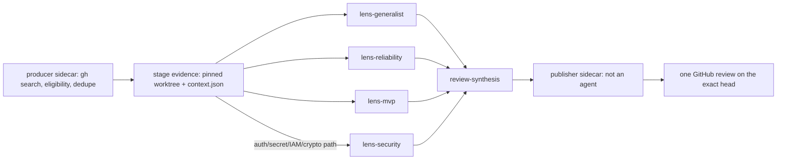

# Move the fleet's producers into Ralph as deterministic sidecars on their own board, with five purpose-built lenses that cannot post, and spend bounded in four places

> **Names in this document are placeholders.** This repository is public. The older agent system
> that runs beside Ralph is "the fleet" and its repository is never named; the employer is "the
> company"; repositories under review are `<repo>`, the GitHub account the work arrives on is
> `<work-account>`, the mail account is `<inbox>`, and host paths are written `/srv/queues/...`.
> Model names (`gpt-6-luna`, `gpt-6-sol`) and Hermes' own configuration keys are real: they are
> vendor and upstream names, and hiding them would make the design unimplementable. A reader
> implementing this needs the private overlay for the real names; a reader reviewing the design
> does not.

Status: **in review** — proposed, awaiting your approval at the design gate. Nothing has been
built, moved, or switched off; no producer has been pointed at Ralph and no service has been
stopped. This document is the thing to review before any of that happens.
Decision: **three producers become one deterministic sidecar writing to a second board; the review
council lands as five purpose-built lens profiles that have no terminal, no network and no GitHub
credential; one non-agent publisher owns the single GitHub write; spend is bounded at admission,
at concurrency, per card, and at the provider; and the fleet is retired repository by repository,
never running alongside Ralph on the same pull request.**
Source: Kanban card `t_e2bd0b59`.

---

## Review header

**Decisions needed from you: four.**

1. **Review scope: an explicit repository allowlist, or everything assigned to `<work-account>`?**
   The fleet's review discovery, in the engine that writes directly to a board, deliberately
   bypasses the authority allowlist and searches *all accessible repositories* [PRODUCER:186-192].
   That is the single largest cost and blast-radius lever in this design, and it is the one thing I
   will not choose for you. I have designed for an allowlist, with the "everything" setting as a
   config change rather than a redesign. If you want everything, the admission cap in section 5
   becomes the only thing standing between a busy week and the ceiling.
2. **Cutover granularity**, which depends on an answer I could not obtain: which queue engine the
   fleet's review producer actually runs in production. If it is the authority-scoped engine,
   repositories move one at a time and each move is a one-line rollback (section 6, plan A). If it
   is the board engine, there is no per-repository dial and the cutover is a single switch with the
   fleet's timer stopped first (plan B). Both are designed; pick one, or tell me which engine and I
   will drop the other.
3. **The money envelope.** I have allocated **$3,000 a month** of the $10,000 ceiling to all three
   queues and put a **$3,500 hard cap** on the provider key that pays for them. I cannot see a bill
   from inside this container, so I do not know what Ralph's nine profiles spend today. If they
   already spend $7,000, this allocation is the whole remaining ceiling and the caps in section 5
   want to come down.
4. **The inbox replier's ceiling: draft-only forever, or draft-only now and send-after-approval
   later?** I have designed draft-only with no code path that can send (section 8). If sending is
   wanted eventually, say so now — it changes which credential is issued in phase 3, and a
   send-capable credential installed "for later" is the kind of thing that is still installed two
   years later.

**Council dissent.**

No council was convened: this profile has no `delegate_task`, and inventing personas to disagree
with would be theatre. The critics here are the sources, which contradict each other in five
places. Each is resolved, and four of the resolutions changed the design.

1. **The fleet's design document says production is disabled; the live board says it is running.**
   The document states "offline implementation only; production route remains disabled"
   [FLEET-DD:4]. The board shows 17 recent pull-request groups and 74 cards [BOARD]. The board
   wins; the document is stale. Everything below treats the council as production software being
   moved, not a prototype being promoted.
2. **The board says two of the five roles are not separate profiles.** Assignee counts are
   `pr-review-v1`: 34, `pr-review-reliability-v2`: 17, `pr-review-mvp-v2`: 17,
   `pr-review-security-v2`: 6 [BOARD]. Seventeen groups, two cards each at 34, means the generalist
   and the synthesis role run **under the legacy `pr-review-v1` profile**, not under the `-v2`
   profiles the design document describes [FLEET-DD:32]. So three lens profiles are proven in
   production and two exist only as configuration. Resolution: Ralph installs all five as its own
   profiles, and the two unproven ones are exactly the two whose *shape* this design adopts for all
   five — which makes their first production run part of PR 2, by hand, before any producer exists.
3. **The two profile shapes disagree about how a lens reads code, and the disagreement is about
   permissions.** The generalist and synthesis configs disable every native toolset and expose
   seven tools through one restricted server [PROFILES:generalist:23,43]. Reliability, MVP and
   security read GitHub with `gh api -X GET` from a terminal and write their result with a native
   `write_file` [PROFILES:reliability-SOUL:1-2]. In Ralph the second shape is not available: the
   terminal sandbox forwards `GH_TOKEN` and `GITHUB_TOKEN` to **every** profile
   [RALPH-CONFIG:terminal.docker_forward_env; RALPH-COMPOSE:131], so a lens with a terminal holds a
   credential that can post a review, and "only the publisher writes to GitHub" degrades to a
   sentence in a prompt. Ralph's own contributor guide forbids exactly that: "Invariants are
   enforced in permissions, not prose" [RALPH-AGENTS:22]. Resolution: all five lenses take the
   restricted shape. Cost: the restricted tool server moves with them (section 3), and two SOULs
   lose their evidence paragraph and gain the generalist's.
4. **The spike says a cheap model found a real defect; the model split is settled.** A Haiku
   specialist found a blocking defect a human had missed. That is evidence that the lens matters
   more than the model, and it is not a reason to reopen a decision you made over many real runs.
   Resolution: `gpt-6-luna` lenses and `gpt-6-sol` synthesis as settled, recorded in section 5 as
   the lever to pull *first* if the measured cost comes in above the model — not re-decided here.
5. **Your instruction says the specialists run `gpt-6-luna`; every fleet record says the generalist
   runs `gpt-6-sol`.** The brief states the split as "the specialists run `gpt-6-luna` and synthesis
   runs `gpt-6-sol`, because that configuration is proven over many real runs in the fleet." The
   fleet's own records disagree about exactly one role. `profile-generalist-config.yaml:6` and
   `profile-synthesis-config.yaml:6` both read `default: gpt-6-sol`, and the design document and the
   PRD each say it in words: "`gpt-6-sol` for generalist and synthesis, `gpt-6-luna` for reliability,
   MVP, and optional security" [FLEET-DD:32; FLEET-PRD:16]. So "proven over many real runs" is true
   of four roles out of five. **Generalist-on-`luna` has never run anywhere.** Resolution: I follow
   your instruction — the generalist is a specialist, and it lands on `gpt-6-luna` in section 2 —
   because choosing the split is yours and re-deciding it is out of scope for me. What is *not* out
   of scope is saying out loud that for this one role the port is a **change, not a port**: section 3
   no longer claims the generalist is a one-line provider swap, PR 2 measures and exercises that
   exact configuration by hand before any producer exists, section 5 prices both answers, and the
   revert is one line in one profile config. If "specialists" meant "the three roles already on
   `luna`", say the word and the generalist goes back to `gpt-6-sol` at about $0.25 more per group.

**Scope: large.** Ten pull requests in four phases: bound what exists (1), the review council
(2-6), the fleet's retirement and the maintenance queue (7-9), the inbox replier (10). Each is
reviewable alone; section 9 says why. Only PR 6 can spend money unattended, and it is sixth for
that reason.

**Changed since v1** (PR #4, commit `3f8d238`; agent review by `ralph-reviewer`, one blocking
finding): the generalist's model is no longer asserted silently. v1's section 2 put
`lens-generalist` on `gpt-6-luna` while section 3 described every profile as the fleet's config
with one provider line changed — which, applied to the pinned generalist config, keeps
`gpt-6-sol`. The two could not both be true. v2 keeps your split (generalist on `gpt-6-luna`) and
names the divergence instead of burying it: new council dissent 5, a corrected section 3, a new
load-bearing assumption 4, a sensitivity line and a both-ways busy day in section 5, an extra
verification in PR 2, a new risk row, and open question 6. No other section changed, and no
decision moved.

---

## 1. What is being moved

Three things, in your words: automatic producers adding cards to a review queue with several agents
reviewing at once; a pull-request maintenance queue; an inbox replier with a producer watching your
mail. The first two exist in the fleet and are being moved. The third does not exist anywhere and
is being built, last.

What is *not* being moved is the fleet's machinery for getting work onto a board — its ingress
lock, its request journal, its versioned admission owner, its legacy/council contention rules
[FLEET-DD:26,44]. All of that exists because the fleet had to run two routes against one head
through a filesystem protocol it invented. Ralph needs none of it: `hermes kanban create` takes an
idempotency key and returns the existing task id instead of creating a duplicate
[HERMES:kanban_parser.py:181-183], which is the whole of what that protocol was for. The port drops
roughly a thousand lines of bespoke concurrency control and replaces it with a key.

What *is* moving: the discovery queries, the eligibility rules, the dedupe keys, the role set, the
five SOULs, the publisher's contract, and the privacy rule.

## 2. The review graph in Ralph

One producer run admits one pull-request head as one **operation**. An operation is
`review-<sha256(repo, number, head_sha)>`, the fleet's identity rule [PRODUCER:344-346], and every
card in the group carries it.

| Card | Profile | Model | Idempotency key | Reads | Writes |
| --- | --- | --- | --- | --- | --- |
| generalist | `lens-generalist` | `gpt-6-luna` † | `<op>-generalist` | staged evidence | result file, own card |
| reliability | `lens-reliability` | `gpt-6-luna` | `<op>-reliability` | staged evidence | result file, own card |
| MVP/scope | `lens-mvp` | `gpt-6-luna` | `<op>-mvp` | staged evidence | result file, own card |
| security *(conditional)* | `lens-security` | `gpt-6-luna` | `<op>-security` | staged evidence | result file, own card |
| synthesis | `review-synthesis` | `gpt-6-sol` | `<op>-synthesis` | parent handoffs + evidence | result file, own card |

**† The generalist's model is the one line in this table that is a change rather than a port.**
Your instruction puts every specialist on `gpt-6-luna`, and the generalist is a specialist, so that
is what this table says. But the fleet runs that role on `gpt-6-sol` today — the pinned config
reads `default: gpt-6-sol` [PROFILES:generalist:6], and both fleet documents assign `gpt-6-sol` to
generalist and synthesis [FLEET-DD:32; FLEET-PRD:16]. Four of these five rows are proven in
production at the model shown; this one is not proven at any model other than `gpt-6-sol`. It is
followed through in dissent 5, assumption 4, the PR 2 verification, and the risk table, and it
reverts with one line.

The security card is created only when a changed path contains an auth, secret, credential, IAM,
crypto or permission segment, and at most one is ever created [FLEET-DD:32]. Observed rate: 6 of 17
groups, 35% [BOARD]. Synthesis is created with `--parent` once per specialist
[HERMES:kanban_parser.py:168], so the dispatcher promotes it only when every lens is done — the
gating is Hermes', not ours.

**Card bodies carry identifiers and a path, never code.** Repository, number, head and base SHA,
role, operation id, and the absolute path of the staged evidence root. Lens results go to a
`0600` file under the operation's work root and the card's metadata carries only `result_path` —
the rule the fleet's production lenses already follow [PROFILES:reliability-SOUL:2], and the reason
Ralph can satisfy "private code must not reach a card body, a log, or shared memory" without
trusting a model to be brief.

**The producer builds the graph; no agent does.** `hermes kanban swarm` is the obvious candidate
and is the wrong tool here: it takes one `--idempotency-key` for the **root card only**
[HERMES:kanban_parser.py:231], so a re-run after a crash cannot be guaranteed to adopt the same
five worker cards, and it requires a verifier *and* a synthesizer, which is a different graph from
the one the board has been running for seventeen groups. Explicit `create` calls, one per role,
each with its own key, give exact replay: a second producer run on the same head creates nothing
and returns the same five ids.

**What the publisher guarantees.** The publisher is a deterministic process in the sidecar, not an
agent: no model, no prompt, no judgement.

1. **Exactly one GitHub review per `(repo, number, head)`.** It pages every existing review and
   comment looking for the marker before writing, records a `post_started` receipt before the call,
   and verifies review id, author, commit and marker after [FLEET-DD:34].
2. **It is the only writer.** The five lens profiles have no terminal, no network and no GitHub
   credential (section 3). This is a permission, not an instruction.
3. **It publishes what synthesis decided, or nothing.** `APPROVE` only when no required finding
   exists and every parent handoff is present and well-formed; `REQUEST_CHANGES` on any credible
   required finding; `COMMENT` for needs-info. Never a vote count, never a timeout-as-approval
   [FLEET-PRD:21-22].
4. **A moved head voids the operation.** No review is ever posted against a head that is no longer
   current; the new head is a new operation with a new key.
5. **An ambiguous response is reconciled by a human, never retried.** An uncertain POST marks the
   operation `reconcile` and raises one card on Ralph's human board. A second POST is not a
   recovery, it is a duplicate.
6. **It never merges, never approves on behalf of a human, and never resolves a thread.**

## 3. Five new profiles, and why Ralph's nine cannot be lenses

New: `lens-generalist`, `lens-reliability`, `lens-mvp`, `lens-security`, `review-synthesis`. Four
of the five are the fleet's config with `provider: openai-codex` changed to `openai-api` — the
credential is already installed in the running stack — plus the path of the restricted tool server.
`lens-generalist` takes **two** changed lines, not one: the provider, and `default: gpt-6-sol` →
`gpt-6-luna`, because your split puts the specialists on `luna` and the fleet's generalist config
is on `sol` [PROFILES:generalist:6]. That second line is the only model change in the port, and it
is the subject of dissent 5; `review-synthesis` keeps `gpt-6-sol` and changes one line like the
rest. The SOULs move verbatim for the generalist and synthesis; the other three lose their `gh api`
evidence paragraph and gain the generalist's, per dissent 3.

**Ralph's existing nine cannot serve as lenses, for three independent reasons, and any one of them
would be enough.**

*They refuse, correctly.* In the four-card spike, two of three specialist cards declined the work:
the auditor said grading a diff's security properties "would make me a de facto code reviewer,
which the system is designed to keep separate from the auditor", and its SOUL says exactly that.
The watcher refused on the same grounds. That is the profile split working, not a bug to argue
around. Rewriting those SOULs to accept review work would delete the separation that makes the
auditor's verdict worth anything.

*A lens is narrower than a profile.* Ralph's reviewer critiques "a design document or a diff
against what it was asked to do" [RALPH-REVIEWER-SOUL:3] — one generalist judgement. The council's
value is that four narrow mandates disagree; the spike's blocking find came from a narrow lens on a
cheap model, not from a broad one on an expensive model.

*They hold a credential a lens must not have.* Every profile's terminal sandbox receives `GH_TOKEN`
and `GITHUB_TOKEN` [RALPH-CONFIG:terminal.docker_forward_env]. Ralph's nine all carry a terminal;
the reviewer additionally runs with `single_query_mode: approve` and `unattended_mode: approve`
[RALPH-REVIEWER-CONFIG:16-17], which is correct for a card worker with nobody present and wrong for
something holding a write token near a GitHub API.

**The restricted tool server moves with the profiles.** Hermes' native tool granularity is the
toolset: `disabled_toolsets` takes toolset names, and there is no per-tool allowlist in
configuration [HERMES:agent_init.py:1094-1118]. A lens needs five of the kanban toolset's tools and
must not have `kanban_create`, which would let a lens add cards and spend money outside the
admission cap. The fleet solved this with an MCP server exposing an explicit `tools.include` list
[PROFILES:generalist:43-44]; Ralph needs the same, serving: `evidence_read`, `evidence_search`,
`result_write`, `kanban_show`, `kanban_parent_handoffs` (synthesis only), `kanban_heartbeat`,
`kanban_complete`, `kanban_block`. With that server a lens profile disables every native toolset
and the "cannot post, cannot create cards, cannot read the network" property is enforced by the
tool list rather than by the SOUL. This is the one piece of fleet machinery worth carrying over,
and PR 3 carries it.

## 4. How producers reach the board, and which board

**The path: a sidecar container in Ralph's compose stack, calling the Hermes CLI through the
hermes container.** Ralph's notifier already does this — a small image that runs
`docker exec <hermes container> hermes kanban ...` through the socket proxy rather than carrying a
4.5 GB image for a CLI [NOTIFIER:47-58]. The producer is the same shape with a different command,
so it inherits a pattern that has been running in production, and the proxy still refuses
everything but container lifecycle [RALPH-COMPOSE:22-51].

Rejected: writing to `kanban.db` directly (bypasses claim, events and promotion, and would be
Ralph's second implementation of the board's rules); and the gateway API server (it is enabled for
the web UI with a shared key [RALPH-COMPOSE:147-149], and adding a producer to that surface widens
what a leaked web UI key reaches).

**The board: a second board, `queues`, not Ralph's human board.** Three facts decide this, all
verified in the installed Hermes rather than assumed:

- The embedded dispatcher enumerates **every** board on each tick and dispatches each one
  separately, with no configuration needed for a new board
  [HERMES:kanban_watchers_dispatcher.py:122-126,217].
- `kanban.max_in_progress` is a **host** cap: running workers on every other board count against
  the same budget [HERMES:kanban_db_dispatch.py:2215-2243]. A second board therefore cannot
  multiply concurrency, which is the usual reason to refuse one.
- The notifier polls exactly one board, the one in `RALPH_BOARD` [NOTIFIER:71-78,188]. Keeping the
  queues off that board means forty machine cards a day cannot page you, **by construction** rather
  than by a filter somebody has to maintain.

Two consequences, both deliberate. A queue card that blocks is invisible to chat, so the publisher
and the producer raise anything needing a human as a card on Ralph's own board, which is the one
thing that *should* page you. And the daily digest gains one line of counts — admitted, published,
blocked, spent — which is numbers only and carries no private content.

## 5. Concurrency and cost

**First, a correction to the brief.** `max_in_progress` and `max_in_progress_per_profile` are
indeed both unset in Ralph's live config [RALPH-CONFIG], but unset does not mean unbounded. On
Linux the dispatcher derives a default of `clamp(MemTotal / 512 MiB, 2, 8)`
[HERMES:kanban_db_dispatch.py:1810-1845]. This host has 5.77 GiB, so Ralph runs today at an
**effective cap of 8**, plus a live memory-pressure guard that drops to one spawn per tick when the
host is stressed [HERMES:kanban_db_dispatch.py:2245-2250]. That changes what is actually missing: a
producer cannot melt the host, because the memory guard stops it. It can only **spend**, because
nothing bounds how many cards get admitted, and 8 workers draining a thousand-card queue costs
exactly as much as 80 would. **The missing bound is on admission, not on concurrency.** The derived
cap is also silent and host-dependent — more RAM would raise it to 8 from a smaller number with no
config change and no log line anyone reads — which is reason enough to set it explicitly.

**Four bounds, in the order a card meets them.**

| # | Bound | Where | Value | Stops | Does not stop |
| --- | --- | --- | --- | --- | --- |
| 1 | Admission | producer sidecar env, compose | 25 groups/day, 10 per run, 7-day age filter, repo allowlist | the backlog flood | a single card costing 10× |
| 2 | Concurrency | `kanban.max_in_progress: 6`, `kanban.max_in_progress_per_profile: 2`, Ralph's `config.yaml` | 6 host-wide, 2 per profile | pile-up, host pressure, one profile saturating a quota | total spend |
| 3 | Per card | `--max-runtime 480`, `--max-retries 1` at create; `run_budget_seconds: 480` in each lens profile | 8 minutes, no retry | a runaway card, and the default's silent second attempt | the number of cards |
| 4 | Provider | monthly hard cap on the `openai-api` key, at the provider | $3,500/month, alerts at 60% and 80% | everything, when 1-3 are wrong | nothing — it is the floor |

Only bound 4 is enforced by code that is not ours. Bounds 1-3 are ours and can be wrong; 4 is what
makes being wrong survivable. It is also *selective*, and that falls out of your cross-model
decision for free: the queues bill to the `openai-api` key and Ralph's nine profiles bill to
Anthropic [PROFILES; RALPH-CONFIG:model], so a tripped cap stops the new thing and leaves Ralph's
own work running.

Two operational notes. Dispatcher settings are read once at gateway boot — "restart to apply"
[HERMES:kanban_watchers_dispatcher.py:33-35] — so bound 2 lands with a restart, not a reload. And
the default failure limit is 2 [HERMES:kanban_db_dispatch.py:37], meaning a timed-out card is
re-queued and paid for twice; `--max-retries 1` makes queue spend deterministic, at the price of
blocking on first failure, which for a review lens is the right trade.

**What it costs, with the arithmetic shown.**

Observed structure, from the live board [BOARD]: 74 cards over 17 groups, **4.35 cards per group**,
35% drawing a security lens. Assumed unit costs — these are assumptions, flagged in the assumptions
list, and PR 2 replaces them with measurements before PR 6 turns on discovery: **$0.35 per lens
card** (bounded diff, 8-minute cap, `gpt-6-luna`) and **$0.60 for synthesis** (`gpt-6-sol`, reads
every parent handoff). A mean group is therefore 3.35 × $0.35 + $0.60 = **$1.77**, and I plan at
**$2.50** to carry long diffs and the occasional retry.

| Queue | Daily cap | Unit | Busy day |
| --- | --- | --- | --- |
| Review | 25 groups (≈109 cards) | $2.50 | $62.50 |
| Maintenance | 10 rounds | $1.50 | $15.00 |
| Inbox (phase 3) | 30 threads | $0.20 | $6.00 |
| | | | **$83.50** |

**A busy day costs about $84**, and the caps make that a ceiling rather than an average: a day with
more work queues the surplus for tomorrow instead of billing for it today. A month of 22 busy
weekdays plus quiet weekends is **≈$1,840**, against a $3,000 envelope and the $3,500 provider cap
— so the model has to be 1.6× wrong before the envelope is gone, 1.9× wrong before the cap trips,
and 5× wrong before the ceiling itself is in question, at which point bound 4 has already stopped
it.

**The generalist's price is the one unit cost that depends on an open question** (dissent 5). The
table above prices it as a `luna` lens at $0.35, which follows your split. If the generalist goes
back to `gpt-6-sol` — the model the fleet actually runs it on — it prices as a second synthesis-
class card at $0.60, and the arithmetic becomes 2.35 × $0.35 + $0.60 + $0.60 = **$2.02** a group,
planned at **$2.75**: a busy day of **$89.75** and a month of **≈$1,975**. That is the whole blast
radius of that question in money: about $140 a month, inside the envelope either way, and no cap,
bound or phase in this document moves. I am recording it so the answer can be given on its merits
rather than on a budget surprise.

The caps are also consistent with the clock: 6 concurrent workers × 480 s ≈ 45 card-slots an hour,
so a full day's 109 review cards drain in about 2.5 hours. The queue is bounded by money, not by
throughput, which is the correct way round.

## 6. The fleet's fate

**Decommissioned, repository by repository, with nothing ever reviewed twice.** The invariant is
ownership, not timing: *at any moment, exactly one of the two systems has a given repository in
scope*. Shadow running is explicitly rejected — two systems watching one pull request is how you
get two bot reviews on a colleague's work, and no amount of marker checking makes that a good idea.

A second belt exists anyway: Ralph's publisher searches for **both** markers — the fleet's and its
own — before writing [FLEET-DD:34]. A repository that somehow appears in both scopes produces one
review, not two.

**Plan A — if the fleet's review producer runs the authority-scoped engine** (decision 2).

| Step | Action | Rollback |
| --- | --- | --- |
| 1 | Ralph's allowlist gets one low-traffic repository; the fleet's authority file loses it | Swap the two lines back; in-flight cards drain |
| 2 | Watch one week: duplicate markers (expect zero), cost per group, lens refusals | Same as step 1 |
| 3 | Move the rest in batches of three, a week apart | Per batch, same two lines |
| 4 | The fleet's review timer is stopped once its authority list is empty | Start the timer |
| 5 | Maintenance repeats steps 1-4 on its own schedule, after review is stable | Same |
| 6 | After 14 days with both timers off and no unresolved operation in the fleet's work root: services stopped, work root archived read-only for 30 days, then removed | Start the services; the archive is intact for 30 days |

**Plan B — if it runs the board engine, which ignores the allowlist** [PRODUCER:186-192]. There is
no per-repository dial, so the cutover is one switch and the ordering carries the safety: stop the
fleet's review timer; drain its in-flight groups to terminal states (none left mid-publish); then
enable Ralph's producer with an allowlist that starts at one repository and widens. Rollback is the
reverse — stop Ralph's timer, restart the fleet's — and it is a minute's work either way, which is
the property that matters.

Nothing in the fleet's history migrates. Its board, journal and receipts stay where they are and
stay readable; Ralph starts with an empty queue board. Migrating a review ledger between two
systems that key operations differently is a week of work to preserve something nobody reads.

## 7. The maintenance queue

Same producer, different mode, different everything downstream. The fleet already draws this line:
`review` discovers pull requests **assigned to** the account, `maintain` discovers pull requests
**authored by** it [PRODUCER:15-19].

| | Review | Maintenance |
| --- | --- | --- |
| Subject | somebody else's pull request | your own |
| Dedupe key | head SHA | canonical digest of unresolved external reviews, unresolved and un-outdated threads, and failing checks [PRODUCER:78-115] |
| Why that key | a new head is a new thing to review | new feedback arrives **without** the head moving; a head key would miss every round |
| Graph | 4-5 cards, parallel lenses then synthesis | one card |
| Tools | no terminal, no network, no credential | terminal, checkout, write-capable token |
| Effect | one GitHub review | commits pushed to its own branch, one summary comment |
| Cap | 25 groups/day | 3 rounds per pull request [PRODUCER:146,150], 10 rounds/day |
| Fails | closed: no review | closed: no push |

The round cap is the important one and it is the fleet's, kept: without it an agent and a reviewer
can trade rounds indefinitely, each one a paid card and a notification to a human who did not ask
for the conversation.

**What maintenance may never do.** Force-push, or rewrite any commit it did not create in this
round. Push to any branch but the head branch of a pull request authored by `<work-account>`. Merge
or close anything. **Reply inside another person's review thread, or resolve one** — it posts one
summary comment saying what it changed and leaves every thread for you. That last rule is
deliberate scope control: writing *to people* is the inbox replier's risk class, and it stays in
phase 3 with the approval model built for it rather than leaking into phase 2 as a side effect.

A maintenance card needs a different profile from the lenses — it writes code — and I have put it
on the same Anthropic model as Ralph's builder rather than on `gpt-6-luna`, since your model
decision was about review lenses. Flagged in the assumptions.

## 8. The inbox replier

**Approval model: a human at both ends, and no agent in between.**

*In:* the producer reads one mail account and admits **only threads you have labelled** with a
reserved label. Not the inbox, not a sender allowlist, not a heuristic — an explicit, per-thread,
human action. The label is the opt-in, and it is revocable by removing it.

*Out:* the agent writes **one draft, in that thread, in your drafts folder**. It does not send.
Sending is a human action in a mail client, which is also the human's last chance to read what was
written.

*Between:* nothing. No agent approves another agent's draft; no "high confidence" path sends
automatically.

**Blast radius.** Draft-only: the worst case is a bad draft you read and delete, and the cost is
your attention. Send-capable: the worst case is an irreversible message to a third party in your
name — the cost is a relationship, and there is no rollback. Those two are not the same system with
a flag between them, which is why decision 4 asks now.

**What it may never do**, each enforced by a credential scope or an absent tool rather than by its
SOUL:

- Send, schedule, or queue a message. The mail credential is issued **draft-scoped**; the send
  capability is not installed.
- Change recipients: no reply-all, no adding or removing anyone, no forwarding.
- Touch a thread that is not labelled, including the rest of a labelled thread's history beyond
  what the draft quotes.
- Delete, archive, mark read, or re-label anything.
- Treat message content as instructions. Mail is untrusted data; a message asking the agent to send
  something, change a recipient or fetch a URL is a finding to surface, not a request.
- Put message text, attachments, or any third party's words in a card body, a log line, or the chat
  webhook. The card carries a thread id and a subject line; the draft lives in the mail account.
- Quote private code, from any repository, in a draft.

**Why it is phased last**, and not merely sequenced last:

1. **It is a different risk class.** Every other queue acts on your own repositories, where a bad
   output embarrasses you and is reversible. This one writes words that other people read.
2. **It inherits four things that must be proven first:** the producer sidecar, the admission cap,
   the privacy rule that keeps content out of cards and chat, and the board separation that keeps
   machine cards from paging you. Building it first would mean building all four twice.
3. **The cost model is an assumption until PR 2 measures it.** Adding a second producer before the
   first has a measured bill is how the envelope gets spent twice.
4. **It needs a new credential with a new blast radius.** A mail token should not arrive in the same
   change as queue machinery, where its scope is reviewed as an afterthought.

## 9. The pull requests, in order

Each lands alone, each is revertible alone, and each is useful without the next one. Sizes are
estimates against Ralph's "one concern, preferably under 400 lines" convention
[RALPH-AGENTS:28]. Only PR 6 can spend money without a human present.

| # | Lands | Reviewable alone because | Size | Unattended spend |
| --- | --- | --- | --- | --- |
| 1 | `max_in_progress: 6`, `max_in_progress_per_profile: 2`, per-profile run budgets, a producer kill switch nothing uses yet, the provider cap written down | Config only. No new behaviour; makes today's silent derived cap explicit | ~60 | no |
| 2 | The five lens profiles, SOULs, provider line | A human creates one group by hand. Proves the models are reachable, the refusals are gone, and **measures the per-card cost** that section 5 assumes. Also the first run anywhere of `lens-generalist` on `gpt-6-luna` — the one role whose model this design changes (dissent 5) — read by a human against a pull request whose defects are already known, so a weaker generalist shows up here and not in production | ~250 | no |
| 3 | The restricted tool server and the evidence staging contract: work root, pinned worktree, `context.json`, `0600` result files | Driven by hand with `--once`. Nothing creates cards | ~350 | no |
| 4 | The graph builder: deterministic card creation, idempotency keys, conditional security lens, `--once --repo <r> --pr <n>` | Builds a graph for one named pull request. No GitHub write exists yet | ~300 | no |
| 5 | The publisher: marker search, head re-check, receipts, reconcile path. Dry-run default; posting behind a flag | The first GitHub write, reviewed on its own, with the flag off | ~350 | no |
| 6 | Review discovery on a timer: allowlist, daily cap, age filter | The first thing that acts without a human. Everything it calls is already reviewed | ~200 | **yes** |
| 7 | Cutover step 1: scope moves from the fleet to Ralph | Config only, one line each way | ~20 | yes |
| 8 | Maintenance: producer mode, profile, round cap, push rules | Separate queue, separate profile, separate cap; review is untouched | ~400 | yes |
| 9 | Fleet decommission: timers off, services stopped, work root archived | Nothing of Ralph's changes | ~40 | no |
| 10 | Inbox: label-scoped producer, `inbox-drafter`, draft-only writer, its own caps and digest line | New queue, new credential, no dependency on 7-9 | ~400 | yes |

## 10. Risks

| Risk | What it would cost | What makes it survivable |
| --- | --- | --- |
| The first discovery run imports the whole backlog — the fleet's search takes up to 1000 results [PRODUCER:204-206] | 200 groups × $2.50 = **$500 in an hour**, and 200 unsolicited bot reviews on other people's pull requests, each one undone by hand | Bound 1: per-run cap of 10, daily cap of 25, 7-day age filter, allowlist of one repository on day one |
| Both systems review one pull request | Double spend and two bot reviews under your name; the second is the expensive half | Ownership invariant (section 6), plus the publisher's check for both markers |
| A lens holds a GitHub token and posts | One unreviewed agent comment in your name, and the single-publisher guarantee silently stops being true | No terminal, no network, no credential — enforced by the tool list (section 3) |
| Private code reaches a card body, a log, or the chat webhook — the notifier posts a card's reason text verbatim to chat [NOTIFIER:142-159] | Private source in a third-party chat log, not retractable | Results in `0600` files, metadata carries `result_path` only, queue cards on a board the notifier does not poll |
| The cost model is 3× low | ≈$6,000/month, most of the remaining ceiling | Measured in PR 2 before PR 6; bound 4 stops it at $3,500 and stops only the queues |
| `lens-generalist` on `gpt-6-luna` is materially worse than on the `gpt-6-sol` the fleet runs it on (dissent 5) | The broadest lens is the weakest one, and it is the role most likely to be the only reader of a given file. A missed defect behind a review that looks like coverage — the same cost as the synthesis risk below, arriving more quietly. In money it is the cheaper direction: reverting costs ≈$140/month (section 5) | Never runs unattended before PR 2 reads its output by hand on a known pull request; four other lenses and synthesis see the same diff; the revert is one line in one profile config, with no other part of the design depending on which way it goes |
| Synthesis approves on incomplete evidence | A defect merged behind a review that looks like coverage and is not. Worse than no review | Missing or malformed parent handoff is needs-info, never approve [FLEET-PRD:21-22] |
| Queue cards starve Ralph's own work under the host cap | Your hand-written card waits behind 20 machine cards; the system feels broken | `max_in_progress_per_profile: 2`, and producer cards created at negative priority so a human card is dispatched first |
| Maintenance pushes something wrong to an open pull request | A bad commit on your own branch, visible to reviewers; recoverable but public | No force-push, no merge, head branches of your own pull requests only, 3-round cap |
| The inbox replier sends | An irreversible message to a third party in your name | Draft-scoped credential; no send path exists to misfire |

## Non-goals

- **Re-deciding the model split.** `gpt-6-luna` lenses, `gpt-6-sol` synthesis, as settled. The one
  divergence that follows from it — the generalist moving off the `gpt-6-sol` the fleet runs it on —
  is named in dissent 5 and priced in section 5, not re-argued.
- **Building a dispatcher.** Hermes dispatches every board every 60 seconds already
  [HERMES:kanban_watchers_dispatcher.py:122-126].
- **Re-litigating whether the council works.** Seventeen groups on the live board answer it.
- **Migrating the fleet's history** — board, journal, receipts stay where they are.
- **A shadow pilot.** Explicitly rejected in section 6: two systems on one pull request is the
  failure being designed out.
- **Auto-merge, anywhere.** Nothing in this design merges a pull request, including its own.
- **A new dashboard or UI.** The existing dashboard shows the second board for free.
- **Reviewing repositories outside the allowlist**, pending decision 1.
- **Changing how already-bound fleet heads behave.** They finish under the fleet or they do not
  finish; Ralph never adopts one mid-flight.

## Assumptions

Every inference the brief did not state, ordered by weight.

1. **Load-bearing: the unit costs in section 5 ($0.35 per lens card, $0.60 per synthesis) are
   guesses.** I have no billing access from this container and no token counts from the fleet's
   runs. Every number downstream — the busy day, the monthly figure, the caps themselves — is
   derived from these two. PR 2 measures them on real cards before PR 6 can spend anything
   unattended, and the caps are expressed in cards per day precisely so that a measurement changes
   one number rather than the design. Which of the two prices the generalist card is itself open —
   see assumption 4.
2. **Load-bearing: the generalist and synthesis roles on the live board run under the legacy
   `pr-review-v1` profile.** The arithmetic is 34 cards over 17 groups [BOARD] and nothing else
   accounts for two cards per group. If those 34 are something else entirely, then the production
   role set is not the one this document ports.
3. **Load-bearing: a lens can do its job from a staged evidence root** — a pinned worktree, the
   diff, and bounded context — without live GitHub reads. Three of the five lenses read GitHub
   directly today [PROFILES:reliability-SOUL:1]. I moved them because of the credential argument in
   dissent 3, and the cost is that a lens can no longer fetch something nobody staged. PR 3's
   `context.json` is where that bill comes due.
4. **Load-bearing: "the specialists run `gpt-6-luna`" includes the generalist.** The brief's model
   sentence and the fleet's four records disagree about this one role (dissent 5): the pinned
   config, the fleet's design document and its PRD all put the generalist on `gpt-6-sol`
   [PROFILES:generalist:6; FLEET-DD:32; FLEET-PRD:16]. I read "specialists" as the role set — the
   three-or-four cards that review a diff, generalist included — and placed it on `gpt-6-luna`. If
   you meant "the three roles already running `luna`", this assumption is wrong, and with it
   section 2's first row, section 3's two-line port, and section 5's $0.35 generalist card.
   Nothing else depends on it: no bound, no phase, no ordering, no guarantee. Unlike the three
   lenses that are already `luna` in production, this configuration has **no production
   precedent**: the role has never run on `luna`, and the roles that do run on `luna` are the three
   narrow ones — which is why PR 2 exercises it by hand before anything automatic exists.
5. **Moderate: the `openai-api` provider is reachable from the gateway container with the installed
   key.** The brief states both models were verified reachable; I did not re-run it, and the
   credential pool does list an `openai-api` entry [RALPH-AUTH].
6. **Moderate: the maintenance worker belongs on Anthropic, not `gpt-6-luna`.** Your model decision
   named specialists and synthesis. Maintenance writes code in Ralph's repositories, which is what
   Ralph's builder already does on Anthropic.
7. **Moderate: $3,000 a month is the right envelope for all three queues.** A guess at 30% of the
   ceiling, made without knowing what the nine profiles spend. Decision 3.
8. **Moderate: `max_in_progress: 6` rather than the derived 8.** 512 MiB per worker is Hermes' own
   assumption [HERMES:kanban_db_dispatch.py:1810]; 8 workers is 4 GiB on a 5.77 GiB host that also
   runs the gateway, the web UI and sandbox containers. 6 leaves room, and the memory-pressure
   guard stays a backstop rather than a load-bearing part of the plan.
9. **Moderate: an explicit repository allowlist, pending decision 1.** The fleet's board engine
   searches everything accessible [PRODUCER:186-192]; I designed the narrower default because the
   wider one cannot be undone from the GitHub side once reviews are posted.
10. **Moderate: a reserved mail label is an acceptable opt-in gesture.** It is one click per
    thread. If that is too much friction you will stop using it, and a replier nobody feeds is
    better than one fed by a heuristic.
11. **Low weight: the second board should be called `queues`.** A name, not a decision.
12. **Low weight: `--max-retries 1` on queue cards.** The default of 2 pays twice for a timeout
    [HERMES:kanban_db_dispatch.py:37]. Blocking on first failure is the right trade for a lens and
    may be wrong for maintenance, which is one flag at PR 8.

## Observations — out of scope, not acted on

- The fleet's design document has been wrong about its own production status for long enough that
  the board had to settle it. Whatever marks a design "shipped" in that repository did not fire.
- `terminal.docker_forward_env` is stack-wide [RALPH-CONFIG], so *every* Ralph profile's sandbox
  holds the GitHub token, including the five that have no use for it. Per-profile credential
  scoping would make several invariants in this document mechanical instead of architectural.
- The notifier recovers a blocked card's reason from a review summary, a `BLOCKED:` comment, or an
  event, and posts it verbatim to chat [NOTIFIER:81-102,152-159]. Any card whose reason quotes code
  leaks it. Worth a truncation and a redaction pass regardless of this design.
- `hermes kanban swarm` takes one idempotency key for the root card only
  [HERMES:kanban_parser.py:231]. A per-worker key would make it usable for exactly this kind of
  deterministic fan-out; upstream issue material.
- The dispatcher's memory-derived concurrency cap is invisible unless someone reads the gateway log
  line at boot [HERMES:kanban_watchers_dispatcher.py:62-72]. Any Hermes install believing itself
  uncapped is capped at 8.

## Open questions

1. **Which queue engine does the fleet's review producer run in production?** Decides plan A or
   plan B in section 6. Answerable in one command by whoever can read the fleet's service
   definition; I could not.
2. **What do Ralph's nine profiles spend today?** Decides whether the $3,000 envelope is generous
   or already most of what is left. Needs billing access.
3. **Does the restricted tool server need to move, or is there a newer Hermes mechanism?** I
   verified there is no per-tool allowlist in configuration on the installed version
   [HERMES:agent_init.py:1094-1118]. If a later version adds one, PR 3 shrinks to a config change.
4. **Which mail account, and does a draft-scoped credential exist for it?** The whole approval model
   in section 8 rests on "send is not installed" being a credential property rather than a promise.
5. **Should the publisher post as `<work-account>` or as a separate bot identity?** The fleet posts
   as the account. A separate identity makes agent reviews filterable by other people, at the cost
   of another credential. Not blocking; PR 5 can land either way.
6. **Did "the specialists run `gpt-6-luna`" mean the generalist too?** One word from you closes it.
   I have built on yes (section 2, assumption 4); no costs ≈$140 a month and one config line, and
   changes nothing else. Not blocking: PR 2 is where it would first matter, and PR 2 has a human
   reading the output.

## Sources

- **[BOARD]** — snapshot of the fleet's live board pinned to this card as `fleet-board-evidence.txt`
  (2026-10-22): 17 groups, cards per group `{4: 11, 5: 6}`, assignees
  `{pr-review-v1: 34, pr-review-reliability-v2: 17, pr-review-mvp-v2: 17, pr-review-security-v2: 6}`.
- **[FLEET-PRD] / [FLEET-DD]** — the fleet's product and design documents for the review council, as
  pinned to this card. Cited by line: the stale status line (DD:4), the graph and role set (DD:32),
  the publisher contract (DD:34), the identity and ingress rules (DD:26,44), the verdict rules
  (PRD:21-22), the 480-second card cap and the per-role model assignment (PRD:16).
- **[PRODUCER]** — the fleet's discovery producer, pinned as `fleet-hermes-pr-producer.sh`, 356
  lines. Cited by line: review/maintain modes (15-19), the feedback snapshot and its digest
  (78-115), the 3-round cap (146,150), the authority allowlist and the board engine's bypass of it
  (186-192), the 1000-result search (204-206), the already-reviewed-at-this-head skip (268-280), the
  operation identity (344-346).
- **[PROFILES]** — the fleet's five reviewer profiles, configs and SOULs, as pinned. Cited:
  the generalist's and synthesis's `model.default: gpt-6-sol` and the other three configs'
  `gpt-6-luna` (config:6 in each), the generalist's disabled toolsets and `tools.include` list
  (config:23,43-44), the reliability
  SOUL's `gh api` evidence path and `result_path`-only metadata (SOUL:1-2), the synthesis SOUL's
  parent-handoff rule.
- **[RALPH-COMPOSE] / [RALPH-CONFIG] / [RALPH-AGENTS] / [NOTIFIER] / [RALPH-REVIEWER-*]** — Ralph's
  compose file, its live `config.yaml` read from the running host at
  `/home/hermes/.hermes/config.yaml` on 2026-10-22, its contributor guide, its notifier poller, and
  its reviewer profile and SOUL. Cited: the socket proxy (compose:22-51), the forwarded GitHub
  tokens (compose:131, config `terminal.docker_forward_env`), the gateway API key (compose:147-149),
  the permissions-not-prose rule (AGENTS:22), the one-concern-per-PR convention (AGENTS:28), the
  notifier's `docker exec` path (47-58), its single-board polling (71-78,188) and its verbatim
  reason posting (81-102,142-159). `kanban.max_in_progress` and `max_in_progress_per_profile` are
  absent from the live config, which is the basis for section 5's correction.
- **[RALPH-AUTH]** — the credential pool on the running host lists `anthropic`, `openai-api` and
  `copilot`; read as key names only, never values.
- **[HERMES]** — Hermes Agent source on the host running this worker, read 2026-10-22 under
  `/opt/hermes`: `hermes_cli/kanban_parser.py` (`create` flags including `--parent` 168,
  `--idempotency-key` 181-183, `--max-runtime` 184, `--max-retries` 193-198, `--model`/`--provider` 199-206; `swarm`'s single root key 231), `hermes_cli/kanban_db_dispatch.py` (the memory-derived
  cap 1802-1845, `MEMORY_GUARD_MB_PER_WORKER = 512` at 1810, `resolve_max_in_progress` 1847-1854, the host-level cap and per-board accounting
  2210-2243, the memory-pressure guard 2245-2250, the per-profile cap 2364-2376,
  `DEFAULT_FAILURE_LIMIT = 2` at 37), `gateway/kanban_watchers_dispatcher.py` (settings read once at
  boot 33-35, the derived-default log line 63-72, per-board ticking 122-126 and 217),
  `hermes_cli/config_defaults.py` (`max_in_progress` and `max_in_progress_per_profile` both
  defaulting to `None`, 1915-1934; `dispatch_in_gateway: True`, 1896), and `agent/agent_init.py`
  (toolset-level granularity only, 1094-1118).
- **[SPIKE]** — the four-card swarm described in the card brief: the Haiku lens's blocking find, the
  auditor's and watcher's refusals, and the verifier's FAIL gate. Not reproducible inside this
  container; taken from the brief as given.
