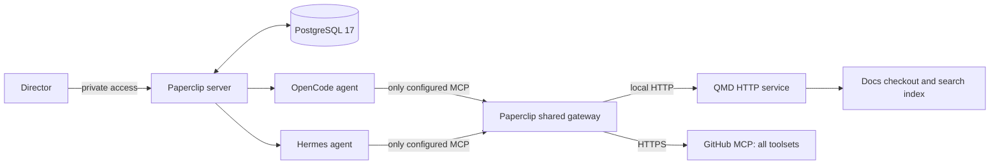

# Run Paperclip with one shared MCP gateway for QMD and GitHub

**Decision needed:** Approve this design after resolving the GitHub policy
question below. The PRD is approved by
[docs#36](https://github.com/Zhachory1/docs/pull/36). This design is not
launch approval.

**Scope:** One private Paperclip instance, persistent PostgreSQL, one shared
gateway, QMD and GitHub connections, and the minimum OpenCode and Hermes agents
needed to verify them. Deliver the platform, gateway, and agents in separate
PRs and/or service starts as specified by
[ralph#338](https://github.com/Zhachory1/ralph/issues/338).

## Evidence and compatibility

- Paperclip's native gateway accepts named MCP clients and brokers upstream
  tools ([gateway reference](https://docs.paperclip.ing/reference/api/tool-gateway/)).
  The [v2026.1117.0 source](https://github.com/paperclipai/paperclip/blob/v2026.1117.0/doc/MCP-ACCESS-GOVERNANCE.md)
  documents managed HTTP connections and company-scoped profiles.
- Released Paperclip `2026.1117.0` passes `--dir` to `opencode_local`. The
  installed OpenCode `2.3.2` rejects that flag. The existing
  [upstream fix](https://github.com/paperclipai/paperclip/pull/22576) is a
  draft, not a released dependency.
- On the fix's exact head
  [`af7577b`](https://github.com/zhachbot/paperclip/commit/af7577bfdc743777f0409e4c3a8615d0480a7784),
  144 focused adapter tests and its typecheck passed. One real invocation of
  the patched adapter launched OpenCode `2.3.2`, omitted `--dir`, and returned
  `OK`; reported model cost was $0.0005434. This was a direct adapter smoke,
  **not** a Paperclip heartbeat or a gateway test.
- The [release source](https://github.com/paperclipai/paperclip/blob/v2026.1117.0/server/src/services/heartbeat/run-preparation.ts#L1269-L1273)
  restricts automatic managed-MCP configuration to `codex_local`. Do not
  assume it injects the gateway into the two required legacy adapters.
- QMD `2.9.0` exposes a shared HTTP MCP endpoint. GitHub's hosted MCP server
  documents [`/mcp/x/all`](https://github.com/github/github-mcp-server/blob/v2.3.0/docs/remote-server.md)
  for all available toolsets. Connector authentication and tool delivery have
  not yet been tested through Paperclip.

## Topology

Paperclip owns agent runs and the gateway. QMD and GitHub are upstream
connections; agents do not connect to them directly as MCP servers. Native
shell and API calls are not governed by the MCP gateway.

## Design

### Platform and versions

- Run Paperclip from a source checkout pinned to `af7577bfdc743777f0409e4c3a8615d0480a7784`
  while the upstream fix is unreleased. This is a candidate, not a released or
  independently reviewed Paperclip build. Verify the exact commit and its
  upstream PR before launch; switch to a verified pinned release containing the
  fix when available.
- Use the upstream source install and run path, with Node `26.13.0` and pnpm
  `9.15.4`. The package declares Node `>=24.11.0`; the full server path still
  needs verification on the target host.
- Run PostgreSQL `17.12` with a persistent volume, using the pinned image
  `postgres:17.12@sha256:87c8b42f423b45d5247e6aa8fdb2e7762fec164c68a50fe3eb07e7bfcaf4dbcf`.
  Bind the database to loopback and keep credentials outside Git.
- Use Paperclip's authenticated private mode and the intended tailnet access
  path. Keep its instance data, configuration, keys, and logs separate from
  other local installations. Verify the tailnet address and service binding
  on the host before exposing the instance.

### Gateway and connections

- Create one ordinary named Paperclip gateway and one shared tool profile
  covering all connected tools. Bind the connections for all agents; do not
  create per-agent policies or enable read-only GitHub mode.
- Run one QMD `2.9.0` HTTP MCP service on loopback, with its own persistent
  configuration and index. Index the approved docs repository and Ralph's
  documentation. Start with keyword search; vector models are not a startup
  prerequisite.
- Connect GitHub's hosted `/mcp/x/all` endpoint with the intended GitHub
  credential, including review, comment, and other write capabilities.
  Credential scopes and GitHub's own permissions still determine which
  operations actually succeed.
- Paperclip can quarantine newly discovered write or destructive tools. During
  setup, verify and activate the connected catalog so the requested tools are
  available; report any native limitation rather than calling a narrower set
  “all tools.”
- Store the GitHub credential and shared gateway-client token in Paperclip's
  secret storage. Inject references, not literal values, into runtime
  configuration. Document token expiry or revocation and recovery.

### Agents and MCP configuration

- Provision only the orchestrator, one domain expert, and the reviewer or
  other minimal agents needed to exercise both runtimes. The expert owns its
  work; the orchestrator routes it.
- Configure `opencode_local` for OpenCode `2.3.2` and the patched source.
  Use a dedicated OpenCode configuration and `--standalone` so the run does
  not attach to the operator's shared server. Configure the named Paperclip
  gateway as its only MCP server, and verify the effective runtime configuration
  does not add servers from any other source.
- Configure `hermes_local` with an isolated Hermes home, its MCP toolset, and
  the same named gateway as its only MCP server. Use Hermes `v0.23.4` at
  `8fc0374447313e276f6b9a2764bfc750190c966a` as the candidate; confirm its
  source installation path and host support before accepting the pin.
- Use each runtime's documented MCP client configuration with a gateway token;
  do not point either runtime directly at QMD or GitHub. The current legacy
  adapters do not automatically receive Paperclip's managed gateway config.
  Verify the actual runtime configuration and gateway calls before accepting
  this design as working.

## Delivery and verification

1. **Platform PR/service:** Add the pinned database and Paperclip setup and
   recovery instructions on the v4 branch; start an isolated private instance
   after this design is approved.
2. **Gateway PR/services:** Start QMD and configure the named gateway, shared
   profile, and QMD/GitHub connections. Verify the discovered catalog and
   GitHub credential permissions without publishing a review.
3. **Agent PR/runs:** Configure both agents and their gateway-only MCP
   connections. A real Paperclip run from each runtime searches QMD and reads
   GitHub; gateway records must show the calls.
4. **Recovery and launch:** Restart the services, confirm state and gateway
   connections survive, and document recovery. Obtain Director launch
   approval, enable the live instance, and repeat the real checks.

A tool appearing in the catalog does not prove its GitHub write permission.
Record provider permission evidence and remaining uncertainty; the first
actual submitted review belongs to #339. A fixture, successful process exit,
or this document alone is not end-to-end verification.

## Alternatives

| Option | Tradeoff |
| :---- | :---- |
| **Current released Paperclip** | Simple to install, but its legacy OpenCode adapter rejects the installed V2 CLI. |
| **Pinned source with the upstream fix** | Chosen candidate; keeps Paperclip's native adapter and gateway, but uses an unmerged source revision until the fix is released. |
| **Separate gateway, compatibility wrapper, or OpenCode downgrade** | Rejected: adds a workaround or changes the requested runtime rather than fixing the native path. |

## Non-goals

- Implementing the PR-review or other workflows, a memory backend, all future
  agents, a custom gateway, or per-agent access controls.
- Publishing a review or changing repository protections in this issue.
- Treating the adapter smoke as proof that Paperclip, QMD, GitHub, and both
  agents work together.

## Risks and open decision

Broad GitHub tools include write and potentially destructive operations.
Ralph's current rules prohibit agents from approving agent-authored work or
merging without explicit human permission. **The Director must resolve how
those rules and branch protection coexist with the requested broad access
before the GitHub connection is enabled.** Do not silently switch it to
read-only or bypass the rules. Finer-grained controls remain
[P2 #343](https://github.com/Zhachory1/ralph/issues/343).

Paperclip's gateway does not prevent shell commands or other processes from
calling upstream services directly. The acceptance target is one configured
MCP connection per agent, not a host-wide network firewall.

Paperclip, QMD, and Hermes remain unverified together on this host. If the
native gateway or either runtime cannot satisfy the PRD, stop and fix the
native integration rather than introducing a wrapper or direct MCP bypass.
Backups must include the PostgreSQL data, persistent agent files, and matching
Paperclip configuration and encryption/signing keys.

## Assumptions

- One host can run the Paperclip process, both local runtimes, QMD, and the
  PostgreSQL container; actual resource use remains to be measured.
- The same shared gateway profile can serve both legacy runtimes through their
  native MCP clients. The Paperclip heartbeat and gateway paths must prove it.
- The public docs repository selected for this work is the initial QMD docs
  source; no memory-backend decision is implied.

## Next gate

Resolve the GitHub policy question, review this design, and obtain Director
approval by merging the design PR. Implementation and service starts follow
that gate; launch remains separately approved.
