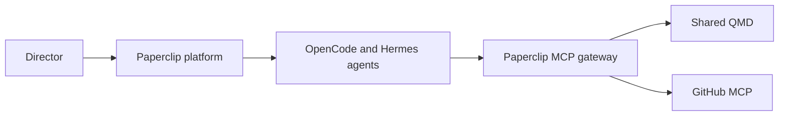

# Paperclip provides a shared platform and MCP gateway for Ralph

**Decision needed:** Approve the infrastructure outcome and requirements below.
The technical design follows in a separate PR. No infrastructure has been
deployed as part of this PRD.

**Sources:** [Infrastructure issue](https://github.com/Zhachory1/ralph/issues/338),
[v4 roadmap](https://github.com/Zhachory1/ralph/issues/337), and
[Paperclip's tool gateway documentation](https://docs.paperclip.ing/reference/api/tool-gateway/).

## Problem and outcome

Ralph needs a working platform before it can automatically review assigned pull
requests. Paperclip is that platform: it hosts the agent organization, work,
schedules, handoffs, and approvals. OpenCode and Hermes run agents; QMD and
GitHub provide tools through Paperclip's native MCP gateway.

The outcome is one private, persistent Paperclip instance with a shared gateway
and the minimum agents needed for the first workflow. The next issue,
[#339](https://github.com/Zhachory1/ralph/issues/339), builds the actual
automated PR-review flow on this foundation.

Agents have the gateway as their only configured MCP connection. QMD and
GitHub are upstream of it; direct shell or API calls are outside this diagram
and are not governed by the MCP gateway.

## Requirements

1. **Private platform.** Paperclip is reachable through the intended private
   access path. The Paperclip and PostgreSQL versions are verified and pinned;
   credentials do not go into the repository.
2. **Persistent state.** Paperclip state and configuration survive a restart.
   Setup, backup, and recovery instructions cover the database, persistent
   files, and matching configuration and encryption material.
3. **One gateway.** Paperclip's native MCP gateway is the only MCP server
   configured for each initial agent. One shared QMD service and GitHub MCP
   connect behind it.
4. **Shared tools.** All connected MCP tools are available to all initial
   agents. Per-agent policies and read-only GitHub access are not required.
   GitHub access supports submitting reviews, commenting, and other available
   actions. Finer-grained controls are a later
   [P2 issue](https://github.com/Zhachory1/ralph/issues/343).
5. **Both runtimes.** The minimum initial agents run through Paperclip using
   OpenCode and Hermes and can use QMD and GitHub through the gateway.
6. **Approval gates.** The Director approves this PRD, the subsequent design,
   and launch. Planning, coding, and feature-PR merging proceed automatically
   after the PRD and design approvals, subject to existing repository rules
   and branch protection. There is no routine plan-approval gate.
7. **Separate delivery steps.** The platform, gateway and connectors, and agent
   configuration are delivered as staged PRs and/or service starts. Do not
   start the next workflow until this infrastructure is verified.

## Acceptance

- A private Paperclip instance starts with persistent PostgreSQL and retains
  its configuration and state after a restart.
- The gateway lists the connected QMD and GitHub tools for both an OpenCode
  agent and a Hermes agent. Each agent searches QMD and reads GitHub through
  its normal Paperclip run; gateway records show the calls passed through it.
- GitHub review and other write capabilities are configured. Record actual
  permission evidence and any limits; listing a tool alone does not prove a
  write will succeed. Do not publish a review in this issue. A real submitted
  review is the acceptance test for #339.
- The initial agents have no direct QMD or GitHub MCP server configured; their
  only configured MCP server is the Paperclip gateway.
- The setup and recovery instructions explain how to preserve the database,
  persistent files, and the matching configuration and keys.
- PRD, design, and launch approvals are recorded before their respective gates.

## Non-goals

- Implementing automatic PR review, PR maintenance, feature delivery, or
  dynamic requests.
- Building a separate MCP gateway or a custom MCP server.
- Per-agent access policies, read-only GitHub access, or other restrictions
  deferred to #343.
- Selecting a memory backend or provisioning every future expert and sub-agent.
- Publishing a GitHub review or merging a feature PR as part of this issue.

## Risks and design questions

- Broad GitHub tools can perform write or destructive actions where the
  credential permits them. Ralph's current repository rules prohibit agents
  from approving agent-authored work or merging without explicit human
  permission. The design must reconcile those rules and branch protections
  with the requested broad access before enabling it; it must not quietly
  substitute read-only access. Weakening either rule needs its own discussion.
- Paperclip documents a native gateway, but the chosen release, QMD connector,
  and both runtime paths have not yet been verified together. The design must
  establish compatibility; if they cannot use the gateway, stop rather than
  bypassing it with direct MCP connections.
- A database backup alone does not preserve all agent files or the key needed
  to decrypt stored secrets. Recovery must account for both.
- Establish an agreed per-task spend and attempt limit before material paid
  runs; do not impose a monthly cap.

## Assumptions

- This is a fresh v4 infrastructure slice; no existing live Paperclip instance
  is assumed to satisfy its acceptance criteria.
- The initial agents can be fewer than the complete expert roster, provided
  both required runtimes and the shared gateway are exercised.
- The GitHub issue is the work brief; there is no separate Kanban card yet.

## Next gate

The Director reviews and approves this PRD by merging its PR. Then prepare the
design PR, including the unresolved compatibility and GitHub-policy questions.
