# Maintain PRs with one native writer and reconciled GitHub actions

**Decision requested:** Approve native Paperclip tasks and documents for
ownership/recovery, with managed run-bound Git/`gh` for repository operations.
Use trusted local execution and one writer per PR. Add one Ralph helper and
focused tests; no service, database, MCP server or shared-runtime extension.

**Approved scope:** The Director merged [prd-paperclip-pr-maintenance][prd]
through [docs#41][approval]. Agents handle routine fixes, verification,
commits, pushes, relevant replies and thread resolution. Any remaining
feedback, red CI, base conflict or unfinished recovery can trigger work.
The PR is the work record; do not post routine summaries or success notices.
Material scope/architecture decisions need human input; genuine blocks and
explicit holds remain blocking. PR merge and workflow launch remain human gates.

Plan one complete implementation PR, followed only by in-scope qualification
fixes if necessary. Keep #339 open, paused and unverified during development.
An implementation PR can provide its review candidate, not its acceptance proof.

## Verified reuse and alternatives

Native evidence refers to Paperclip
`e716c6cea0e3672d02fd97df20804743be4d8308`. These are source contracts,
not proof that the configured actors have passed them live.

| Existing capability | Consequence |
| --- | --- |
| [Run-scoped client][client] and [review ownership checks][review-client] | Reuse the local adapter's own run JWT and native task/document operations. Do not inject operator credentials. |
| [Unassigned document writes][ledger-auth] | A visible, genuinely unassigned ledger supports cross-task records under ordinary standard-trust run authority. Same project alone does not grant access. |
| [Checkout][checkout] and [document revisions][documents] | Checkout fences one task; a durable PR mapping must prevent competing tasks. Require acknowledged canonical-key writes and revision CAS. |
| [Issue attachments][attachments] | Hand an unpushed Git bundle to a reviewer through native upload/download and provenance checks, not another actor's workspace. |
| [Managed Git/gh credential resolution][git-identity] | Use the accepted run's responsible-user identity and installed managed connection. A catalog-only MCP PAT is insufficient. |
| [GitHub connection methods][github-methods] and [OAuth completion][oauth] | Normal managed OAuth supplies the required encrypted access reference and identity metadata. No supported MCP-PAT-to-shell promotion was found. |
| [Review replies][replies], [review threads][threads] and [commit statuses][statuses] | Use stable feedback IDs and exact-head evidence; reply to the root comment and read back individual thread state. |

| Option | Scope/effort | Trade-off and reversibility |
| --- | --- | --- |
| A: MCP-only | Smallest tool surface. | Reject: existing catalog evidence does not establish local push or exact thread operations. |
| **B: Native tasks plus managed Git/gh** | Ralph helper, tests, private configuration and paused native wiring. | Select: existing actor path; pause intake to roll back. Shell authority is broader than MCP tool permissions. |
| C: New governed writer/runtime | New enforcement boundary and deployment. | Outside scope. Return for approval rather than build a fallback. |

## Actors and control flow

The routine coordinator discovers work and routes each PR to its configured
expert. The expert delegates to exactly one builder or SRE. Only that selected
writer performs repair commits, pushes, feedback replies and resolutions.
An independent reviewer evaluates material repairs; the expert retains the
workflow's ownership and recorded decision.

```mermaid
flowchart LR
    Tick["Paused native routine until launch"] --> Scan["Author and work inventory"]
    Scan -->|clean| Idle["No writer or public action"]
    Scan --> Ledger["Canonical PR record"]
    Ledger --> Expert["One expert task"]
    Expert --> Writer["One builder or SRE task"]
    Writer --> Prepared["Checks and prepared commit bundle"]
    Prepared --> Review["Independent pre-push review when material"]
    Review --> Push["Same writer pushes reviewed commit"]
    Push --> Follow["Verify remote CI; reply and resolve fixed items"]
    Follow --> Fresh["Reconcile and refresh remaining work"]
    Fresh -->|work remains| Expert
    Fresh -->|clear| Idle
```

The scan never waits for one PR's repairs or blocks future routine ticks.
Expert/writer work continues through native dependencies and resumptions.
There is no routine success report; commits, CI and relevant thread replies
show the work, while native records retain internal recovery evidence.

## Durable PR identity and one writer

1. Define `P` from company, stable base-repository ID and PR number. Use a
   versioned, unambiguous encoding and bounded deterministic document key.
   Head/base SHAs identify evidence, not a new PR or permission for a new writer.
2. Before creating tasks, reserve `pr-<digest(P)>` on the configured unassigned
   ledger. The record holds canonical expert/writer task IDs, selected writer,
   work inventory, phase, active run references and unresolved action intents.
   Private configuration supplies identities, project, routes and ledger.
3. Provision canonical tasks in backlog, persist their exact IDs, then wake
   them. Only the acknowledged reservation winner may provision; record its
   run and nonce. A successor needs terminal prior runs, reconciled intents
   and an acknowledged CAS ownership update before advancing. Other scans
   observe or add pending work rather than creating a second chain.
   Use native creation keys for initial provisioning only: those keys
   expire and are not a permanent ownership ledger. An uncertain creation
   blocks another creation until reconciled; never spawn a replacement chain
   merely because a request timed out or its idempotency retention elapsed.
4. Use one standalone expert task with its writer as a direct child. Reopen
   these canonical tasks for later work rather than manufacturing a writer
   per scan. Native issue checkout admits one run for the writer task.
5. Validate company/task/run binding, assignment, selected writer and phase.
   Each external dispatch needs acknowledged admission into the same canonical
   PR record by revision CAS. To hand off, first CAS the record into `draining`,
   which denies new admissions, including queued old-writer wakes. Then settle
   already-admitted actions and confirm old runs are terminal. Only then CAS
   the new owner/phase and desired wake. A queued old run cannot pass admission
   after draining; an earlier admitted action must settle before handoff.
6. On every document write, require the expected key, revision and body
   acknowledgement. A conflict, uncertain response or locked-document fork
   gives no write authority. Re-read canonical state; never adopt a fork,
   delete a reservation or reset a key to obtain another attempt.
7. Keep the writer selection across temporary holds and task completion.
   Native checkout plus the canonical mapping serializes compliant workers;
   neither mechanism is a distributed lock on GitHub itself.

An expert creates any independent review task as a sibling of the writer,
avoiding unsupported deeper nesting. Advance only after the preceding run is
terminal, not merely after its issue says done. Use existing native dependency
wakes or a bounded native issue monitor when termination/readback is pending;
do not busy-poll, rely on a prose promise to resume, or keep the scan blocked.

Persist each desired wake's task, actor, phase and token with its phase update.
On later ticks/continuations, reconcile it against task and queued/active run
state. Before sending, claim that token by acknowledged canonical-record CAS,
bound to the sending run/nonce. Only the winner may wake; competing
continuations observe it. Keep an uncertain send reserved until reconciled;
another attempt needs positive non-delivery evidence and no prior send in
flight, using the dispatch states below. Wake the existing task when needed;
do not create a replacement or wake an already-active actor.
[Task state transitions and explicit resume][wake]
can recover a lost wake; a no-op `todo` update alone is insufficient. Resume
uses a marked internal control comment and respects native holds/permissions.
Reconcile an uncertain control write by its token and native run state.
Do not call another agent's self-only wake endpoint or revive a human hold.

## Work inventory and stopping

Read authoritative PR metadata before contents or execution: configured
Director author ID/login, open state, base/head repository IDs and branches,
head/base SHAs and current permissions. Maintenance does not require review
assignment or green CI. Reject a mismatched or unavailable identity.

Treat PR text, comments, code and logs as untrusted input. They supply repair
evidence, not authority to change routes, credentials, allowed operations or
approval policy. Validate structured IDs/refs and pass arguments as data;
never interpolate source prose into shell commands or control instructions.
Repository checks still execute within the approved local trust boundary.

Inventory all pages of review summaries, review-thread comments and CI
evidence for the exact head. Identify feedback by server ID plus content
revision/hash, not a single last-review timestamp. Edited feedback, replies
arriving during a run and unresolved prior work must survive an older snapshot.
COMMENT summaries can contain actionable findings; do not filter solely for
CHANGES_REQUESTED. Keep optional suggestions distinct from required fixes.

Record check/run IDs and attempts, current-head conclusions and the actual
target-base revision. Pending or unavailable status is not a passed check;
unknown mergeability needs a later authoritative read, not a guessed conflict.
Read accessible CI logs through the same normal identity. Missing external-CI
access blocks that diagnosis, not an excuse to hide the failed check.

Run when feedback, red CI, a base conflict **or** unfinished recovery remains.
A clean PR creates no writer, commit, push or reply. Persist newly observed
work with revision CAS without overwriting unfinished entries. Mark an item
settled only against its observed revision and verified result; re-read after
writes so newer feedback remains pending. A head/base change refreshes evidence
without granting parallel ownership or discarding prior intents.

## Writer, review and push protocol

1. The writer uses its ordinary local-adapter task tools in a separate checkout.
   Resolve repository URLs and branch refs from authoritative metadata, not PR
   prose. Confirm the head repository is writable; fork PRs must not redirect a
   push into the base repository. Preserve unrelated local/incoming work.
2. Fetch the actual target base and merge it when necessary. The agent resolves
   routine conflicts, makes scoped fixes and runs repository-required checks.
   A proposed commit must descend from the captured remote head and include
   the reviewed target-base snapshot. No rebase or history-rewrite path exists
   in the helper. Unsafe conflicts hold the affected work.
3. Record the prepared commit/tree, starting head/base, feedback revisions,
   commands/results and writer run in a specific native result revision.
   For material repairs, upload a minimal Git bundle as a native attachment
   on the writer's checked-out issue before finishing its prepare phase.
   The expert gives the sibling reviewer the issue, result key/revision and
   attachment ID. In its own checkout the reviewer checks server writer/run
   provenance, attachment SHA-256/size, bundle commit/tree and target base.
   It records its independent result against those exact objects. No public
   push or cross-workspace file access is needed to obtain review.
4. A changes-requested review resumes the same writer in a repair-only phase,
   with no GitHub write admission. Successful material review of the exact
   prepared commit/base gates the push phase, not further repairs. Any change
   to either invalidates approval and requires re-review before push.
   The helper verifies those native result revisions,
   local ancestry and exact refs; caller text is not repository/head proof.
   No second writer acts during review, and there is no extra public summary.
5. Reserve a push intent before transport. Before each external action, recheck
   configured authorship, open state, head repository/branch, actual target
   base, assignment and run authority. For a push, also recheck remote head
   and prepared commit. Use an explicit normal push
   of that commit to the captured head repository/ref. Never use force,
   force-with-lease, rebase, a default-branch fallback or a PR-merge API.
   A rejected non-fast-forward push returns to reconciliation and refresh.
6. Confirm remote ref/PR identity and the pushed commit through authoritative
   reads. Follow the new commit's CI; a local pass or successful push does not
   prove remote CI recovered. Do not invent an empty commit just to trigger CI.
   A later head invalidates fix verification until rechecked: commit ancestry
   can confirm delivery, but does not prove the fix still holds at the new tip.
7. Reply and resolve only against the verified pushed fix and current feedback.
   Review findings and fresh CI/feedback feed the internal pending inventory.

Attachment metadata supplies ID, SHA-256, size, creating agent and originating
run; bind these to the pinned result revision. Reviewer issue-read authorization
is required: an attachment ID grants no access. Verify/import the bundle without
executing its code to establish the reviewed objects. The default upload cap is
10 MiB; if a minimal bundle cannot fit the deployment's limit, hold that handoff
rather than push unreviewed code or introduce another storage service.

The agent resolves routine ambiguity from available context. If a safe fix
still lacks evidence, keep that item pending and continue independent repairs.
Only larger scope/architecture decisions ask the Director; true permission,
safety or unrecoverable execution blocks and explicit holds still stop affected
work. Use the existing native waiting/interaction mechanisms, not a new notifier.
Record the exact blocker and unblock action. Report a genuine block or material
decision through that native path; do not turn ordinary progress into a report.

## External actions and uncertain outcomes

Create one immutable native action-intent document before each external write.
Store the stable PR/source-item revision, operation, payload hash, expected
before-state, desired after-state, evidence and owning task/run. Keep receipts
and intents across task rounds, retries and restarts. Dispatch state lives in
the canonical PR record, so draining and admission use the same CAS boundary:

- `reserved`: immutable intent exists, but no external I/O is permitted.
- `ready`: a CAS-admitted attempt has a run/nonce; it still cannot dispatch.
- `dispatching`: only a newly acknowledged CAS from `ready` permits that
  attempt's one transport invocation. A missing acknowledgement grants no send.
- `confirmed`, `not_sent` or `unknown`: retain authoritative receipt, positive
  non-delivery evidence or unresolved uncertainty, respectively.

A crash while merely reserved/ready is distinguishable from possible dispatch.
After dispatch begins, absence of a remote result is not non-delivery proof.
Only positive evidence of no I/O or definitive rejection before mutation,
terminal/no-in-flight prior execution, fresh evidence and a new acknowledged
CAS may retry the **same intent and payload** with a new attempt nonce.
Otherwise keep it unknown and continue independent work without replay.
If the payload is stale, settle proven non-delivery before preparing a linked
replacement; never replace an unknown intent to escape its reservation.

| Action | Confirmation and recovery |
| --- | --- |
| Normal push | Compare intended commit with the authoritative head ref and commit graph. Confirm the intended commit if it is the tip or an ancestor of a later tip; preserve later commits. Otherwise retain uncertainty until transport evidence proves the outcome. Never turn a missing read into a force-push or a new intent. |
| Feedback reply | Key by source feedback identity/revision and operation, not each retry's head. Associate the response with its verified pushed fix commit. Include automated attribution and a stable marker in a concise relevant reply. Confirm reply ID, root-comment association, publishing account and exact marked body. Preserve an uncertain send; do not send again because a list is empty. |
| Thread resolution | Re-read the exact thread and all comments, resolution state, current head and verified fix. If new feedback appeared, leave it open. Resolve by thread node ID; confirm returned/read-back state and resolver. Already-resolved external work is observed state, not evidence that this run performed it. |

GitHub's [reply endpoint][replies] targets a top-level review comment; replies
to replies are unsupported. Use [thread pagination and resolution][threads]
for individual review threads. Read review summaries through their native
review identity; if a concise response is necessary, use the PR conversation
with the same per-item intent/readback rules, not a general completion summary.
GraphQL `clientMutationId` is a correlation value, not proof of deduplication.

No GitHub operation atomically compares our entire PR/feedback snapshot.
Recheck immediately before and after a write. If new feedback races resolution,
leave it pending. Reopening is a separate reconciled write, allowed only with
evidence that it reverses this run's exact resolution, not an intervening human
resolution. Current resolver identity alone is insufficient. If readback cannot
establish that ordering, do not reopen automatically: record the reconciliation
block and retain new feedback. Never report the PR clear from an older snapshot
or dismiss unrelated human work.

## Proposed helper and permissions

Add `bootstrap/paperclip_maintain.py`; reuse `paperclip_client.py`, adding only
the small multipart-upload/binary-download operations needed by native
attachments and their client tests. No new framework or dependency.
Proposed actions are paused `routine` rendering,
coordinator `discover`, expert `advance`, actor `preflight`, native
`record-result`, and selected-writer `push`, `reply`, `resolve`. These are
planned interfaces, not installed commands. Reject actor/phase mismatches.

Use standard-trust local adapters that supply their own short-lived run JWT.
Native Runner does not export that helper environment to child programs.
Managed Git/`gh` must use the same accepted responsible-user grant and account.
Normal [managed connection setup][github-methods] is required before shell
qualification. Do not copy operator tokens, synthesize OAuth metadata, inject
legacy GitHub environment credentials or change adapters as an implicit fallback.
When replacing a shared connection, update both workflows' private references,
avoid ambiguous installed identities and requalify #339. Preserve its receipts.

The helper's fixed operations, actor checks, normal fast-forward-only push
semantics and GitHub protections guard the intended workflow. Configure narrow
MCP profiles without merge/history-rewrite tools and qualify actual branch
permissions/rulesets; do not modify protection or use bypass rights.
**Managed shell access is broader than those MCP profiles.** The broker does
not enforce per-command GitHub writes or audit their outcomes. Native intents
and remote receipts supply workflow evidence. Trusted local execution is not
adversarial shell containment, and this design does not claim it makes an
arbitrary terminal script incapable of merging or exfiltrating data. If that
stronger boundary is required, stop for a separately scoped design.

## Implementation and validation

Plan **one implementation PR** on Ralph `clean-slate`: the helper,
`evals/test_paperclip_maintain.py`, a deny-by-default placeholder configuration,
and concise setup/workflow/operations documentation. Include the verified
attachment client operations and focused `test_paperclip_client.py` coverage.
At most one additional in-scope qualification-fix PR; broader work renews scope.
No CI configuration, lockfile, service or dependency changes are planned.

| Requirement | Required validation |
| --- | --- |
| Any-trigger/no-op | Feedback-only, CI-only, conflict-only, unfinished recovery and clean snapshots; no clean-PR write or success notification. |
| One writer | Concurrent provisioning, expired creation keys, lost acknowledgements, CAS forks/conflicts, queued old wakes racing drain/admission, simultaneous checkouts and reassignment only after draining admitted actions. |
| Durable continuation and review | Crash after task/phase persistence but before wake; reconcile desired wakes without duplicate actors. Verify bundle hash/provenance and exact prepared-commit/base approval before material push; reject drift. |
| Fresh evidence | Tests for edited/new feedback, head/base/branch drift, pending/unknown CI, exact target-base merge, forks and incoming commits; a documented native run showing new feedback stays visible while older work is active. |
| Safe writes | Reject force/rebase/PR-merge operations, wrong actors/refs, missing ancestry or review evidence; require normal push and remote readback. |
| Recovery | Crash at reserved/ready/dispatching states; positive non-delivery retry versus unknown/no-resend; lost responses, late visibility, manual replies/resolution, repeated scans and reopening races. No duplicate replies or abandoned work. |
| Autonomous completion | Agent-side checks and material review; no per-fix human approval, routine report or completion-only notification; explicit item-scoped blocks and human holds. |

Use the existing stdlib eval stack:
`python3 -m unittest discover -s evals -v`, focused maintenance/client tests,
offline CLI checks and `git diff --check`. Fixtures prove implementation
behavior, not real delivery. Preserve failing tests and report unavailable checks.

## Qualification, rollout and rollback

1. Human-merge this design, then implement and independently review the patch.
   Keep rendered routine/trigger requests paused/disabled.
2. Through normal owner-authorized setup, qualify managed Git/gh identity,
   standard-trust roles, each role's ledger access, current branch permissions
   and exact push/reply/resolve readback. Qualify sibling bundle upload/download
   and import through ordinary run JWTs. Do not spend company runs testing a
   known-ineligible MCP-only shell credential or substitute an operator run.
3. With separate live approval, exercise a Director-authored PR with actionable
   feedback, red CI and a base conflict through the normal expert/writer path.
   Preparing failures/conflicts on a live PR needs explicit permission.
   Record required checks and independent material-change review internally.
4. Prove restart/concurrent-trigger recovery and no duplicate replies. Qualify
   #339 separately; an implementation PR by another allowed review author can
   test review, but is not a Director-authored maintenance acceptance PR.
5. Enable native recurring intake only after verified acceptance and human
   launch approval. Existing native retry, timeout and budget policies apply;
   no new spend service or monthly cap is introduced.

Rollback pauses native intake, holds/resolves in-flight ownership through the
normal actor path, and reconciles accepted writes. Pausing intake does not
cancel an accepted GitHub write. Do not delete ledgers, intents, commits or
receipts, rotate credentials to bypass an uncertain action, or roll back #339
state as a shortcut.

## Non-goals

- Creating feature PRs, approving/merging PRs, rewriting history or protections.
- New infrastructure, a privileged publisher, credential fallback or sandbox.
- Maintaining additional authors or requiring assignment/green CI for intake.
- Routine summaries, success notifications or a second public work log.
- Treating source inspection, operator actions or passing fixtures as launch.

## Assumptions and next gate

- The configured Director author identity is distinct from the scanner's
  convenience account; validate actual numeric IDs/login through native access.
- The Director accepts standard-trust local maintenance execution when approving
  this design; it does not create new credentials or grant bypass authority.
- A canonical PR record and native checkout fence compliant workers, not an
  external human or hostile process; GitHub drift still requires reconciliation.
- Managed identity, role permissions and real delivery remain live qualifications.

**Next gate:** Human approval of a design-only docs PR. No implementation,
connection migration, company run or launch has occurred as part of this design.

[prd]: https://github.com/Zhachory1/docs/blob/f404b8158f6c61d0050035e8d044cc11c1a8e835/projects/paperclip-pr-maintenance/prd.md
[approval]: https://github.com/Zhachory1/docs/pull/41
[client]: https://github.com/Zhachory1/ralph/blob/f300dd8154d9c456c6e0ea444fe403a07fe3454a/bootstrap/paperclip_client.py#L93-L187
[review-client]: https://github.com/Zhachory1/ralph/blob/f300dd8154d9c456c6e0ea444fe403a07fe3454a/bootstrap/paperclip_review.py#L439-L470
[ledger-auth]: https://github.com/zhachbot/paperclip/blob/e716c6cea0e3672d02fd97df20804743be4d8308/server/src/routes/issues.ts#L11467-L11515
[checkout]: https://github.com/zhachbot/paperclip/blob/e716c6cea0e3672d02fd97df20804743be4d8308/server/src/services/issues.ts#L12880-L12964
[documents]: https://github.com/zhachbot/paperclip/blob/e716c6cea0e3672d02fd97df20804743be4d8308/server/src/services/documents.ts#L317-L425
[attachments]: https://github.com/zhachbot/paperclip/blob/e716c6cea0e3672d02fd97df20804743be4d8308/server/src/routes/issues.ts#L20476-L20739
[wake]: https://github.com/zhachbot/paperclip/blob/e716c6cea0e3672d02fd97df20804743be4d8308/server/src/routes/issues.ts#L16559-L16743
[git-identity]: https://github.com/zhachbot/paperclip/blob/e716c6cea0e3672d02fd97df20804743be4d8308/server/src/services/git-credentials.ts#L577-L610
[github-methods]: https://github.com/zhachbot/paperclip/blob/e716c6cea0e3672d02fd97df20804743be4d8308/packages/shared/src/app-definitions/github.json#L18-L78
[oauth]: https://github.com/zhachbot/paperclip/blob/e716c6cea0e3672d02fd97df20804743be4d8308/server/src/services/tool-access/oauth/cloud-callback.ts#L271-L337
[replies]: https://docs.github.com/en/rest/pulls/comments#create-a-reply-for-a-review-comment
[threads]: https://docs.github.com/en/graphql/reference/pulls#pullrequestreviewthread
[statuses]: https://docs.github.com/en/rest/commits/statuses#get-the-combined-status-for-a-specific-reference
