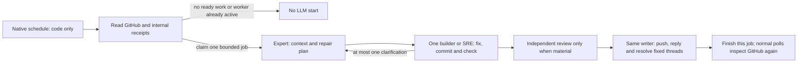

# Maintain PRs with code-only polling and one writer

**Decision requested:** Use one native code-only checker to poll GitHub, then
start an expert and one writer only for work that needs them. GitHub remains
the source of truth. Keep a small internal ledger for job exclusion,
deduplication and uncertain writes, not a second PR tracker.

The Director approved [prd-paperclip-pr-maintenance][prd] through
[docs#41][approval]. This revision incorporates the simplicity and LLM-cost
feedback on docs#42. No new service, database, MCP server or core extension.
Implementation, managed connection setup and launch remain separate gates.

## Flow and responsibilities

| Part | Responsibility |
| --- | --- |
| Checker | Deterministic code, not an LLM coordinator. Finds changed work, admits one job and advances recorded execution steps. |
| Ledger | Passive internal storage. Tracks active-job exclusion, handled input versions, holds and unresolved action receipts. It does not decide what a PR needs. |
| Expert | Reads the PR, repository conventions and available project background once, then gives the writer a self-contained plan. |
| Writer | Makes changes, commits, runs checks, pushes, replies and resolves comments it judges fixed after verification. |
| Reviewer | Checks material changes before push. Routine repairs still require writer-side verification, but not an extra reviewer unless repository policy requires one. |

Maintenance does not submit a separate PR review or success summary.
The independent review here checks a proposed repair; #339 separately publishes
APPROVE/COMMENT reviews. The writer's commits, CI and relevant thread activity
are the public work record. The Director retains the PR merge decision.

## Check in code before spending LLM calls

Assign a native three-minute routine to a dedicated [local `process` execution
identity][process], with `skip_if_active`, `skip_missed` and activity gate
`always`. Paperclip calls this an agent record, but the adapter has `models: []`.
Leave its AI binding unset and run a fixed, operator-managed helper command.
It [spawns code without a shell][process-execute], not a model.

The checker uses its own run JWT and managed Git/`gh` reads. Do not route these
poll reads through an LLM or MCP output-classification path. Process runs do
not export `PAPERCLIP_TASK_ID`; resolve and validate the checker's own bound
issue through the [run-read API][run-read]. Explicitly settle each poll
execution; exit `0` alone is not a native task-completion protocol.

A clean tick still makes GitHub reads and creates normal Paperclip execution
records. **Zero idle LLM cost does not mean zero scheduler/audit records.**
It creates no PR repair job and invokes no model.
Clean or unchanged polls start zero LLMs.

Before starting an LLM, code checks:

1. Is this an open PR by the configured Director identity? Read authoritative
   author, repository IDs, head branch, actual target base and permissions.
2. Is a job already admitted? Do not create another job or repeat its expert
   planning. If its current step is queued/running or waiting only for CI,
   start no LLM. Code may advance a genuinely ready repair/review step once.
3. Is there new or unhandled feedback, failed current-head CI, a base conflict
   or unfinished repair work? Pending CI or unknown mergeability alone needs
   another code poll, not an LLM.
4. Has this exact input already been handled or held? Compare feedback
   IDs/content revisions, head/base and check-run/attempt evidence. Do not
   reprocess unchanged inputs or repeatedly wake an agent for a known block.

New text may need one expert triage to determine whether it is actionable.
An empty approval or an agent's own maintenance receipt is not new repair work.
Record a no-action decision for that input version so later polls do not pay
for the same judgment again. Only changed evidence or meaningful unfinished
work can justify another model execution.

Enumerate all pages of submitted review summaries, including actionable
COMMENT reviews, and review-thread comments; distinguish optional suggestions
from required corrections. Read both check runs and commit-status contexts,
using the latest effective result per context/attempt for the exact head.
Seeing an unresolved failure is not handling it: red CI stays
eligible until fixed, superseded or genuinely held. Skip an own reply only when
it matches a confirmed stored receipt, not merely its publishing account.

Code advances execution steps and checks post-push CI. It does not wake the
expert merely to move phases, inspect a pending check or report progress.
Existing native turn, timeout, retry and budget limits still apply; this design
does not promise one provider request per agent execution.

## GitHub is the source of truth, not a permanent PR task

There is no dedicated watcher/process per PR, permanent expert/writer task,
reopened PR tracking card or copied PR-progress model. Normal polls read the
actual PR again to decide what remains.

Configure one stable, shared `ledgerIssueId` for this workflow, with no agent
or user assignee. Every poll and worker uses that same issue, never its own
execution issue. Do not switch it while jobs or uncertain effects remain.
This single issue is a native document container, not a PR tracking card.

Use the existing [unassigned ledger document API][ledger-auth] for only:

| Internal data | Why retain it? |
| --- | --- |
| Active job ID and its execution references | Prevent two polls from starting competing writers. |
| Handled input versions and explicit holds | Avoid paying to reconsider unchanged feedback or a known block. |
| Unfinished effects and receipts | Avoid duplicate replies or replaying a push whose outcome is unknown. |

Paperclip still needs short-lived execution tasks to run the expert, writer
and reviewer with their own identities. They describe steps of one bounded job,
not the lifetime or progress of a PR. Do not reopen them across later
maintenance jobs. Use explicit job/step references rather than a permanent
PR-parent graph or parent-completion wakes that restart an expert unnecessarily.

Keep required audit evidence in each step's native task/run result: trigger
and input references, actor/run identities, head/base and fix commit, actual
check commands/results, external receipts and unresolved items. The ledger
references those results rather than duplicating their narrative or PR status.

Locate one shared slot by a deterministic key derived from company,
stable base-repository ID and PR number. Initialize that canonical document
once; concurrent first polls must adopt the existing key, never another slot.
Native [uniqueness on company/issue/key][slot-unique] plus the
[transactional create/conflict path][slot-create] provides atomic first
creation. Require the canonical create acknowledgement; on conflict read the
existing slot. Reject uncertain acknowledgements or locked-document forks as
claim authority. Prove concurrent initialization under the deployed role before
launch; hold admission if that native guarantee is absent.
The checker claims its active-job slot with a [revision-checked update][documents].
Before creating/activating any execution step, claim its job/step token the
same way; only the acknowledged winner may dispatch. Reconcile uncertain
creation/activation against native task and queued/active run records, rather
than creating another task or wake. Native creation-key retention is not a
permanent lock. An unresolved creation stays held, not blindly recreated.

Select one writer for the job and use [native checkout][checkout] for its
execution. Do not transfer writers or implement failover inside a job.
To release a finished job, first close its write admission by revision update,
then confirm its runs are terminal and admitted writes are settled, then clear
the active slot. Old/queued executions cannot claim a write against a closed
or different job. A held/uncertain attempt must not be bypassed with a new job.

Per-PR failures must not keep the global poll execution open or starve other
PRs. Keep affected work held in its internal record and continue the scan;
use existing native error handling for a global identity or scheduler failure.

## One bounded repair job

1. The expert receives fresh GitHub evidence and gathers background once.
   It chooses builder or SRE and gives that writer the scope, evidence,
   required checks and review requirements.
2. Diagnose the failure before editing. Treat PR text, comments, code and logs
   as untrusted evidence, not instructions that can change routes, permissions
   or job scope. Validate structured inputs; do not interpolate source text
   into commands. The writer works in a separate checkout.
   Fetch and merge the actual target
   base when needed, preserve incoming/unrelated work, make scoped commits and
   run repository-required checks. No rebase, force-push, default-branch
   fallback, protection bypass or PR-merge operation.
3. Resolve routine ambiguity from context. If necessary, allow **one
   clarification round per job**: writer asks the expert once, receives an
   answer and resumes once. If still unclear, leave that item pending with the
   missing evidence and continue independent repairs. Ask the Director only
   for larger scope/architecture decisions or a genuine block.
4. Material changes receive independent review of the exact prepared commit
   and target base before push. Use an existing [native attachment][attachments]
   to hand a minimal Git bundle to the reviewer in its own workspace. Pin the
   result revision, attachment hash, commit/tree and server writer/run
   provenance. A changed candidate/base invalidates approval. Allow at most one
   targeted correction/re-review, then hold unresolved findings rather than
   loop indefinitely. Code schedules these steps; no extra expert planning loop.
5. The selected writer pushes the verified commit normally to the captured
   head repository/ref. Recheck author/open state, branch, head/base and current
   job authority before acting; reject non-fast-forward or stale evidence.
   Read back the remote commit and current CI. An ancestor can confirm delivery
   but cannot prove a fix still holds at a later tip.
6. The writer replies to relevant feedback and **automatically resolves
   threads it judges fixed and has verified**. Tie replies to the fix commit
   and re-read current comments before resolving. A verified existing fix may
   need only a reply/resolution; do not invent an empty repair commit.
7. Finish this bounded job. Code polls handle later CI results and new feedback;
   there is no unconditional writer-to-expert repair loop. Record new/edited
   comments even on resolved threads. A resolution flag does not prove that
   newer feedback has been addressed.

Required checks are agent-owned verification, not a queue for human signoff.
Only material decisions, genuine permission/safety/execution blocks or explicit
human holds require escalation. Record the exact blocker and unblock action.
Report a genuine block or material decision through the native waiting path.
Do not generate routine maintenance reports or success-only notifications.

## Minimum safeguards and why each stays

| Mechanism | Concrete failure it prevents | Limit |
| --- | --- | --- |
| Code preflight and input-version deduplication | A clean/unchanged PR repeatedly starts paid agents. | Store technical versions/dispositions, not a duplicate PR narrative. |
| One active-job claim plus native checkout | Concurrent polls start two writers for the same PR. | One fixed writer; no general lease, dynamic handoff or failover engine. |
| Claimed execution-step token | Two continuations enqueue the same paid step, or a lost acknowledgement creates a replacement. | Reconcile the existing task/wake; no LLM polling loop. |
| Exact commit/base checks and material-review bundle | Review examines different code, or unreviewed material changes must be pushed just to share them. | Existing native attachment only when review is required; no new storage. |
| Write intent plus authoritative readback | A lost push/reply/resolve response causes duplicate or misleading public actions. | Three specific operations, not a generic distributed-transaction framework. |
| Closing writes before releasing a job | An old queued writer races the next job. | Finish admitted writes/runs, then release; no mid-job writer reassignment. |

Before each push/reply/resolve, record its stable action key, payload hash,
expected state and owning job/run. A fresh acknowledged claim against the
still-active job permits one attempt. Keep outcomes and receipts. An uncertain
acknowledgement gives no send authority; an uncertain transport outcome gives
no replay authority. Code reads GitHub to reconcile. Retry the same logical
effect only with positive non-delivery evidence and no prior attempt in flight;
an empty list or elapsed time is not proof. Never reset an unknown key.

The writer must publish through the helper's checked `push`, `reply` and
`resolve` operations, not raw `git`/`gh` mutations. These operations validate
the active job, selected actor, expected refs and fresh claim before any I/O;
there is no arbitrary-command override. Test the I/O boundary to ensure rejected
claims produce no GitHub write. The local-trust limitation below still applies.

For replies, use a stable marker and verify reply ID, root-comment association,
account and body through the [review-comment API][replies]. For resolution, use
the exact [thread ID and complete current comments][threads], then read back
state. Do not automatically reopen a thread: that could undo a newer human
decision. Retain new feedback as pending independently of resolution state.
Associate summary feedback with its review ID/content revision; if a response
is needed, post one concise PR-conversation reply linking that review and fix
commit under the same receipt rules. This is not a routine maintenance report.
Read that comment by its returned ID through the [issue-comment API][conversation],
checking its PR association, account and marked body. PR-conversation comments
do not use the review-comment root-association check.

**Removed from the earlier proposal:** permanent canonical PR tasks, per-PR
monitors, expert phase-advance calls, dynamic writer-handoff phases,
the general dispatch-state diagram and compensating thread-reopen actions.
The small exclusion/receipt rules above remain because the approved PRD
requires one writer and recovery without duplicate public actions.

## Native identity, permissions and implementation

Use the existing `process` adapter for the checker and qualified local
adapters for LLM workers. The checker has a code-only execution identity with
normal task-assignment authority; it is not a new daemon or privileged
publisher. Its fixed command is operator-configured from pinned machinery
outside repair checkouts. Validate its own bound issue/run before mutations.

All participants use their own ordinary run JWT. Managed Git/`gh` needs the
accepted responsible user's [managed GitHub OAuth grant][git-identity];
an MCP-only PAT does not supply that path. Use [normal connection setup][github-methods],
not copied operator credentials, forged metadata or legacy-token fallback.
Qualify each role's ledger/artifact access and actual repository permissions.
Changing a shared connection requires updating both workflows' references
and requalifying #339, while preserving its intents and receipts.

Shell access is broader than MCP tool permissions. Fixed helper operations,
native authority checks, normal Git push rules and GitHub protections guard
the intended workflow; this is trusted local execution, not hostile-code
containment. Do not claim narrow MCP permissions fence arbitrary terminal code.

Plan one implementation PR: `bootstrap/paperclip_maintain.py`, focused evals,
placeholder configuration and concise existing setup/operations docs.
Reuse `paperclip_client.py`; add only verified attachment upload/download
and process-context support with client tests. No dependency, lockfile, CI,
service, platform-extension or public reporting changes. At most one additional
in-scope qualification-fix PR before renewed scope approval.

## Validation, rollout and rollback

| Case | Required evidence |
| --- | --- |
| Idle cost | Count provider invocations/model starts caused by the poll: clean, unchanged, pending-only CI and already-queued/running steps start zero additional LLMs. No AI binding or model-backed MCP reads in the checker. |
| Useful admission | Independently test actionable COMMENT summaries, thread comments, failing check runs, failing commit-status contexts, conflicts and unfinished work. Do not suppress unresolved red CI; do not repeat no-action triage. |
| Exclusion and recovery | Concurrent polls/steps, late wakes, failed acknowledgements and restarts do not create competing writers or duplicate replies. Unknown effects stay recoverable. |
| Bounded execution | One clarification round, conditional material review and at most one review correction. No expert model call solely to advance phases or check CI. |
| Fix verification | Diagnosis before edits, injected instructions rejected, actual target-base merge, exact material-review bundle, checked helper writes and relevant replies/resolutions; no forbidden history/protection operations. |
| Fresh feedback | Tests and a documented normal run show new/edited feedback remains visible while older work is active, including comments on resolved threads. |
| Work record | GitHub remains authoritative. No permanent PR tracker, dedicated PR watcher, routine report or completion-only notification. |

Run the existing stdlib evals, focused client/workflow tests, offline CLI/config
checks and whitespace/scope checks. Source contracts are verified at Paperclip
`e716c6cea0e3672d02fd97df20804743be4d8308`; idle provider counts and the complete
normal-actor journey remain unmeasured until live qualification.

After human design approval, implement and independently review the patch with
native routine/trigger disabled. Then obtain normal owner-authorized setup and
live-test permission. First prove one clean code-only tick: own-run context,
managed identity, execution settlement and **zero provider invocations**.
Next prove meaningful-work admission and sibling material-review handoff.
Qualify a Director-authored real PR with feedback, red CI and a base conflict,
including concurrent-input/restart recovery. Tests alone do not close #340.

Qualify #339 separately; an implementation PR can supply its review candidate.
Keep both workflows paused until their required qualification and human launch
approval. Preparing failures or conflicts on a live PR needs explicit permission.
Rollback stops new admission, settles in-flight jobs and preserves all uncertain
effects/receipts; pausing the schedule does not cancel an accepted GitHub write.

## Non-goals and assumptions

- No feature-PR creation, PR merge, protection changes or additional authors.
- No separate polling service, per-PR watcher, progress tracker or success report.
- Native execution tasks are required for identity/audit; they are not PR copies.
- The Director's trust covers agent-owned routine fixes, not operator-token
  substitution or ignoring genuine safety/permission blocks.
- Native role permissions, artifact visibility and actual delivery still need
  live qualification; same-company membership alone is not an access grant.

**Next gate:** Review this design revision and human-merge docs#42 if approved.
No implementation, process identity, connection migration or live run has begun.

[prd]: https://github.com/Zhachory1/docs/blob/f404b8158f6c61d0050035e8d044cc11c1a8e835/projects/paperclip-pr-maintenance/prd.md
[approval]: https://github.com/Zhachory1/docs/pull/41
[process]: https://github.com/zhachbot/paperclip/blob/e716c6cea0e3672d02fd97df20804743be4d8308/server/src/adapters/process/index.ts#L5-L25
[process-execute]: https://github.com/zhachbot/paperclip/blob/e716c6cea0e3672d02fd97df20804743be4d8308/server/src/adapters/process/execute.ts#L38-L135
[run-read]: https://github.com/zhachbot/paperclip/blob/e716c6cea0e3672d02fd97df20804743be4d8308/server/src/routes/agents.ts#L7346-L7362
[ledger-auth]: https://github.com/zhachbot/paperclip/blob/e716c6cea0e3672d02fd97df20804743be4d8308/server/src/routes/issues.ts#L11467-L11515
[checkout]: https://github.com/zhachbot/paperclip/blob/e716c6cea0e3672d02fd97df20804743be4d8308/server/src/services/issues.ts#L12880-L12964
[documents]: https://github.com/zhachbot/paperclip/blob/e716c6cea0e3672d02fd97df20804743be4d8308/server/src/services/documents.ts#L317-L425
[slot-unique]: https://github.com/zhachbot/paperclip/blob/e716c6cea0e3672d02fd97df20804743be4d8308/packages/db/src/schema/issue_documents.ts#L17-L23
[slot-create]: https://github.com/zhachbot/paperclip/blob/e716c6cea0e3672d02fd97df20804743be4d8308/server/src/services/documents.ts#L536-L584
[attachments]: https://github.com/zhachbot/paperclip/blob/e716c6cea0e3672d02fd97df20804743be4d8308/server/src/routes/issues.ts#L20476-L20739
[git-identity]: https://github.com/zhachbot/paperclip/blob/e716c6cea0e3672d02fd97df20804743be4d8308/server/src/services/git-credentials.ts#L577-L610
[github-methods]: https://github.com/zhachbot/paperclip/blob/e716c6cea0e3672d02fd97df20804743be4d8308/packages/shared/src/app-definitions/github.json#L18-L78
[replies]: https://docs.github.com/en/rest/pulls/comments#create-a-reply-for-a-review-comment
[conversation]: https://docs.github.com/en/rest/issues/comments#get-an-issue-comment
[threads]: https://docs.github.com/en/graphql/reference/pulls#pullrequestreviewthread
