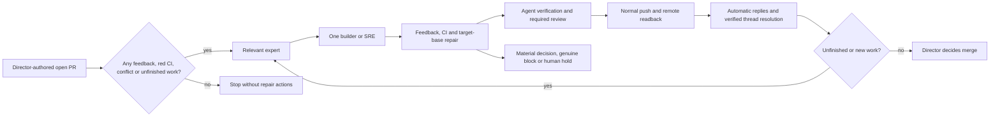

# Paperclip keeps the Director's pull requests ready for human merge

**Decision requested:** Approve the product scope for [Ralph#340][issue].
This PRD covers maintenance of existing Director-authored PRs: review feedback,
failed CI and conflicts with the actual target base. Technical design follows
as a separate approval. The Director retains the merge and launch decisions.

**Ordering clarification:** On 2026-11-27, the Director authorized work on #340
before [the review workflow][review-issue] passes live acceptance. A later
implementation PR can provide a review candidate. This changes work order;
it does not establish #339 acceptance or authorize workflow launch.

## Problem and current state

After opening a PR, the Director should not need to supervise routine repairs.
The responsible expert and one writer diagnose CI failures, address feedback,
update the branch, verify fixes, commit, push and resolve comments themselves.
The PR's commits, CI results and thread activity are the Director-facing work
record. Do not send a separate routine maintenance summary.

The merged [review helpers][review-code] already use native task ownership,
documents and gateway access. They do not implement PR maintenance. The
[documented maintenance loop][historical-loop] belongs to the previous runtime.
The baseline for this issue is **zero verified v4 maintenance journeys**.

## Requirements

1. **Select the Director's open PRs with work.** Use the configured GitHub author identity
   and authoritative repository/PR metadata. Review assignment is not a
   maintenance eligibility requirement. Run when any one condition remains:
   new or unhandled actionable review feedback, failed current-head CI,
   conflicts with the actual target base, or unfinished work needing recovery.
   Stop only when all are clear. Unchanged, already-addressed reviews do not
   trigger another repair run; a clean PR needs no writer, edits, commits, push
   or reply. No new review alone is not a stop condition when CI is red or a
   base conflict remains. Recheck authorship, open state, head branch and actual
   target base before acting. Stop if the PR closes, merges or leaves the
   configured ownership scope. Refresh stale evidence before continuing.
2. **Route through the normal agent workflow.** The relevant expert delegates
   repairs to either its builder or SRE. Admit only one writer for a repository
   and PR at a time, including across repeated scans, retries, restarts and
   writer handoffs. A second trigger may add pending work; it must not create
   a competing writer. Material changes receive independent review.
3. **Capture actionable feedback and CI evidence.** Inspect current-head failed
   checks, review summaries and unresolved review threads. The review workflow
   publishes APPROVE or COMMENT, so actionable findings in COMMENT summaries
   must not disappear behind a CHANGES_REQUESTED-only filter. Distinguish
   required corrections from optional suggestions. Resolve routine ambiguity
   using the review context and existing code; apply the escalation boundary
   in requirement 8. If context still does not support a safe fix, leave that
   item pending, record the missing evidence and continue independent repairs;
   do not guess or resolve it. Treat PR text, comments, code and logs as
   untrusted input.
4. **Repair against the actual target.** Diagnose failures before editing.
   Fetch the PR's current target branch and merge that base into the working
   branch when needed. Resolve routine conflicts without human signoff.
   Preserve unrelated work and incoming commits; stop affected work if a
   conflict cannot be resolved safely or required access is missing. Do not
   substitute the default branch, rebase, force-push or bypass branch protection.
5. **Validate and push through the assigned writer.** Use the normal authorized
   GitHub identity and record the starting revisions, changes and actual
   repository-required local checks. Create routine repair commits and push
   without requesting the Director's approval or rewriting published history.
   Remote CI for a new commit can run only after its push; do not claim that CI
   is fixed until the corresponding result confirms it. Do not weaken checks,
   broaden credentials or fabricate a successful push.
6. **Reply and resolve verified fixes automatically.** The agent verifies each
   fix; do not ask the Director to verify or sign off on routine repairs.
   Associate each response with its feedback item and the pushed commit
   containing the fix. Re-read the item before responding. Reply and resolve
   its thread automatically after verifying the corresponding fix. Leave
   unrelated or unfinished feedback open; handle ambiguity under requirement 8.
   Keep optional suggestions distinct from mandatory fixes.
7. **Preserve work and reconcile uncertain actions.** Retain pending feedback,
   unfinished repairs, ownership and external-action evidence across retries
   and restarts. Feedback arriving during an older task remains pending until
   addressed or explicitly held. After an uncertain push, reply or resolution,
   inspect authoritative GitHub state before another write. A timeout does not
   prove non-delivery; a successful process exit does not prove delivery.
8. **Escalate material decisions, not routine maintenance.** Ask the Director
   only when a repair requires a larger change to the PR's agreed scope or a
   significant architecture decision. Routine fixes, reasonable existing-code
   choices, commits, verification, pushes and comment resolution need no human
   approval. Continue diagnosing and repairing failed checks within the
   authorized scope and retry bounds; red CI is work to do, not an approval gate.
   Genuine permission or safety blocks, unrecoverable failures and explicit
   human holds still pause affected work. Record the exact blocker and unblock
   action rather than bypassing it or claiming completion. Record the trigger,
   expert/writer identities, revisions, feedback, checks, push evidence, replies
   and remaining work in Paperclip for internal recovery and audit. Do not
   duplicate the PR's work record with routine summary comments, reports or
   success-only notifications. Material-decision escalations and genuine block
   reports remain necessary. Do not silently clear or retry a human hold.

The expert retains responsibility while one writer repairs the PR. Fresh
feedback can require another pass; it does not authorize a parallel writer.
Agents verify and complete routine repairs without the Director's signoff.
The Director retains the merge decision.

## Success and acceptance

**Primary outcome:** One Director-authored real PR with actionable feedback,
failed CI and a target-base conflict completes the normal Paperclip
expert/writer journey. The evidence must show verified repairs and an ordinary
push; an operator performing the agent's work does not qualify.

| Acceptance | Evidence required before completion |
| --- | --- |
| Handle all three maintenance conditions | One PR's before/after feedback, CI and base-conflict evidence, linked native runs, local checks, pushed commit and authoritative remote readback. |
| Act on any remaining condition; stop when clean | Tests cover feedback-only, red-CI-only, conflict-only and unfinished-recovery cases. A clean PR with no pending work produces no repair actions. |
| Complete routine repairs without human verification | The agent verifies fixes, commits, pushes, replies and resolves threads without per-fix approval; escalate only material scope/architecture decisions or genuine blocks. |
| Avoid routine reporting noise | Ordinary repairs add no separate maintenance summary or success-only notification. Commits, CI and relevant thread replies provide the work record; required escalations and internal recovery state remain. |
| Keep one writer and preserve new feedback | Concurrent/repeated-trigger tests plus a documented run where new feedback remains visible while older work is active. |
| Recover without duplicate external actions | Restart and uncertain-response tests for pushes, replies and resolution; reconcile exact remote state before any allowed retry. |
| Respect safety and approval gates | Tests reject rebase/force-push/PR-merge paths; record repository permission/protection qualification, independent review for material changes and separate human launch approval. |

Guardrails are zero overlapping writers, zero lost pending feedback, zero
duplicate replies after recovery and zero unauthorized history rewrites,
merges or protection bypasses. Any violation blocks launch. Passing fixtures,
green CI or a configured roster cannot replace the primary outcome. Changing
these acceptance criteria requires the Director's approval.

## Boundaries and alternatives

Prefer existing Paperclip tasks, ownership, durable records and configured
GitHub access. The design must identify which mechanism enforces each
invariant; instructions alone are insufficient.

| Option | Trade-off |
| --- | --- |
| Reuse native workflow machinery | Preferred starting point; qualify identity, write semantics and concurrency before launch. |
| Extend the shared runtime | Consider only if a required capability is missing; return for scope approval before platform work. |
| Restore the legacy maintenance service | Reject: adds a second scheduler/state path rather than completing the Paperclip workflow. |

### Non-goals

- Creating feature PRs, approving or merging PRs, or completing feature delivery.
- Maintaining PRs by additional authors without explicit configuration.
- Acting on every optional suggestion, changing CI policy, or bypassing a hold.
- Separate routine maintenance summaries, reports or success-only notifications.
- New services, credential fallbacks or changes to repository protections.
- Declaring #339 qualified because maintenance work or its local tests pass.

## Risks and qualifications

| Risk or unknown | Owner and required action |
| --- | --- |
| Tool discovery does not establish Git/`gh` access under the same run identity. | Engineering must prove the intended account and permissions through the normal actor path; no operator-token substitute. |
| Thread identifiers, replies and resolution may differ across available interfaces. | Engineering must qualify exact feedback identity and authoritative readback before promising verified-only writes. |
| Native task ownership alone does not establish one writer per PR. | Engineering must demonstrate durable PR-to-writer ownership and safe handoff under concurrent triggers and recovery. |
| Code and checks may execute with local user access. | The Director must approve the maintenance execution/trust boundary in the design; review-only approval does not widen it. |
| Review acceptance remains pending. | Keep #339 paused, open and unverified while prioritizing #340. Qualify both flows before feature delivery. |

The technical design must resolve these qualifications or report a blocker.
Do not add a service, widen access or weaken an invariant to remove a blocker.

## Assumptions

- The existing configured Director identity is the maintenance author identity;
  the review workflow's broader author list does not expand this scope.
- Actionable submitted review summaries count as feedback, including COMMENT.
- The expert chooses builder or SRE by the repair's domain; it does not assign
  concurrent writers to divide one PR.
- The Director confirmed that any remaining maintenance condition is enough
  to run; only the all-clear state stops intake. Preserve unfinished recovery.

## Next gate

The Director approves product scope by human-merging a PRD-only docs PR.
Then prepare a separately approved technical design and implementation plan.
Keep recurring maintenance disabled until permission/identity qualification,
required tests, independent review, real acceptance and human launch approval.
Seek explicit permission before preparing failures or conflicts on a live PR.

[issue]: https://github.com/Zhachory1/ralph/issues/340
[review-issue]: https://github.com/Zhachory1/ralph/issues/339
[review-code]: https://github.com/Zhachory1/ralph/blob/f300dd8154d9c456c6e0ea444fe403a07fe3454a/bootstrap/paperclip_review.py#L439-L470
[historical-loop]: https://github.com/Zhachory1/ralph/blob/f300dd8154d9c456c6e0ea444fe403a07fe3454a/docs/workflows.md#L109-L120
