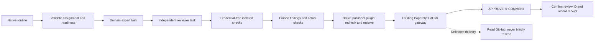

# Use native Paperclip tasks to submit APPROVE or COMMENT reviews once per head

**Decision needed:** Approve native routines and task ownership for discovery
and delegation, plus a deterministic native plugin for validation and publication
through the existing GitHub gateway. Publish only **APPROVE or COMMENT**. Keep the
workflow disabled until identity, sandbox isolation and launch checks pass.

**Scope:** One configured company, repository allowlist and expert/reviewer
route. This follows [prd-paperclip-pr-review][prd], approved through docs#38,
with the Director's subsequent APPROVE/COMMENT-only clarification. Finding
labels describe recommendations; they do not create GitHub change-request
blocks or a requirement for bot approval.

**Proposed delivery:** This design approval PR includes the PRD clarification.
After design approval, use at most two implementation PRs against Ralph's
`clean-slate` base: helpers and regression tests; then agent/routine wiring and
qualification. Launch approval remains separate. This draft changes no runtime.

## Verified capabilities and gaps

Paperclip source references below use clean commit
`e716c6cea0e3672d02fd97df20804743be4d8308` in the existing source checkout.
Source inspection establishes behavior, not successful execution by the
configured company.

| Capability | Verified evidence | Design consequence |
| --- | --- | --- |
| Routine dispatch | [Routine contract, lines 1-10, 66-107][routines] creates execution issues and offers coalescing, catch-up and activity gates. | Reuse its scheduler and heartbeat path. |
| Task ownership | [Issue checkout, lines 12904-12964][checkout] conditions acquisition on assignment, status and execution run. | One owning agent run per task; conflicts do not justify a second worker. |
| Creation deduplication | [Issue creation, lines 10730-10772][issue-create] serializes keyed creation but also expires old creation keys. | Creation keys reduce duplicate tasks; they are not the permanent review ledger. |
| Durable records | [Document updates, lines 410-425][documents] require the current revision; [creation, lines 487-584][document-create] enforces unique issue/document keys. | Keep review evidence and send reservations in native task documents. |
| Gateway and policy | [Gateway contract, lines 55-71, 131-157][gateway] governs calls, not the whole host. [Policy conditions, lines 245-279, 524-560][conditions] inspect arguments and task context. | Reuse the shared connection and narrowly scoped native deny rules. No new MCP server or general access-policy rollout. |
| Gateway idempotency | [Invocation records, lines 1863-1878][invocations] accept explicit keys; the default [key includes the run ID, lines 316-327][default-key]. | Supply a stable workflow key; default per-run deduplication is insufficient. |
| Publisher separation | [Plugin host API][plugin] exposes native tools, issue documents, secret references and HTTP; [gateway selectors][selectors] include client-token identity. | Put publishing credentials and ledger mutations in the plugin worker, outside agent/test environments. Qualify the scoped boundary before launch. |
| Native bot reviews | [Bot scope, lines 130-212][bot-scope] requires a GitHub chat-origin binding and its formal event enum differs from this workflow. | Do not use the chat bot's formal-review path or manufacture a chat event. |
| Sandbox limits | [Provider requirements, lines 42-71, 107-119][sandbox] leave provider isolation and internet policy to the operator. | A provider name, catalog entry or successful probe is not proof of network denial. No provider is qualified by this draft. |

## Alternatives

| Option | Scope and effort | Trade-off and reversibility |
| --- | --- | --- |
| **A: Native routines/tasks/gateway plus one publisher plugin** | Focused workflow patch in Ralph; native documents hold receipts and reservations. | Selected. A deterministic plugin protects the publishing credential without a new server, queue or datastore. Pause intake and fence the publisher to stop it; retain receipts. |
| B: Extend Paperclip's GitHub chat-review service | Larger platform patch and bot setup; add assignment intake, two-event semantics and base guards. | Its leases and markers are useful references, but chat-origin and policy changes exceed this slice. Reversal also needs platform/config rollback. |
| C: Port the historical poller into a separate review service | New scheduling, locking and persistence alongside Paperclip. | Reject: duplicates native capabilities and increases operational scope. Highest effort and rollback cost. |

## Discovery and ownership

1. Configure the company, project, stable workflow-ledger task, repository
   allowlist, Director's GitHub account ID/login, publishing account ID/login,
   connection ID, and repository-to-expert/reviewer mapping. Store credential
   references in Paperclip, not in repository configuration.
2. Create the routine **paused**. Proposed polling interval: three minutes,
   `coalesce_if_active`, `skip_missed`, `activityGatePolicy: always`.
   GitHub activity need not create Paperclip activity, so quiet-company gating
   would miss assignments. Each tick uses the normal execution-issue path.
3. Search within the allowlist for open PRs assigned to the configured Director,
   then read each PR's authoritative metadata. Require open state, non-draft,
   and the configured account in the assignee list. Do not use `@me`, CI status,
   review requests or an author exclusion as discovery gates. Paginate all
   results; report incomplete scans instead of claiming no work.
4. Route eligible PRs to the configured expert using keyed native tasks. The
   expert delegates exact-head/base analysis to a distinct reviewer and owns
   delivery through the publisher plugin. Missing routes, permissions or
   independent reviewers produce a visible blocked task, not a guessed
   assignee or self-review.
5. Use native task dependencies and normal heartbeat continuation for the
   handoff. A finished run is not a finished review: the expert needs the
   reviewer's validated result and a confirmed GitHub receipt.

Paperclip schedules and assigns work. The reviewer supplies judgment; the native
publisher plugin validates the result and owns the write. PR content and check
output remain data throughout the handoff and cannot select a destination, credential,
event outside the allowlist, or an execution command.

## Evidence and verdict contract

The reviewer records repository ID, PR number, head SHA, base SHA, agent/run
identity, coverage, findings and check results on its task, including actual
commands, exit outcomes and reasons for omitted commands. Each finding includes
classification, location, evidence and an actionable correction. The expert
does not substitute a new verdict for the reviewer's judgment.

- **APPROVE:** Sufficient evidence, no unresolved blocking findings, and no
  authorship prohibition. Non-blocking suggestions may remain.
- **COMMENT:** Blocking findings, other concerns, insufficient evidence, or an
  approval-ineligible authorship relationship. Explain why approval is withheld.
- Reject REQUEST_CHANGES, missing/unknown events and APPROVE with blockers
  before invoking any write. Do not downgrade a transport or authorization
  failure into a second COMMENT write.

Publish one submitted review with labeled inline findings. Include
**Blocking findings**, **Non-blocking suggestions**, and **Checks**, plus head
and base SHAs, coverage limits, automated attribution and a reconciliation
marker in the summary. Each inline comment carries **Blocking** or
**Non-blocking**, a stable finding marker, and an anchor validated against the
pinned diff. Findings without a valid inline anchor remain in the corresponding
summary section, with a location and the anchoring limitation. The published
Checks section lists actual commands and outcomes, pending/failing CI, and every
check not run with its reason. CI does not gate
discovery or decide the verdict on its own.

## Publication and reconciliation

### Identity and event enforcement

Register one native plugin tool that accepts only the completed result's task
and document/revision references. The expert calls it through its normal run.
The plugin loads those records, verifies the configured task ancestry,
expert/reviewer identities and completion provenance, then validates the
structured result. Callers cannot supply destination, token, arbitrary gateway
method, command or a replacement verdict. Duplicate calls only reconcile the
same persisted operation. The plugin runs no model and executes no PR code.

Keep the publisher's named gateway-client token in a plugin-only secret
reference. Native [gateway sessions][publisher-token] identify that client
separately from ordinary agent runs. Use the existing gateway and GitHub
connection, not a new gateway/server or a raw GitHub credential.
Ordinary review-agent tokens must be denied direct create, inline and submit
tools, even with otherwise valid arguments. Only the publisher client can use
those entries for this workflow. Inventory equivalent review-write aliases and
connections so another catalog entry cannot bypass the boundary.

Contain all agent runs consuming external PR content within a review-task root
under `low_trust_review`. Keep the plugin's ledger task outside that root.
Those agents may write their own results, but cannot edit publication intents,
ownership records, plugin configuration or publisher secrets. Prove these
denials through the intended agents; shared tools alone are not containment.
This scoped workflow boundary does not replace the wider #343 policy work.

Use the existing gateway connection for discovery, `get_me`, review reads and
publication, under the appropriate distinct client identities.
[GitHub MCP v2.3.0][github-tools] documents `get_me` and
`pull_request_review_write` with `method`, `commitID` and `event`. Discover and
validate the actual connected schema and catalog IDs; do not assume aliases
or hosted-server versions match that reference.

For inline findings, use the documented native sequence: create a pending
review at the pinned commit, call `add_comment_to_pending_review` for each
finding, then submit the pending review as APPROVE or COMMENT. This is
machine-owned preparation, not a pending review left for human submission.
The inline/submit tools address the account's pending review rather than
accepting an arbitrary review ID. Require a dedicated publishing account,
serialize preparation per repository/PR, and verify the pending review ID,
commit and workflow marker before each subsequent write.

Before launch and before each write, verify the publishing account through that
gateway path. Bind its numeric account ID to the result and deny a mismatch.
The Director's assignment identity is independent of the publishing identity.
Do not approve work authored by the publishing account or by the reviewer
agent; apply the repository's approved rules to other agent-authored work.
Record the reviewer agent separately when several agents share one GitHub bot.

The plugin uses strict APPROVE/COMMENT validation for submission. Also configure
native gateway deny policies for the publisher client and connected publication
catalog entries: block REQUEST_CHANGES, omitted submission events
and unrelated methods. Permit `create` without an event only for private
preparation, and `submit` with an explicit APPROVE/COMMENT. Validate unknown,
null and malformed events against the connected schema. Test direct gateway
calls as well as the plugin, so prompt instructions are not the only event
guard. Do not change
branch protections, require bot approval or broaden company-wide permissions.
If native client separation, containment or the installed policy/schema
combination cannot enforce these restrictions, stop before launch rather than
describe plugin validation as the whole gateway boundary.

### Stable keys and write-ahead reservations

Define `K = company + repository ID + PR number + head SHA + publishing account
ID`, with unambiguous encoding and a versioned digest. Base SHA belongs in the
evidence and payload hash, not in K: changing the base must not permit a second
review of the same head by the same publishing account.

Keep a small native document per K on the configured workflow-ledger task,
separate from transient routine tasks. It links the expert/reviewer tasks,
pinned result, full payload hash, origin run and final receipt. Preserve these
records across restarts; do not expire unresolved send reservations or depend
on issue-creation-key retention.

The per-PR slot records owner instance, ownership epoch, K, preparation
generation and pending review ID. On first use, create its unique document
without a `baseRevisionId` in the **free**, unowned state. Initialization grants
no publishing authority; after a conflict or lost acknowledgement, read the
canonical slot. Every owner, including the first, acquires the free slot with
its current `baseRevisionId`. Release also requires the current revision.
A conflict, lost acquisition acknowledgement or locked-document fork is not
ownership. Re-read the canonical slot before each phase.
Do not expire or steal an occupied slot. Release only after the current owner
has settled its requests and confirmed the terminal remote state.

Before operator-driven transfer, stop the old publisher worker, revoke its
gateway-client token and resolve or drain its already accepted gateway calls.
An unresolved in-flight call prevents transfer even after revocation. Assign
a fresh epoch/client token only after fencing is proven; a former owner must
fail authorization if it resumes. A lost release acknowledgement requires
reading the current revision/epoch, not replaying an old release over a new owner.
These are native document revisions and token controls, not a second lease service.

Before the publication sequence:

1. Read and fully paginate prior reviews. A submitted review by the configured
   account for this head means already reviewed, including when the local
   receipt is missing. Reconcile it instead of sending again. Resume a pending
   review only when its ID, marker, commit and recorded phases match this
   workflow. Any other pending or conflicting state blocks publication.
   If the create response lost the pending ID, enumerate the account's pending
   reviews and adopt an ID only from exactly one review matching the create
   intent's marker, account and commit. Persist that adopted ID before adding
   comments. Missing pending-review visibility, incomplete history or ambiguous
   matches leave the operation unresolved.
2. Recheck authorization, identity, open/non-draft/assigned state, head and base.
   On drift, discard the prepared result. A changed base may require fresh
   automatic analysis under the same K only while no send reservation exists;
   later recovery follows the fenced operator procedure below.
3. Initialize the canonical per-PR slot if absent, then acquire it through the
   revision-checked transition above; do not take over unresolved writes. For each write,
   create an immutable `send-<digest(K, generation, phase)>` intent document
   without a `baseRevisionId`, containing the exact event, revisions, payload
   hash, originating run, ownership epoch and fresh per-invocation nonce.
   Proceed only after an acknowledged creation at the exact expected key with that nonce. Existing
   keys, replayed acknowledgements, conflicts, timeouts, or a different returned
   key forbid a write. Native agent document writes can fork locked documents
   ([route, lines 11497-11520][document-route]); a fork is not a reservation.
4. The phases are `create`, one `inline:<finding digest>` per comment, and
   `submit`. Each has its own stable gateway idempotency key derived from K,
   generation and phase. Create once with `commitID = reviewed head` and the
   workflow marker; save the pending review ID. Add each labeled finding once and
   confirm its remote marker and review ID before advancing. Recheck the
   slot epoch, pending review's identity, eligibility, head and base before each
   write; drift stops the sequence without submitting a stale pending review.
5. Submit once with explicit APPROVE/COMMENT. Read GitHub to confirm the account
   ID, commit, submitted state, event, summary marker, inline markers and review
   ID/link. Record the receipt and release the pending-review slot only after
   its terminal remote state is known. Do not leave submission to the human.

Native gateway idempotency adds protection; the durable reservation supplies the
cross-run no-resend rule for each phase. Never retry an uncertain phase or
advance past it until its remote effect is confirmed. The first implementation
must test both through the
real gateway transport. Neither a replay response nor a local exit proves
GitHub delivery.

| Observed state | Action |
| --- | --- |
| Prepared; no intent; no prior review | Eligible for final validation and the next phase's reservation. |
| Confirmed matching submitted review | Record/adopt its receipt; no write. |
| Confirmed matching pending review or inline comment | Record its phase receipt; resume only unsent phases after fresh validation. |
| Intent exists, response or receipt missing | Reconcile that phase by marker, account ID, commit and pending review ID, including after eligibility or revision drift. |
| No match after an uncertain send, incomplete pagination, or ambiguous matches | Mark `submission_unknown`, retain the intent and notify the operator. Do not resend or mint another automatic attempt. |
| Drift detected after the write | Retain the remote receipt, mark the result stale and notify the operator; no automatic dismissal, second review or merge. |

Retain a stopped pending review's slot until an operator reconciles and clears
it; do not automatically delete an uncertain draft or attach a new head's
findings to it. A completed review releases the slot, so a new eligible head
can start its own sequence.

For base-only drift after draft creation, an operator may authorize fresh
analysis under the same K after confirming no submitted review, verified
removal of the identified workflow-owned pending draft, and fencing/draining
the former owner. Keep old intents and receipts; revision-check a generation
increment and use new phase keys within that generation. A confirmed prior
submission permanently forbids another generation for K. Any uncertain submit
or unresolved request prevents this recovery. A changed head uses a new K
after the same pending-slot reconciliation. Count recovery against the agreed
task attempt/spend limits; the bot cannot authorize its own reset.

This trades unattended retry availability for duplicate prevention. A crash
after reserving but before sending can require human reconciliation even when
no review reached GitHub. Operator recovery must establish non-delivery before
authorizing another attempt; elapsed time or an empty read alone is insufficient.

GitHub's review API pins the head commit but does not atomically condition the
write on base SHA and assignment. Recheck immediately before sending and read
again afterward. The Director must accept this residual race at design review;
this design does not promise atomic eligibility across systems.

## Sandbox boundary

Only trusted, pinned workflow/plugin code may run outside the agent/check
sandboxes. Never load helper code, commands, shell fragments or runtime configuration from the
reviewed PR. The trusted staging path obtains the exact revisions and transfers
source as data using the platform's configured repository transport. Validate
paths and links; do not execute Git hooks, filters, lifecycle scripts or PR
setup commands during staging.

Use an approved native sandbox environment for authorized PR checks. Separate
networked source acquisition and agent/model access from the **test execution
environment**: the latter receives source, a pinned toolchain and approved
dependencies, but no gateway/API tokens or model/GitHub credentials. Enforce
test-network denial from outside the sandbox, including DNS, IPv6,
private/metadata addresses and control-plane endpoints. No host home/repository
mounts, SSH agent or host Docker socket. Apply resource/time limits and destroy the
ephemeral environment after success, failure, timeout or cancellation.

Do not call a normal host-local adapter an isolated runtime. Review-agent runs
use `low_trust_review` with its actual sandbox-driver, isolated-workspace,
scope and secret-binding requirements
([runtime contract, lines 137-169][low-trust]). Contained delegates complete their
own task rather than promote raw prose into a higher-trust parent
([reporting contract, lines 127-135][low-trust]).

**Qualification remains open:** Source inspection has not demonstrated an
available provider that meets the credential-free, network-denied test
contract. The implementer must qualify one through the existing environment
stack before enabling checks. Do not install a new provider, start another
container stack or incur provider spend as an unapproved workaround.
If isolation is unavailable, execute no PR code, record checks as not run, and
withhold approval when that leaves insufficient evidence. This does not satisfy
the sandbox acceptance case or permit closing #339.

## Validation and delivery gates

| Gate | Required evidence |
| --- | --- |
| Focused regressions | Draft/closed/unassigned negatives; assigned PRs without review requests and with pending/failing CI; complete pagination; missing route and reviewer/self-authorship cases. |
| Verdict and policy | APPROVE with no findings or suggestions only; COMMENT with blockers or insufficient evidence; matching summary/inline labels; ordinary agents cannot invoke direct publication tools or mutate the ledger; publisher rejects REQUEST_CHANGES, omitted/invalid submission events and unrelated methods; private preparation never substitutes for automatic submission; no branch-protection mutation. |
| Ownership and delivery | Concurrent scans/publishers, two publishers racing to initialize and acquire the first free slot, lost initialization acknowledgement, process restart, expired creation keys, locked-document forks, lost reservation acknowledgements, remote success with lost response at create/inline/submit, pending-ID adoption, receipt-save failure, conflicting pending reviews and truncated history. Stale-owner resume and lost release acknowledgement cannot bypass fencing. At most one submitted review per K and no duplicate inline findings. |
| Revision safety | Head/base/assignment/readiness drift before reservation and before transport; post-send drift remains visible. Verified draft removal and fenced operator recovery permit base-only reanalysis under K; submitted/unknown cases cannot reset. A new eligible head gets a new K. |
| Isolation | Intended runner proves network denial, absent credentials/mounts/socket, bounded execution and cleanup after timeout/cancellation. Dependency access failures remain explicit, not a reason to enable networking. |
| Native identity path | Normal company expert/reviewer runs resolve the authorized account and shared connection; task links and gateway records establish attribution. Another client's `gh` identity is not evidence. |
| Real acceptance, after launch approval | One eligible real PR traverses routine, expert, reviewer, checks, gateway and confirmed submitted review. Repeat scan/restart does not duplicate it; a new head receives another review. Record actual task spend and attempts. |

PR 1 adds the focused discovery/result helpers, native publisher plugin,
task-document protocol and regressions. PR 2 wires the existing agents and paused
routine, qualifies the connected schema/policies and sandbox through the
intended execution path, and records operational recovery. Implementation
details and command names belong in Ralph, not executable copies in this repo.

Before any paid qualification or live acceptance, agree the per-task spend cap,
attempt limit, repository/PR target and identity with the Director. Design
approval does not authorize those runs or publishing the acceptance review.
All PRD acceptance cases, including sandbox proof, must pass before closing #339
or starting the next workflow.

To stop the workflow, pause the routine and prevent outstanding tasks from
publishing; revoke the workflow's gateway access if an in-flight write cannot
be ruled out. Pausing future ticks alone is insufficient. Retain send intents,
receipts and `submission_unknown` records. Do not delete remote reviews or
discard the ledger during rollback.

## Non-goals

- PR maintenance, code changes to reviewed PRs, merges or deployments.
- A second scheduler, queue, database, MCP server or chat-origin bot integration.
- New company/agent provisioning, memory capture or a broad #343 access rollout.
- Pending reviews for manual submission and branch-protection changes.
- Universal dependency/test support or retrying an uncertain write for convenience.

## Assumptions

- Three-minute polling is acceptable for the initial bounded repository scope.
- The existing roster has an expert and a distinct reviewer for that scope.
- The native plugin can read result documents and own the ledger through scoped
  plugin capabilities, without a board token or exposing those writes to agents.
- The publishing account is dedicated to this workflow; it has no concurrent
  manual or unrelated automation manipulating its pending reviews.
- Native policy and connected-tool schemas can enforce the scoped event guard;
  the plugin and transport still require regression proof.
- The Director accepts the documented cross-system revalidation race; otherwise
  publication remains disabled pending a revised requirement/design.

## Open decisions and observations

| Item | Owner | Blocks |
| --- | --- | --- |
| Accept pre/post revalidation with no atomic GitHub base/assignment condition. | Director | Design approval. |
| Authorize the publishing account, repository allowlist and authorship policy. | Director | Live qualification/publication. |
| Demonstrate the available native sandbox's offline, credential-free test path. | Implementer; Director approves any new resource/spend. | Test execution and launch. |
| Verify plugin/client separation, document authorization, fenced slot transfer, create-only reservations, pending-ID recovery, gateway idempotency and scoped deny rules through the intended actors. | Implementer | Launch. |
| Set task spend/attempt limits and approve the real acceptance target. | Director | Paid runs and launch. |

- Issue #339 retains an older ban on agent-authored approvals; align the brief
  with approved repository policy before launch. This draft changes no issue
  text or live permissions.
- The broader shared gateway is not a host-wide prompt-injection boundary;
  wider access hardening remains #343. Do not claim otherwise.

## Next gate

The Director reviews this design and the PRD clarification in the design
approval PR. Merging that PR approves the design only. No implementation,
company-agent run, sandbox provisioning, paid qualification or live review
publication is authorized by this document.

## Source index

Links identify documents by ID; pinned code links identify the inspected
implementation. No source, transcript or credential is copied into this repo.

[prd]: https://github.com/Zhachory1/docs/pull/38
[routines]: https://github.com/zhachbot/paperclip/blob/e716c6cea0e3672d02fd97df20804743be4d8308/skills/paperclip/references/routines.md#L1-L107
[checkout]: https://github.com/zhachbot/paperclip/blob/e716c6cea0e3672d02fd97df20804743be4d8308/server/src/services/issues.ts#L12904-L12964
[issue-create]: https://github.com/zhachbot/paperclip/blob/e716c6cea0e3672d02fd97df20804743be4d8308/server/src/services/issues.ts#L10730-L10772
[documents]: https://github.com/zhachbot/paperclip/blob/e716c6cea0e3672d02fd97df20804743be4d8308/server/src/services/documents.ts#L410-L425
[document-create]: https://github.com/zhachbot/paperclip/blob/e716c6cea0e3672d02fd97df20804743be4d8308/server/src/services/documents.ts#L487-L584
[document-route]: https://github.com/zhachbot/paperclip/blob/e716c6cea0e3672d02fd97df20804743be4d8308/server/src/routes/issues.ts#L11497-L11520
[gateway]: https://github.com/zhachbot/paperclip/blob/e716c6cea0e3672d02fd97df20804743be4d8308/doc/MCP-ACCESS-GOVERNANCE.md#L55-L157
[conditions]: https://github.com/zhachbot/paperclip/blob/e716c6cea0e3672d02fd97df20804743be4d8308/server/src/services/tool-access-policy.ts#L245-L560
[invocations]: https://github.com/zhachbot/paperclip/blob/e716c6cea0e3672d02fd97df20804743be4d8308/server/src/services/tool-access-policy.ts#L1863-L1878
[default-key]: https://github.com/zhachbot/paperclip/blob/e716c6cea0e3672d02fd97df20804743be4d8308/server/src/services/tool-access-policy.ts#L316-L327
[plugin]: https://github.com/zhachbot/paperclip/blob/e716c6cea0e3672d02fd97df20804743be4d8308/packages/plugins/sdk/src/types.ts#L711-L1748
[selectors]: https://github.com/zhachbot/paperclip/blob/e716c6cea0e3672d02fd97df20804743be4d8308/packages/shared/src/types/tool-access.ts#L1577-L1606
[publisher-token]: https://github.com/zhachbot/paperclip/blob/e716c6cea0e3672d02fd97df20804743be4d8308/server/src/services/tool-gateway.ts#L9888-L9907
[bot-scope]: https://github.com/zhachbot/paperclip/blob/e716c6cea0e3672d02fd97df20804743be4d8308/server/src/services/chat-github-reviews.ts#L130-L212
[sandbox]: https://github.com/zhachbot/paperclip/blob/e716c6cea0e3672d02fd97df20804743be4d8308/packages/plugins/sandbox-providers/SANDBOX-REQUIREMENTS.md#L42-L119
[low-trust]: https://github.com/zhachbot/paperclip/blob/e716c6cea0e3672d02fd97df20804743be4d8308/doc/LOW-TRUST-PRESETS.md#L127-L169
[github-tools]: https://github.com/github/github-mcp-server/blob/v2.3.0/README.md
