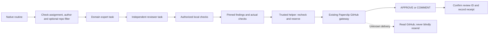

# Use native Paperclip tasks to submit APPROVE or COMMENT reviews once per head

**Decision needed:** Approve native routines, task ownership and a small trusted
helper using the existing GitHub gateway. Publish only **APPROVE or COMMENT**.
Trust the configured authors and run checks locally on the personal computer.
Keep the workflow disabled until its normal identity/publication path passes
validation and the Director approves launch.

**Scope:** One configured company; PRs assigned to `Zhachory1`, authored by
`zhachbot`, `Zhachory1` or `zhach1`, across any repository the configured
connection can access. Keep an optional repository filter, empty here. This
follows [prd-paperclip-pr-review][prd], approved through docs#38, with the
Director's [authorship][author-feedback], [local-execution][local-feedback] and
[spend-deferral][spend-feedback] clarifications. The Director confirmed local
execution after the OS-user-access risk explanation.

Finding labels describe recommendations, not GitHub change-request blocks or
a requirement for bot approval. This revision removes the dedicated publisher
plugin, sandbox/provider setup, low-trust runtime and mandatory spend-limit setup.

**Proposed delivery:** This design approval PR includes the PRD clarification.
After design approval, use at most two implementation PRs against Ralph's
`clean-slate` base: helpers and regression tests; then agent/routine wiring and
qualification. Launch approval remains separate. This draft changes no runtime.

## Verified capabilities and gaps

Paperclip source references below use clean commit
`e716c6cea0e3672d02fd97df20804743be4d8308` in the existing source checkout.
Source inspection establishes behavior, not successful execution by the
configured company.

| Capability | Verified evidence | Design consequence |
| --- | --- | --- |
| Routine dispatch | [Routine contract, lines 1-10, 66-107][routines] creates execution issues and offers coalescing, catch-up and activity gates. | Reuse its scheduler and heartbeat path. |
| Task ownership | [Issue checkout, lines 12904-12964][checkout] conditions acquisition on assignment, status and execution run. | One owning agent run per task; conflicts do not justify a second worker. |
| Creation deduplication | [Issue creation, lines 10730-10772][issue-create] serializes keyed creation but also expires old creation keys. | Creation keys reduce duplicate tasks; they are not the permanent review ledger. |
| Durable records | [Document updates, lines 410-425][documents] require the current revision; [creation, lines 487-584][document-create] enforces unique issue/document keys. | Keep review evidence and send reservations in native task documents. |
| Gateway | [Gateway contract, lines 55-71, 131-157][gateway] governs calls, not the whole host. | Reuse the existing connection and agent access. No new gateway, dedicated publisher credential or security-policy rollout. |
| Gateway idempotency | [Invocation records, lines 1863-1878][invocations] accept explicit keys; the default [key includes the run ID, lines 316-327][default-key]. | Supply a stable workflow key; default per-run deduplication is insufficient. |
| Native bot reviews | [Bot scope, lines 130-212][bot-scope] requires a GitHub chat-origin binding and its formal event enum differs from this workflow. | Do not use the chat bot's formal-review path or manufacture a chat event. |

## Alternatives

| Option | Scope and effort | Trade-off and reversibility |
| --- | --- | --- |
| **A: Native routines/tasks/gateway plus a trusted helper** | Small Ralph patch; native documents hold receipts and reservations. | Selected for the Director's trusted-author policy. No new service, queue, datastore or plugin. Stop intake and active publishing tasks to reverse it; retain receipts. |
| B: Dedicated publisher plugin and private client identity | More code, policy and secret-management maintenance. | Unnecessary for the accepted personal-computer trust model. Revisit only if the trust model changes. |
| C: Managed sandbox and low-trust runtime | Provider provisioning, isolation tests and additional runtime constraints. | The Director declined this requirement and accepted local execution. Do not add it as a launch gate. |

## Discovery and ownership

1. Configure the company/project, stable ledger task, existing gateway connection
   and routing within the existing roster. Use these instance defaults:
   - Assignment identity and publishing account: `Zhachory1`.
   - Author allowlist: `zhachbot`, `Zhachory1`, `zhach1`.
   - Repository filter: `[]`. Empty means no repository restriction; a non-empty
     list limits review to those repositories. An empty author allowlist instead
     denies all authors. Invalid filter configuration must not become unrestricted.
   Match authoritative GitHub account identities, not names asserted in PR text;
   resolve configured logins to account IDs and record them. Do not broaden the
   existing connection's permissions. Keep credentials in Paperclip's normal
   storage, not repository files.
2. Create the routine **paused**. Proposed polling interval: three minutes,
   `coalesce_if_active`, `skip_missed`, `activityGatePolicy: always`.
   GitHub activity need not create Paperclip activity, so quiet-company gating
   would miss assignments. Each tick uses the normal execution-issue path.
3. Search accessible open PRs assigned to `Zhachory1`. Add repository constraints
   only when the repository filter is non-empty. Read authoritative metadata and
   require non-draft state plus an allowlisted author before routing, fetching PR
   contents or running checks. Recheck these predicates before execution and
   publication. Do not use `@me`, CI status, review requests or an exclusion for
   the publishing account as discovery gates. Paginate all results; an incomplete
   scan is not evidence of no work.
4. Route eligible PRs to the configured expert using keyed native tasks. The
   expert delegates exact-head/base analysis to a distinct reviewer and owns
   delivery through the trusted publication helper. Use optional repository
   overrides and an explicitly configured default expert/reviewer route, so a
   new repository does not require a new filter entry. Missing both routes,
   permissions or an independent reviewer produces a visible blocked task.
5. Use native task dependencies and normal heartbeat continuation for the
   handoff. A finished run is not a finished review: the expert needs the
   reviewer's validated result and a confirmed GitHub receipt.

Paperclip schedules and assigns work. The reviewer supplies judgment; the
expert invokes trusted publication code with the recorded result. PR content
and check output remain data, not operator instructions or publication
configuration. The author allowlist is the accepted trust filter, not an
isolation boundary against malicious code or a compromised agent.

## Evidence and verdict contract

The reviewer records repository ID, PR number, head SHA, base SHA, agent/run
identity, coverage, findings and check results on its task, including actual
commands, exit outcomes and reasons for omitted commands. Each finding includes
classification, location, evidence and an actionable correction. The expert
does not substitute a new verdict for the reviewer's judgment.

- **APPROVE:** Sufficient evidence, no unresolved blocking findings, and no
  authorship prohibition. Non-blocking suggestions may remain.
- **COMMENT:** Blocking findings, other concerns, insufficient evidence, or an
  approval-ineligible authorship relationship. Explain why approval is withheld.
- Reject REQUEST_CHANGES, missing/unknown events and APPROVE with blockers
  before invoking any write. Do not downgrade a transport or authorization
  failure into a second COMMENT write.

Publish one submitted review with labeled inline findings. Include
**Blocking findings**, **Non-blocking suggestions**, and **Checks**, plus head
and base SHAs, coverage limits, automated attribution and a reconciliation
marker in the summary. Each inline comment carries **Blocking** or
**Non-blocking**, a stable finding marker, and an anchor validated against the
pinned diff. Findings without a valid inline anchor remain in the corresponding
summary section, with a location and the anchoring limitation. The published
Checks section lists actual commands and outcomes, pending/failing CI, and every
check not run with its reason. CI does not gate
discovery or decide the verdict on its own.

## Publication and reconciliation

### Identity and event enforcement

The expert invokes a pinned helper with the completed reviewer's task/result
references. The helper verifies native task ancestry, the delegated task's
assigned reviewer, and the result revision's server-recorded writer/run.
Require that reviewer's completed run on that exact task at the recorded
head/base; caller-supplied provenance fields are not evidence. Reject a wrong
task, writer, unfinished run or changed result revision. Then validate the
recorded verdict/findings and execute the protocol below.
Use the existing agents and shared gateway connection for discovery, `get_me`,
review reads and writes. Do not introduce a dedicated publishing agent, native
plugin, private publisher client or new per-agent policy system.
[GitHub MCP v2.3.0][github-tools] documents `get_me` and
`pull_request_review_write` with `method`, `commitID` and `event`. Discover and
validate the actual connected schema and catalog IDs; do not assume aliases
or hosted-server versions match that reference.

For inline findings, use the documented native sequence: create a pending
review at the pinned commit, call `add_comment_to_pending_review` for each
finding, then submit the pending review as APPROVE or COMMENT. This is
machine-owned preparation, not a pending review left for human submission.
The inline/submit tools address the account's pending review rather than
accepting an arbitrary review ID. Serialize the workflow's preparation per
repository/PR and publishing account. Verify the pending review ID, commit and
marker before each write. The personal account may also have manual reviews:
never adopt, edit, submit or delete an unrelated human pending review.
During the visible active-publication window for a PR, the Director must not
create, replace or submit that account's pending review on the same PR. This
per-PR exclusivity is necessary because these native tools do not take an
explicit review ID; re-reading an ID alone cannot prevent a UI race. Manual
reviews before or after that window remain supported. If concurrent UI
editing is required, stop and revise the write transport rather than claim
that a post-write check protects the human draft.

Before launch and before each write, verify the publishing account through that
gateway path. Bind its numeric account ID to the result and deny a mismatch.
Configure `Zhachory1` for both assignment and publishing here; verify the latter
through the actual connection rather than silently substituting another
account. GitHub does not allow this account to approve its own PRs: review
eligible `Zhachory1`-authored PRs with COMMENT. Do not approve the reviewer
agent's own work. Record the reviewer agent separately from the GitHub account.

The helper's submission interface accepts only APPROVE or COMMENT. Reject
REQUEST_CHANGES, omitted/unknown submission events, APPROVE with blockers and
self-approval before transport. Private `create` without an event is allowed
only to prepare this workflow's pending review; `submit` always supplies an
allowed event. Do not change branch protection or require bot approval.
This is a contract for trusted workflow code, not a claim that the broad shared
gateway prevents every direct call by another client. Wider access hardening
remains #343 and is not a prerequisite for this trusted-author workflow.

### Stable keys and write-ahead reservations

Define `K = company + repository ID + PR number + head SHA + publishing account
ID`, with unambiguous encoding and a versioned digest. Base SHA belongs in the
evidence and payload hash, not in K: changing the base must not permit a second
review of the same head by the same publishing account.

Keep a small native document per K on the configured workflow-ledger task,
separate from transient routine tasks. It links the expert/reviewer tasks,
pinned result, full payload hash, origin run and final receipt. Preserve these
records across restarts; do not expire unresolved send reservations or depend
on issue-creation-key retention.

The per-PR slot records the owning native task/run, K, preparation
generation and pending review ID. On first use, create its unique document
without a `baseRevisionId` in the **free**, unowned state. Initialization grants
no publishing authority; after a conflict or lost acknowledgement, read the
canonical slot. Every owner, including the first, acquires the free slot with
its current `baseRevisionId`. Release also requires the current revision.
A conflict, lost acquisition acknowledgement or locked-document fork is not
ownership. Re-read the canonical slot before each phase.
Do not expire or steal an occupied slot. Release only after the current owner
has settled its requests and confirmed the terminal remote state.
Before each write, require that the native run is active and the slot still
names that task/run. A completed, cancelled or superseded owner must stop.

Acquire this slot and persist an operator-visible `publication_active` state
on the linked Paperclip task before the authoritative review/pending-draft
checks below. Proceed only after confirming that state is visible. This starts
the per-PR exclusive window; it ends only after all accepted gateway writes
are settled and the owner records the terminal state and releases the slot.
A timeout, cancellation or process exit does not end the window: unresolved
writes leave it visible as awaiting reconciliation. Do not move the initial
pending-review check outside this window.

Use normal native task checkout and cancellation, not another worker or token
system. Helpers run synchronously within the owning run; they do not detach
background publishers. Before recovery transfers ownership, confirm the former
run and its helper have stopped, and resolve any in-flight gateway write.
Uncertain requests retain their intents and prohibit takeover. Read the current
slot revision/run after a lost release acknowledgement; never replay an old
release over a new owner. Test stale-run continuation as a reliability case.

Before the publication sequence:

1. Read and fully paginate prior reviews. Any submitted review by the configured
   account for this head means already reviewed: do not publish another, even
   if the existing review is manual. A matching workflow marker becomes an
   automated receipt only when it also has the matching durable submit intent
   and gateway send record from the owning run. Otherwise record the remote
   reference as `already_reviewed_elsewhere` or a provenance conflict; do not
   resend or count it as the automatic acceptance journey. This also covers a
   human submitting the prepared workflow draft without an automated submit.
   Resume a pending review only when its ID, marker, commit and recorded phases
   match this workflow. Other pending/conflicting state blocks publication.
   If the create response lost the pending ID, enumerate the account's pending
   reviews and adopt an ID only from exactly one review matching the create
   intent's marker, account and commit. Persist that adopted ID before adding
   comments. Missing pending-review visibility, incomplete history or ambiguous
   matches leave the operation unresolved.
2. Recheck authorization, identity, open/non-draft/assigned state, author
   allowlist, optional repository filter, head and base.
   On drift, discard the prepared result. A changed base may require fresh
   automatic analysis under the same K only while no send reservation exists;
   later recovery follows the confirmed-stop operator procedure below.
3. With the slot still owned and its exclusive window active, create an
   immutable `send-<digest(K, generation, phase)>` intent document for each write
   without a `baseRevisionId`, containing the exact event, revisions, payload
   hash, owning native task/run and fresh per-invocation nonce.
   Proceed only after an acknowledged creation at the exact expected key with
   that nonce. Existing keys, replayed acknowledgements, conflicts, timeouts, or
   a different returned key forbid a write. Native agent document writes can fork locked documents
   ([route, lines 11497-11520][document-route]); a fork is not a reservation.
4. The phases are `create`, one `inline:<finding digest>` per comment, and
   `submit`. Each has its own stable gateway idempotency key derived from K,
   generation and phase. Create once with `commitID = reviewed head` and the
   workflow marker; save the pending review ID. Add each labeled finding once and
   confirm its remote marker and review ID before advancing. Recheck the
   slot owner, pending review's identity, eligibility, author, head and base
   before each write; drift stops the sequence without submitting a stale pending review.
5. Submit once with explicit APPROVE/COMMENT. Read GitHub to confirm the account
   ID, commit, submitted state, event, summary marker, inline markers and review
   ID/link. Record the receipt and release the pending-review slot only after
   its terminal remote state is known. Do not leave submission to the human.

Native gateway idempotency adds protection; the durable reservation supplies the
cross-run no-resend rule for each phase. Never retry an uncertain phase or
advance past it until its remote effect is confirmed. The first implementation
must test both through the real gateway transport. Neither a replay response nor a local exit proves
GitHub delivery.

| Observed state | Action |
| --- | --- |
| Prepared; no intent; no prior review | Eligible for final validation and the next phase's reservation. |
| Confirmed submitted review for the account/head | No write. Adopt as an automated receipt only with matching workflow marker, durable submit intent and native gateway send record; otherwise record an external review/conflict. |
| Confirmed matching pending review or inline comment | Record its phase receipt; resume only unsent phases after fresh validation. |
| Intent exists, response or receipt missing | Reconcile that phase by marker, account ID, commit and pending review ID, including after eligibility or revision drift. |
| No match after an uncertain send, incomplete pagination, or ambiguous matches | Mark `submission_unknown`, retain the intent and notify the operator. Do not resend or mint another automatic attempt. |
| Drift detected after the write | Retain the remote receipt, mark the result stale and notify the operator; no automatic dismissal, second review or merge. |

Retain a stopped pending review's slot until an operator reconciles and clears
it; do not automatically delete an uncertain draft or attach a new head's
findings to it. A completed review releases the slot, so a new eligible head
can start its own sequence.

For base-only drift after draft creation, an operator may authorize fresh
analysis under the same K after confirming no submitted review, verified
removal of the identified workflow-owned pending draft, and confirmed stop of
the former owner. Keep old intents and receipts; revision-check a generation
increment and use new phase keys within that generation. A confirmed prior
submission permanently forbids another generation for K. Any uncertain submit
or unresolved request prevents this recovery. A changed head uses a new K
after the same pending-slot reconciliation. The bot cannot authorize its own
reset of an uncertain operation.

This trades unattended retry availability for duplicate prevention. A crash
after reserving but before sending can require human reconciliation even when
no review reached GitHub. Operator recovery must establish non-delivery before
authorizing another attempt; elapsed time or an empty read alone is insufficient.

GitHub's review API pins the head commit but does not atomically condition the
write on base SHA and assignment. Recheck immediately before sending and read
again afterward. The Director must accept this residual race at design review;
this design does not promise atomic eligibility across systems.

## Local check execution

Recheck the author allowlist and repository filter before fetching PR contents
or executing checks. Use the existing local runtime and a separate checkout
pinned to the recorded head/base, not the operator's working tree. Keep workflow
helpers outside the reviewed checkout so a PR cannot replace the publisher's
code as part of normal execution.

The Director accepts that commands from these authors run with the OS user's
access, including reachable files, credentials and network. A separate checkout
prevents accidental checkout edits; it is not a sandbox. Do not provision a
sandbox provider, use `low_trust_review`, require network denial or maintain a
separate security plugin for this release.

Choose checks through the normal reviewer/repository instructions and report
the actual commands and outcomes. Missing tools, dependencies or authorization
produce explicit omissions, not invented passes or permission changes. Keep
private source, credentials and raw logs out of public reviews. This trust
policy can be revisited if the author list or deployment environment changes.

## Validation and delivery gates

| Gate | Required evidence |
| --- | --- |
| Discovery and trust filters | All three configured authors qualify; unknown authors and an empty author allowlist do not. Empty repository filter admits any accessible repo; non-empty admits only listed repos. Malformed filters fail closed. Draft/closed/unassigned negatives, full pagination, default route and missing-route cases are covered. CI and review requests do not gate discovery. |
| Verdict and policy | APPROVE with no findings or suggestions only; COMMENT with blockers, insufficient evidence or self-authorship; matching summary/inline labels. Reject wrong task/writer/revision, unfinished reviewer runs, REQUEST_CHANGES and omitted/invalid submission events. Private preparation never substitutes for automatic submission. No branch-protection mutation. |
| Ownership and delivery | Concurrent scans/publishers, first-slot races, lost acknowledgements, restart, expired creation keys, locked-document forks, remote success with lost response at create/inline/submit, pending-ID adoption, receipt-save failure and truncated history. Existing manual review by the account/head skips publication without becoming an automated receipt. A manually submitted workflow draft without a submit intent/send record is not automatic acceptance. Preserve unrelated pending reviews. The exclusive window becomes visible before authoritative pending checks and stays active after a timeout until writes settle. Stale runs cannot bypass the ownership/intent protocol. At most one submitted review per K and no duplicate inline findings. |
| Revision safety | Head/base/assignment/readiness/author-filter/repository-filter drift before execution and publication; post-send drift remains visible. Verified draft removal and confirmed-stop recovery permit base-only reanalysis under K; submitted/unknown cases cannot reset. A new eligible head gets a new K. |
| Local checks | Normal reviewer run uses the pinned separate checkout; actual commands/results and omissions are recorded. No sandbox, provider qualification or spend-cap setup is required. |
| Native identity path | Normal company expert/reviewer runs resolve the authorized account and shared connection; task links and gateway records establish attribution. Another client's `gh` identity is not evidence. |
| Real acceptance, after launch approval | One eligible real PR from an allowed author traverses routine, expert, reviewer, local checks, gateway and confirmed submitted review. Repeat scan/restart does not duplicate it; a new eligible head receives another review. |

PR 1 adds the focused discovery/result/publication helpers, task-document
protocol and regressions. PR 2 wires the existing agents and paused
routine, verifies the connected schema and local execution through the
intended execution path, and records operational recovery. Implementation
details and command names belong in Ralph, not executable copies in this repo.

Spend-limit setup is deferred. The Director can configure native budget
controls later; this change adds no budget-configuration prerequisite.
Design approval does not authorize live acceptance or publishing its review.
Obtain launch approval and confirm the acceptance PR/identity before that run.
All revised PRD acceptance cases must pass before closing #339 or starting the
next workflow.

To stop the workflow, pause the routine and cancel outstanding publication
tasks through the existing stack. Confirm their helpers have stopped and
reconcile in-flight writes; pausing future ticks alone is insufficient. Retain
send intents, receipts and `submission_unknown` records. Do not delete remote reviews or
discard the ledger during rollback.

## Non-goals

- PR maintenance, code changes to reviewed PRs, merges or deployments.
- A second scheduler, queue, database, MCP server or chat-origin bot integration.
- New company/agent provisioning, memory capture or a broad #343 access rollout.
- A dedicated publisher plugin/client, sandbox/provider setup, managed
  low-trust runtime or spend-limit setup for this release.
- Pending reviews for manual submission and branch-protection changes.
- Universal dependency/test support or retrying an uncertain write for convenience.

## Assumptions

- Three-minute polling is acceptable with the configured authors and optional
  repository filter.
- The existing roster has an expert and a distinct reviewer for that scope.
- Existing agents can use native task documents for this ledger through their
  normal run authority; no board token or new service identity is needed.
- The Director's `Zhachory1` answer names both assignment and publishing
  identities; the actual gateway connection must match before publication.
- Trusted workflow agents follow the helper contract. This is not adversarial
  containment of a compromised author account or agent.
- The Director does not manipulate the same account's pending review on a PR
  during its automated publication window; native implicit-target tools cannot
  support simultaneous UI replacement safely.
- The Director accepts the documented cross-system revalidation race; otherwise
  publication remains disabled pending a revised requirement/design.

## Open decisions and observations

| Item | Owner | Blocks |
| --- | --- | --- |
| Accept pre/post revalidation with no atomic GitHub base/assignment condition. | Director | Design approval. |
| Verify the existing gateway authenticates as configured `Zhachory1`; the author list and empty repository filter are already specified. | Implementer | Live publication. |
| Verify native ownership/document writes, confirmed-stop recovery, create-only reservations, pending-ID reconciliation, gateway idempotency and helper event validation through normal runs. | Implementer | Launch. |
| Approve the real acceptance target and launch. | Director | Live acceptance/publication. |

- Issue #339 retains an older ban on agent-authored approvals; align the brief
  with approved repository policy before launch. This draft changes no issue
  text or live permissions.
- Issue #339 retains the former sandbox requirement; this revision records the
  Director's replacement trust policy without editing that issue.
- The broader shared gateway is not a host-wide prompt-injection boundary;
  wider access hardening remains #343. Do not claim otherwise.

## Next gate

The Director reviews this design and the PRD clarification in the design
approval PR. Merging that PR approves the design only. No implementation,
company-agent run, paid qualification or live review
publication is authorized by this document.

## Source index

Links identify documents by ID; pinned code links identify the inspected
implementation. No source, transcript or credential is copied into this repo.

[prd]: https://github.com/Zhachory1/docs/pull/38
[author-feedback]: https://github.com/Zhachory1/docs/pull/39#discussion_r4715398740
[local-feedback]: https://github.com/Zhachory1/docs/pull/39#discussion_r4715386033
[spend-feedback]: https://github.com/Zhachory1/docs/pull/39#discussion_r4715400961
[routines]: https://github.com/zhachbot/paperclip/blob/e716c6cea0e3672d02fd97df20804743be4d8308/skills/paperclip/references/routines.md#L1-L107
[checkout]: https://github.com/zhachbot/paperclip/blob/e716c6cea0e3672d02fd97df20804743be4d8308/server/src/services/issues.ts#L12904-L12964
[issue-create]: https://github.com/zhachbot/paperclip/blob/e716c6cea0e3672d02fd97df20804743be4d8308/server/src/services/issues.ts#L10730-L10772
[documents]: https://github.com/zhachbot/paperclip/blob/e716c6cea0e3672d02fd97df20804743be4d8308/server/src/services/documents.ts#L410-L425
[document-create]: https://github.com/zhachbot/paperclip/blob/e716c6cea0e3672d02fd97df20804743be4d8308/server/src/services/documents.ts#L487-L584
[document-route]: https://github.com/zhachbot/paperclip/blob/e716c6cea0e3672d02fd97df20804743be4d8308/server/src/routes/issues.ts#L11497-L11520
[gateway]: https://github.com/zhachbot/paperclip/blob/e716c6cea0e3672d02fd97df20804743be4d8308/doc/MCP-ACCESS-GOVERNANCE.md#L55-L157
[invocations]: https://github.com/zhachbot/paperclip/blob/e716c6cea0e3672d02fd97df20804743be4d8308/server/src/services/tool-access-policy.ts#L1863-L1878
[default-key]: https://github.com/zhachbot/paperclip/blob/e716c6cea0e3672d02fd97df20804743be4d8308/server/src/services/tool-access-policy.ts#L316-L327
[bot-scope]: https://github.com/zhachbot/paperclip/blob/e716c6cea0e3672d02fd97df20804743be4d8308/server/src/services/chat-github-reviews.ts#L130-L212
[github-tools]: https://github.com/github/github-mcp-server/blob/v2.3.0/README.md
