# Paperclip submits one automated review for each eligible PR head

**Decision needed:** Approve automatic COMMENT reviews for open, non-draft PRs
assigned to the Director's configured GitHub identity. The first release covers
one configured Paperclip company and an explicit repository scope. It does not
approve or merge PRs.

This proposal needs one PRD PR, followed by a separate design PR after PRD
approval. No workflow has been enabled as part of this draft.

## Problem and outcome

The Director should not need to request each review, wait for green CI, or
submit an agent's pending review by hand. Paperclip should discover eligible
PRs, route them through the relevant expert and reviewer, and submit a review
that identifies its exact code revision and actual checks.

The infrastructure delivery in
[prd-paperclip-infrastructure](https://github.com/Zhachory1/docs/pull/36)
provides the foundation. It does not demonstrate the review outcome required
by [#339](https://github.com/Zhachory1/ralph/issues/339).

## Release boundary and alternatives

The first release submits COMMENT reviews with findings or an explicit
no-findings result. That meets the automatic-review outcome without choosing
an approval policy for agent-authored work. The existing repository policy
still governs other workflows; this release does not impose a global approval
ban or change the human merge gate.

Manual pending-review staging would leave the Director responsible for
submission and would not meet this outcome. Automated APPROVE and
REQUEST_CHANGES events can follow under a separate approved scope; neither is
needed to prove this first review workflow.

Prefer the verified Paperclip platform, native routines, task ownership and
gateway. The design must verify their fit before proposing another scheduler,
queue, datastore or MCP server.

## Requirements

1. **Discover eligible PRs.** Find open PRs assigned to the configured Director
   identity with `isDraft = false`. A separate review request and green CI are
   not prerequisites. Do not assume the scanner's authenticated `@me` is the
   Director.
2. **Use the normal agent path.** A Paperclip trigger routes the PR to its
   relevant domain expert. The expert delegates review of the identified head
   and base to its reviewer. A manually posted review does not qualify as
   acceptance evidence.
3. **Pin the evidence.** Record repository, PR, head SHA, base SHA, reviewer
   identity, findings, and checks. Treat PR descriptions, comments, files and
   test output as untrusted input.
4. **Contain execution.** Run authorized PR checks in an ephemeral,
   network-isolated sandbox without host credentials, host home/repository
   mounts, or the host Docker socket. Do not execute PR scripts on the host.
   Report unavailable checks and their reasons; do not enable network access
   or claim success to get past a failed sandbox check.
5. **Revalidate before publishing.** Recheck open state, assignment, readiness,
   head, base and prior reviews before submission. Invalidate prepared results
   if their head or base changed. Submit against the identified head.
6. **Publish with explicit attribution.** Use an authorized reviewer identity
   and identify the review as automated. Do not impersonate a human or turn
   automated findings into a human approval. This release submits COMMENT
   events only and never merges.
7. **Deduplicate and reconcile.** Submit at most one review per repository,
   PR, head and reviewer identity across repeated scans and restarts. Review a
   new eligible head again. If submission is uncertain, read GitHub state
   before retrying; a successful local process exit is not proof of delivery.
8. **Keep an operator-visible record.** Record the trigger, expert/reviewer
   handoff, reviewed revisions, actual checks, GitHub review ID/link, and
   terminal or blocked state in Paperclip. Keep private code, credentials and
   raw transcripts out of public documentation.
9. **Respect launch and task limits.** Obtain Director launch approval and
   agreed task spend/attempt limits before paid live acceptance. Do not impose
   a monthly cap. Keep the workflow disabled until its boundaries and identity
   have passed validation.

```mermaid
flowchart LR
    PR["Open, assigned, non-draft PR"] --> Trigger["Paperclip trigger"]
    Trigger --> Expert["Relevant domain expert"]
    Expert --> Reviewer["Independent reviewer"]
    Reviewer --> Sandbox["Isolated authorized checks"]
    Sandbox --> Recheck["Recheck eligibility, head and base"]
    Recheck --> Review["Submitted COMMENT review"]
    Review --> Record["Paperclip result and GitHub review link"]
```

The Director approves the workflow at launch rather than submitting each
review. The expert owns review delivery; the operator can trace its evidence
through Paperclip and the submitted GitHub review.

## Success and acceptance

The baseline for this issue is no verified v4 automatic submitted-review
journey. Native gateway availability and a configured roster do not count.

| Acceptance | Required evidence |
| --- | --- |
| One eligible real PR receives a submitted COMMENT review | Normal Paperclip trigger and expert/reviewer records, plus the GitHub review ID and reviewer identity |
| No review of draft, closed or unassigned PRs | Controlled negative cases and a final eligibility check before submission |
| CI does not gate discovery | An eligible PR with failing or pending CI reaches review; the report identifies its check state |
| Repeated scans/restart do not duplicate a review | Same repository/PR/head/reviewer produces one GitHub review; a new eligible head produces a new review |
| Changes before submission invalidate stale results | Head/base drift and eligibility-change cases stop stale publication |
| Delivery uncertainty does not cause a duplicate | Reconciliation finds the committed review or leaves an explicit unresolved state without blind resubmission |
| The sandbox enforces the boundary | Evidence of network denial, no host credentials or Docker socket, and cleanup of the ephemeral test environment |
| The review describes what ran | Reviewed head/base, actual commands/results, and checks not run with reasons |
| Launch remains a human gate | Recorded Director approval before enabling the live workflow |

All listed acceptance cases must pass before closing #339 or moving to PR
maintenance in #340. Do not replace the real trigger/agent/submission journey
with a fixture, CLI-only manual review, or a successful process exit.

## Non-goals

- PR maintenance, code changes to reviewed PRs, feature delivery, or merges.
- Automatic approval or changes-requested review events in the first release.
- New company/agent provisioning, a broader expert-team rollout, or memory
  backend selection.
- A new gateway, general workflow engine, or independent queue/scheduler.
- Universal test-environment support. Unknown or unavailable checks stay
  visible in the review instead of weakening isolation.
- Broad access-policy changes deferred to #343.

## Risks and design questions

- **Reviewer identity:** The Director must authorize the actual publishing
  identity and repository scope before launch. The design must prove the
  intended gateway/runtime path uses that identity; another client's identity
  or a tool catalog is insufficient.
- **Sandbox capability:** Native Paperclip documentation describes routines
  and low-trust containment, but scheduling alone does not enforce test
  isolation. The design must verify an available provider's network, filesystem
  and credential boundaries before relying on it.
- **Uncertain writes:** GitHub submission and Paperclip bookkeeping can fail at
  different points. The design must reconcile a remote commit without treating
  an unknown result as permission to submit again.
- **Historical references:** Retained architecture text describes
  `review-requested:@me` and manual pending-review submission. Those paths do
  not satisfy this issue's assignment-based, submitted-review outcome.

## Assumptions

- COMMENT reviews satisfy the initial automatic-review outcome; approval
  events are not required for this first release.
- The Director will identify the initial repository scope and authorize the
  reviewer identity before launch, without sharing credentials in documents.
- The workflow will use an existing configured company and roster.
- The GitHub issue is the work brief; no separate execution card exists yet.

## Sources

- [Issue #339](https://github.com/Zhachory1/ralph/issues/339) and
  [roadmap #337](https://github.com/Zhachory1/ralph/issues/337).
- [Infrastructure closeout #338](https://github.com/Zhachory1/ralph/issues/338)
  and [dd-paperclip-infrastructure](https://github.com/Zhachory1/docs/pull/37).
- Ralph at `35d36cf`:
  [current workflow status, lines 1-6](https://github.com/Zhachory1/ralph/blob/35d36cf4372ccaa00a7cf0c0816d4e6254721abb/docs/workflows.md#L1-L6)
  and [platform boundary, lines 15-38](https://github.com/Zhachory1/ralph/blob/35d36cf4372ccaa00a7cf0c0816d4e6254721abb/compose/PAPERCLIP.md#L15-L38).
- Paperclip `v2026.1117.0`:
  [native routines](https://github.com/paperclipai/paperclip/blob/v2026.1117.0/skills/paperclip/references/routines.md),
  [low-trust containment](https://github.com/paperclipai/paperclip/blob/v2026.1117.0/doc/LOW-TRUST-PRESETS.md),
  and [untrusted-review security limits](https://github.com/paperclipai/paperclip/blob/v2026.1117.0/doc/UNTRUSTED-PR-REVIEW.md).

## Next gate

The Director approves this PRD by merging its approval PR. Then prepare the
technical design against verified native capabilities. Design approval precedes
implementation; launch approval precedes enabling the workflow or publishing
its real acceptance review.
