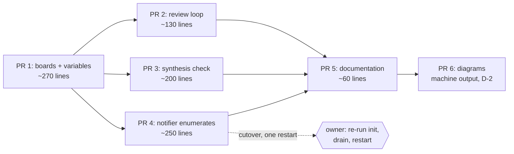

# The board split ships in six pull requests — the variables, the loop, the synthesis check, the notifier, the words, the pictures

> **This repository is public.** No employer, person, space, message content or
> private repository appears here. The two deployments are "the work instance"
> and "the personal instance". The PRD's banner applies unchanged.

Status: **draft**. This document turns `dd-ralph-board-split` into the pull
requests a builder opens, in build order. Nothing is built. No board was
created and no card was moved.

**Grounding.** Every path and line number below is read from a fresh clone of
`Zhachory1/ralph` at `8e0ea5f` (`main`, merge of #174) — the same commit the
design cites, confirmed unmoved. I read the code, and I ran the existing eval
files named below to see which of them pass today. Two of those runs found
things a builder needs before it starts; they are in the test plans of PR 1 and
PR 4, and in **Observations**.

**The design is not merged.** `Zhachory1/docs#30` is open at head `87264b4`,
which is the copy this plan is written against. The design gate card completed
citing the PRD's pull request (#27) rather than #30, so the gate opened early.
See **D-1**: nothing here is wrong because of it, but your merge of #30 is
still what makes this plan's source authoritative.

---

## Review header

### Decisions needed from you: four

| # | Decision | Why it is yours | Default if you say nothing |
|---|---|---|---|
| **D-1** | **The design's own three decisions are taken at their defaults.** `dd-ralph-board-split` D1 (the librarian's weekly card stays on `queues`), D2 (the notifier enumerates every board, including `ralph-evals` and `default` on the personal instance), D3 (cut over with a short drain). This plan builds all three as written. | They are the design's decisions, still open because #30 is unmerged. | **Take the defaults.** Answering D1 the other way moves two lines in PR 2 (`run-review-loop:148,153` use `$MAINTAIN_BOARD` instead of `$QUEUES_BOARD`) and flips one existing assertion (`evals/test_run_review_loop.py:276`). Answering D2 the other way changes PR 4's shape completely and contradicts PRD R16. D3 is a runbook step, not code: see **Cutover**. |
| **D-2** | **The diagram pull request (PR 6) cannot meet the 400-line scope cap, and needs your `scope-approved` label.** `docs/diagrams/system.svg` is 895 lines and `system-flow.svg` is 575, and every node in them carries absolute coordinates. Adding two board cylinders re-lays out both graphs, so the regenerated files rewrite most of their own lines: roughly 2,900 changed lines, none of them written by a person. The `.png` files count as zero (see **Observations**, O-2). | The override is a label with your name on it (`bootstrap/scope-check:181-183`). An agent applying it to its own pull request would make the cap optional. | **Keep PR 6 separate and label it.** The `.dot` edits are twelve reviewable lines; the rest is Graphviz output. The alternative, dropping regeneration, is refused by design §9 ("a stale architecture diagram is worse than none"). |
| **D-3** | **PR 1 adds a `boards` CI workflow (~35 lines).** No workflow runs `evals/test_run_review_loop.py`, `evals/test_profile_config.py` or `notifier/test_approvals.py` today, so every test this plan adds would run only when someone remembers to. The chat plan and the tracker plan both answered this the same way, in their own first pull request (`.github/workflows/chat.yml:5-8`, `tracker.yml:3-6`). | A new workflow runs on every pull request to the repository and is a `SENSITIVE` path to `scope-check`. It is also minutes of runner time per pull request. | **Add it.** It is the third time this has come up, which is the repository's own trigger for automating it (`STANDARDS.md`, "automate a task the third time"). If you would rather not, drop the file from PR 1's planned list; nothing else changes, and the test plans then say "run by hand". |
| **D-4** | **The notifier pull request (PR 4) is the one that could cross the cap**, at an estimated ~250 changed lines against 400. If the builder's diff comes out larger, the split line is the archived-board filter (design §5, "Archived boards"): a refinement whose absence costs one wasted poll per archived board. | Splitting an approved design's section into two pull requests is a shape change. | **Let the builder split there if it must**, and say so in both pull requests. Do not split the enumeration from the per-board state files: a sorted list with the old first-board state exception is exactly the bug design §5 exists to prevent. |

### Council dissent

**None ran.** No council or lens critique was invoked for this document. The
card's finishing sequence is one agent reviewer, then your gate.

### Scope rating

**M — six build pull requests, about 890 changed lines**, plus PR 6's
regenerated diagrams, which are machine output and sized separately (**D-2**).
The largest reviewable pull request is PR 4 at ~250 lines. The design predicted
five pull requests and about fifteen files; this is six, because the diagrams
are separated from the prose for the cap reason in **D-2**.

### What changed since the last revision

v1. Nothing yet.

---

## How these pull requests are opened and reviewed

All six land in `Zhachory1/ralph`, against `main` at `8e0ea5f` or later.

- **Opened by `ralph-builder`.** Branch `agent/<card-id>-<short-slug>`, opened
  as a draft and marked ready when checks pass. Commit trailers `Kanban-Card:`
  and `Design-Doc:`, spelled exactly. The card's `<planned_files>` block copied
  into the commit message unchanged, because CI cannot read the board
  (`bootstrap/scope-check:90-105`). Label `agent-authored`.
- **Reviewed by `ralph-reviewer` and the review loop, with `zhachbot` as
  assignee and reviewer.** Not a formality: `bootstrap/discover-reviews`
  searches for pull requests assigned to the review account, so one that is not
  assigned to `zhachbot` is never discovered and never reviewed.
- **The builder cannot merge.** You do. That gate is unchanged by this work.

**What CI enforces.** `.github/workflows/scope-check.yml` runs
`bootstrap/scope-check` on every `agent-authored` pull request. It fails on any
changed path outside the `<planned_files>` block, and on more than 400
added-plus-removed lines (`bootstrap/scope-check:44`). Sizes below are added
plus removed, measured against that cap. A file the work genuinely needs and
the list does not hold is a scope escalation before the edit, not an edit to
the list afterwards.

**One shared file, named up front.** `compose/docker-compose.yml` is touched by
PR 1 (three services gain board variables) and again by PR 4 (the notifier
service loses `RALPH_REVIEW_BOARD`). They cannot be one pull request without
also merging their code, and PR 4's deletion is unsafe before PR 4's script
lands. PR 4 rebases on PR 1 and touches a different line.

---

## PR 1: every board exists, and everything that needs a board name is told it

- **Goal:** a fresh or existing instance ends up with four boards, and every
  container and profile holds the variables the later pull requests read.
- **Implements:** design §6 and §2. It also carries the variable half of §4
  (the `hermes` service and the synthesis profile's `.env`), so no later pull
  request has to touch `install` or `compose` for plumbing.
- **Depends on:** nothing. It is inert: no script reads the new variables yet,
  and two new empty boards change no behaviour.
- **Size:** ~270 changed lines, ~150 of them a new test file.

**What:**

1. **`bootstrap/install`.**
   - Add `ensure_board()` exactly as design §6 writes it, above `:329`
     (`hermes kanban init`). It takes slug, display name and description, keeps
     the existing `grep -qE "^[● ]+$1\b"` existence test, and keeps both echo
     lines so the install log reads the same.
   - Replace the two inline blocks (`:330-338` for `$BOARD`, `:348-356` for
     `$QUEUES_BOARD`) with four `ensure_board` calls, using design §6's table of
     slugs, display names and descriptions. `LENS_BOARD` and `MAINTAIN_BOARD`
     are read beside `QUEUES_BOARD` at `:348`, in the same
     `${RALPH_*:-default}` form.
   - **An existing board is never renamed.** The existence check skips it, and
     that is what preserves the **Intake** display name you set by hand
     (PRD R3, R14). The `--name` and `--description` apply to a fresh instance
     only.
   - Fix the stale comment at `:339-347`, which says the notifier polls
     `RALPH_BOARD` only (PRD R18). It has polled more since #145, and after
     PR 4 it polls everything.
   - Write `RALPH_LENS_BOARD=<value>` into the synthesis profile's `.env`
     (design §4, its assumption A2), following the read-token block at
     `:477-500`: `docker exec -u hermes`, `grep -v "^RALPH_LENS_BOARD="` into a
     temp file, append, `chmod 600`, `mv`. **Place it after both token blocks**,
     and strip only its own key, so it cannot drop the `GH_TOKEN` those blocks
     just wrote.
2. **`compose/docker-compose.yml`**, environment keys only:
   - `init` (`:77`) gains `RALPH_LENS_BOARD`, `RALPH_MAINTAIN_BOARD` and
     `RALPH_QUEUES_BOARD`, so `install` creates the boards the loop will use.
   - `review-loop` (`:248-281`) gains the same three. It is passed **no** board
     variable at all today (the design's observation O2).
   - `hermes` (`:102`) gains `RALPH_LENS_BOARD`, for PR 3.
   - The `notifier` service is **not** touched here. Removing
     `RALPH_REVIEW_BOARD` while `run-notifier:11` still reads it would silence
     every gate on `queues` until PR 4 merges.
3. **`compose/.env.example`**: all four board variables with their defaults,
   beside `RALPH_BOARD` at `:157` (PRD R15), each with one line of comment
   saying which workflow it routes.
4. **`evals/test_board_wiring.py`** (new): the install and compose assertions
   below.
5. **`.github/workflows/boards.yml`** (new, **D-3**): runs the eval files this
   feature touches, on pull requests that touch `bootstrap/install`,
   `bootstrap/run-review-loop`, `bootstrap/run-notifier`,
   `bootstrap/lens-tools`, `compose/docker-compose.yml`, `compose/.env.example`,
   `evals/test_board_*`, `evals/test_lens_tools.py`,
   `evals/test_run_review_loop.py`, `evals/test_profile_config.py` or
   `notifier/test_approvals.py`. Use `tracker.yml`'s glob-over-existing-files
   shape, so the workflow is correct from this pull request through the ones
   that add new eval files, with no edit here. It needs `pip install pyyaml`
   before `evals/test_profile_config.py` and `evals/test_board_wiring.py`: both
   parse YAML, and a bare runner has no `yaml` module (verified — see the test
   plan).

**Planned files:**
<planned_files>
- bootstrap/install
- compose/docker-compose.yml
- compose/.env.example
- evals/test_board_wiring.py
- .github/workflows/boards.yml
</planned_files>

- **Test plan:**
  - **`ensure_board`, behaviour and not text.** The test extracts the function
    from `bootstrap/install` (`sed -n '/^ensure_board() {/,/^}/p'`), sources it
    in `bash` with a stub `hermes` on `PATH`, and asserts: an absent board is
    created once with its `--name` and `--description`; a present board is not
    created and prints "already exists"; a second run creates nothing and exits
    0; a board whose display name differs from the table is **not** renamed
    (PRD R3, R14 — the reason **Intake** survives). Extracting rather than
    running `install` is deliberate: `install` does far more than this and
    cannot run inside a test.
  - **All four boards are asked for.** Assert `bootstrap/install` calls
    `ensure_board` with each of the four slug variables, and that no
    `hermes kanban boards create` call survives outside the function.
  - **Compose, parsed as data** (the shape `evals/test_chat_sender_compose.py`
    already uses): `init` and `review-loop` each carry all three new keys;
    `hermes` carries `RALPH_LENS_BOARD`; `notifier` still carries
    `RALPH_REVIEW_BOARD` at this commit — that last assertion is PR 4's to
    flip, and it is what fails if PR 4 forgets the deletion.
  - **`.env.example`** holds all four board variables with the design's
    defaults.
  - Run: `python3 evals/test_board_wiring.py`, plus the workflow on the pull
    request itself.
  - **Verified while planning, so the builder does not rediscover it:**
    `evals/test_profile_config.py` fails with 31 errors on a machine without
    PyYAML (`ModuleNotFoundError: No module named 'yaml'`). That is an
    environment gap, not a repository bug, and it is why **D-3**'s workflow
    installs PyYAML.

---

## PR 2: the review loop names three boards

- **Goal:** discovery, publishing and maintenance each run against the board
  their workflow owns, instead of one `$BOARD` shared by all three.
- **Implements:** design §3, and the per-script default half of §2.
- **Depends on:** PR 1, for the boards to exist (design assumption A6: a board
  that does not exist is not created implicitly) and for `review-loop` to
  receive the variables. Merging this first would route cards at boards that
  are not there.
- **Size:** ~130 changed lines.

**What:**

1. **`bootstrap/run-review-loop`**: replace
   `BOARD=${RALPH_REVIEW_BOARD:-queues}` at `:14` with the three reads design
   §3 writes (`LENS_BOARD`, `MAINTAIN_BOARD`, `QUEUES_BOARD`), then change each
   call site per the design's table: `:62` and `:73` (publish) and `:82`
   (discover) to `$LENS_BOARD`; `:99` (maintain) to `$MAINTAIN_BOARD`; `:148`
   and `:153` (the librarian's weekly card) to `$QUEUES_BOARD`. The startup
   line at `:56` prints all three, so a misconfigured container says so in its
   first log line. Add the one-line warning when `RALPH_REVIEW_BOARD` is still
   set, then ignore it (design §1).
2. **The four Python scripts' own defaults**, which exist for a human running
   them by hand — the loop always passes `--board`:
   `discover-reviews:371` → `lenses`; `build-review-graph:111` → `lenses`;
   `publish-review:227` → `lenses`; `maintain-pr:326` → `maintain`. Each
   script's usage example names the old board and changes with it:
   `build-review-graph:12`, `publish-review:14`, `maintain-pr:13`.
3. **`evals/test_run_review_loop.py`**: a new board-routing test class beside
   the existing ones, built on `LibrarianCardTests`' stub harness (`:214-268`)
   — stub `docker`, `python3`, `gh` and `sleep` on `PATH`, record the calls,
   read them back.

**Planned files:**
<planned_files>
- bootstrap/run-review-loop
- bootstrap/discover-reviews
- bootstrap/build-review-graph
- bootstrap/publish-review
- bootstrap/maintain-pr
- evals/test_run_review_loop.py
</planned_files>

- **Test plan:**
  - New: `publish-review` and `discover-reviews` are called with
    `--board lenses`; `maintain-pr` with `--board maintain`; the done-synthesis
    listing reads `lenses`; with `RALPH_LENS_BOARD=x` and
    `RALPH_MAINTAIN_BOARD=y` set, those values are used instead (PRD acceptance
    11, per-instance names).
  - New: a set `RALPH_REVIEW_BOARD` prints the warning and changes no board —
    the failure design §1 names, where a leftover `.env` line cancels the split
    silently.
  - New: publishing and discovery read the **same** variable. Assert on the one
    value, not on two equal literals, so a later edit that splits them fails
    here (design §3: two different values would review the same head twice and
    post nothing).
  - Unchanged and expected to keep passing: `:276` (`--board queues` for the
    librarian card). Under **D-1** it is correct as written, and it is the test
    that fails first if the librarian card ever moves.
  - Run: `python3 evals/test_run_review_loop.py`. **It is slow.** Each case
    spawns `bash` against the real script with a 30-second ceiling, and the
    file did not finish inside 180 seconds in my sandbox. Give the CI step
    room, and run it alone while iterating.
  - Not covered by any unit test, per design §10: that the live loop reaches
    the right board. That is PRD acceptance examples 2, 3 and 5, run by hand at
    cutover.

---

## PR 3: the synthesis safety check follows the board

- **Goal:** `lens-tools` grants parent handoffs on the configured lens board
  and refuses every other board, without becoming "any board".
- **Implements:** design §4.
- **Depends on:** PR 1 (the `hermes` service and the synthesis profile's `.env`
  carry `RALPH_LENS_BOARD`). Independent of PR 2 in code; see **Cutover** for
  why neither may be deployed without the other.
- **Size:** ~200 changed lines, ~140 of them a new test file.

**What:**

1. **`bootstrap/lens-tools`**: inside `parent_handoffs()` (`:430-431`) only,
   replace the `!= "queues"` literal with the three-step resolution of design
   §4 — `LENS_EXPECTED_BOARD`, then `RALPH_LENS_BOARD` from the environment,
   then the constant `lenses`. A value that is set but is not a valid slug
   **fails the call** rather than falling through, so junk cannot be a route to
   the default. Validate it with the existing `BOARD_RE` at `:133`; do not add
   a second pattern. Update the stale `queues` mention in the file header at
   `:6`.
2. **Not in `LENS_ALIASES`** (`:118-126`). Every name there is required for
   every lens tool call, and the four lens profiles never call
   `parent_handoffs()`; a missing value would break them for nothing. The test
   below pins that.
3. **`profiles/review-synthesis/config.yaml`**: add
   `LENS_EXPECTED_BOARD: "${RALPH_LENS_BOARD:-lenses}"` to the `env:` block
   (`:31-40`), in the same form as `LENS_TOOLS_PYTHON` at `:40`. Fix the stale
   `queues` wording in the comment at `:44`.
4. **`evals/test_lens_tools.py`** (new). No eval covers `parent_handoffs()`
   today.
5. **`evals/test_profile_config.py`**: the synthesis profile declares
   `LENS_EXPECTED_BOARD`.

**Planned files:**
<planned_files>
- bootstrap/lens-tools
- profiles/review-synthesis/config.yaml
- evals/test_lens_tools.py
- evals/test_profile_config.py
</planned_files>

- **Test plan:**
  - New, in `evals/test_lens_tools.py`: synthesis on the expected board is
    allowed; synthesis on any other board is refused (PRD acceptance 4, which
    names `ralph` and `maintain`); a non-synthesis profile on the expected
    board is still refused; `LENS_EXPECTED_BOARD` wins over `RALPH_LENS_BOARD`,
    which wins over the constant; an invalid value in either variable is
    refused and does **not** fall through to the default; with no source set at
    all, `lenses` is expected and the call fails loudly on anything else
    (design §4, "it fails closed").
  - New: `LENS_EXPECTED_BOARD` is absent from `LENS_ALIASES`, so a lens profile
    that never sets it is unaffected.
  - New, in `evals/test_profile_config.py`: the synthesis profile's `env:`
    block carries `LENS_EXPECTED_BOARD` with the `${RALPH_LENS_BOARD:-lenses}`
    default.
  - Run: `python3 evals/test_lens_tools.py` and
    `python3 evals/test_profile_config.py` (needs PyYAML).
  - **Confirm and record in the pull request body, per design §4's assumption
    A2:** whether Hermes expands `${RALPH_LENS_BOARD}` in a profile `env:`
    block from the container's environment or from the profile's own `.env`.
    The design writes both paths deliberately, so neither answer changes the
    code; the pull request is where the answer stops being unknown
    (`AGENTS.md`, "verify before you build on it").

---

## PR 4: the notifier stops being told which boards exist

- **Goal:** the notifier polls every board the instance has, so adding a board
  can never silently hide a gate.
- **Implements:** design §5, and the notifier line of §6.
- **Depends on:** PR 1 (the boards exist to be enumerated). Independent of PR 2
  and PR 3.
- **Size:** ~250 changed lines, most of it tests. The one to watch — **D-4**.

**What:**

1. **`bootstrap/run-notifier`**: replace the two-variable `BOARDS` at `:11`
   with an enumeration through `hermes kanban boards list --json`, the way
   `cleanup-sandboxes:59-68` already does it, slugs sorted. Guard the command
   substitution: `run-notifier` runs under `set -euo pipefail` (`:7`), so an
   unguarded failure kills the container. On failure, use the cached list at
   `/var/lib/ralph/notifier-boards.json` (the existing `notifier-state`
   volume); with no cache, log one line and skip the pass, writing and pruning
   **nothing**, so nothing is announced twice afterwards. Skip archived boards
   if `boards list --json` exposes that flag.
2. **Per-board state, with no first-board exception**: every board gets
   `${STATE%.json}-<slug>.json` and `${DIGEST_STAMP}-<slug>`, replacing the
   `state=$STATE` and `stamp=$DIGEST_STAMP` carry-over at `:22-24, 38, 46-48,
   58`. Add the one-time startup rename: if the bare file exists and the
   per-board file for `${RALPH_BOARD:-ralph}` does not, move it. The `queues`
   file already carries its slug and needs nothing. `RALPH_BOARD` is read for
   that one purpose only.
3. Warn once and ignore if `RALPH_REVIEW_BOARD` is still set (design §1).
4. **`compose/docker-compose.yml`**: delete `RALPH_REVIEW_BOARD` from the
   `notifier` service (`:220`). One line; the only compose change here.
5. **`notifier/test_approvals.py`**: extend `BoardsTests` (`:630-671`).

**Planned files:**
<planned_files>
- bootstrap/run-notifier
- compose/docker-compose.yml
- notifier/test_approvals.py
</planned_files>

- **Test plan:**
  - **Read this first.** The existing `BoardsTests` harness stops the loop with
    a `sleep` stub that runs `kill $PPID`. I ran the file: all three of those
    tests fail in my sandbox with `subprocess.TimeoutExpired` after 30 seconds
    each, and a minimal reproduction confirms the stub does not stop a
    `while true` loop there. The other 74 tests in the file pass. Whether this
    is specific to my container is unverified. **The builder confirms the
    harness exits on its own machine before extending it.** If it does not, the
    fix belongs in this pull request — every test below depends on it — and the
    honest shape is a stub that writes a sentinel the loop reads, rather than
    one that relies on signal delivery.
  - New, with a stubbed `docker` returning four boards (the harness stubs
    `python3` and `sleep` today and must now stub `docker` too): each board is
    polled exactly once by each of `approvals.py`, `poller.py` and `digest.py`
    (PRD acceptance 6); each board announces from its own state file and its
    own digest stamp (acceptance 7); the bare state file is renamed once, and a
    second pass renames nothing and announces nothing twice; an enumeration
    failure with no cache polls nothing and writes nothing; a cached list is
    used when enumeration fails; the list is sorted, so two runs agree.
  - Flip the compose assertion PR 1 left: the `notifier` service no longer
    carries `RALPH_REVIEW_BOARD`.
  - Run: `python3 notifier/test_approvals.py` (~90 seconds today).
  - Unchanged, by PRD R13: `notifier/approvals.py` keeps its `--board` argument
    and gains no board-specific behaviour. Its existing tests are the proof and
    are not edited.

---

## PR 5: the documentation stops saying there are two boards

- **Goal:** every as-built statement about how many boards there are, and which
  one holds what, matches the shipped system.
- **Implements:** design §9, its prose rows, and PRD R17, R18.
- **Depends on:** PR 2, PR 3 and PR 4. Documentation that describes behaviour
  which has not merged is the same defect in the other direction.
- **Size:** ~60 changed lines.

**What:**

1. **`profiles/PRINCIPLES.md:11`** — "Board `queues` holds machine-created
   work" becomes the four-board sentence. This file is prepended to every
   profile's instructions (`bootstrap/install:377, 389, 408`), so a stale copy
   files cards on the wrong board **by instruction**. It reaches the profiles
   only when `install` next runs: see **Cutover**.
2. **`docs/workflows.md:54`** (sequence-diagram participant) and **`:142`**
   (the librarian's weekly card, which stays on `queues` under **D-1**).
3. **`docs/operations.md:34-35`** (the blocked-card lookup), **`:90`** (the
   librarian runbook), **`:136`** (the board glossary row: four boards, one
   line each on who creates cards there).
4. **`compose/README.md:229-231`** — two boards, and the stale claim that the
   notifier polls `RALPH_BOARD` only.

**Planned files:**
<planned_files>
- profiles/PRINCIPLES.md
- docs/workflows.md
- docs/operations.md
- compose/README.md
</planned_files>

- **Test plan:** no test asserts this prose, and none should — a test that
  pinned the wording would fail on every edit and teach nothing. The check is
  mechanical and belongs in the pull request body:
  `grep -rn 'queues' --include='*.md' .` returns only
  `profiles/PRINCIPLES.md`, `docs/workflows.md`, `docs/operations.md`,
  `compose/README.md` and
  `skills/code/code-optimizer/references/optimization-patterns.md` (which is
  about queues the data structure, not the board). After this pull request
  every remaining hit is deliberate: the intake paths that keep the slug
  (design §8). I verified that list at `8e0ea5f`; the builder re-runs it rather
  than trusting it.

---

## PR 6: the diagrams show four boards

- **Goal:** the architecture pictures show the boards the system has.
- **Implements:** design §9, its diagram rows.
- **Depends on:** PR 5, to keep the reviewable prose away from the generated
  output.
- **Size:** twelve hand-written `.dot` lines, and roughly 2,900 changed lines
  in the regenerated `.svg` files. That is why this pull request needs your
  `scope-approved` label (**D-2**).

**What:**

1. **`docs/diagrams/system.dot`**: `:45` becomes lens and maintenance cylinders
   beside `queues`, and the edges at `:128-129`
   (`discover -> board_q; maintain -> board_q`) point at the new ones.
2. **`docs/diagrams/system-flow.dot`**: the same two edits at `:22` and
   `:53-54`.
3. **Regenerate all four outputs** with the command `docs/infrastructure.md:15`
   documents:
   `for f in docs/diagrams/*.dot; do dot -Tsvg "$f" -o "${f%.dot}.svg"; dot -Tpng "$f" -o "${f%.dot}.png"; done`.
   It regenerates `io` and `tools` as well; commit only the two pairs this pull
   request changed, so an unrelated Graphviz-version diff does not ride along.

**Planned files:**
<planned_files>
- docs/diagrams/system.dot
- docs/diagrams/system.svg
- docs/diagrams/system.png
- docs/diagrams/system-flow.dot
- docs/diagrams/system-flow.svg
- docs/diagrams/system-flow.png
</planned_files>

- **Test plan:** `dot` exits 0 on both sources, and the two `.svg` files open
  and show four cylinders with the right edges. Review the `.dot` diff; the
  `.svg` and `.png` are output, not source. The builder says so in the pull
  request body and asks for the `scope-approved` label there, naming the line
  count.

---

## Build order and parallelism

1. **PR 1 first, alone.** Everything depends on it, and nothing depends on its
   order beyond that.
2. **PR 2, PR 3 and PR 4 in parallel.** They share no file except
   `compose/docker-compose.yml` between PR 1 and PR 4, on different lines.
   Three builder cards can run at once.
3. **PR 5 after all three**, because it describes their result.
4. **PR 6 last**, and only with the `scope-approved` label.

**Nothing is deployed by a merge.** The scripts are mounted read-only from the
host checkout, so what the containers run changes when you pull and restart,
not when GitHub merges. That is what lets PR 2 and PR 3 merge separately and
still arrive together.

---

## Cutover: the steps no pull request and no card can do

These are owner-only operations on live instances, one pass per instance. They
are listed here so the orchestrator creates **no card for them**.

1. **Re-run `init` on every instance, after PR 1 merges.** `install` is what
   creates `lenses` and `maintain` (design assumption A6: a board that does not
   exist is not created implicitly), and what re-renders every profile's
   `SOUL.md` from `PRINCIPLES.md` after PR 5. In compose, `review-loop` and
   `notifier` already wait on `init: service_completed_successfully`, so a
   single `docker compose up -d` after a pull does this in the right order.
2. **Drain before the cutover restart** (design §7, D3): stop `review-loop`;
   wait for lens and synthesis cards on `queues` to finish; publish what
   finished during the drain from the old board
   (`publish-review --task <id> --board queues --post`); then pull and
   `docker compose up -d`. About fifteen minutes of no new reviews. Cutting
   over hot costs one duplicate review graph per in-flight pull request and one
   stranded verdict.
3. **Do not deploy PR 2 without PR 3.** The board where graphs are created and
   the board `lens-tools` expects are the same value. Both merge before the one
   restart; neither is restarted into production alone.
4. **Delete the empty `ralph-evals` board on both instances.** A board delete,
   not a code change. Out of scope for every pull request here.
5. **Rollback** is `RALPH_LENS_BOARD=queues` and `RALPH_MAINTAIN_BOARD=queues`
   in the instance `.env`, then restart. Cards created on the new boards in
   between stay there; there is no undo for cards (PRD N2).

| PRD acceptance example | Proven in |
|---|---|
| 1. Fresh install creates four boards; a second run creates nothing | PR 1's `ensure_board` tests, then step 1 above on a live instance |
| 2, 3. A review graph and its verdict land on the lens board | PR 2's routing tests; live after the cutover |
| 4. Synthesis is refused elsewhere | PR 3's `evals/test_lens_tools.py` |
| 5. Maintenance cards land on `maintain` | PR 2's routing tests; live after the cutover |
| 6, 7, 8. Gates reach the owner from every board, once, and GitHub decisions still move cards | PR 4's `BoardsTests`; `notifier/approvals.py` unchanged (PRD R13) |
| 9, 10. Nothing on `queues` moves; intake unchanged end to end | No pull request touches the intake paths (design §8); confirmed by PR 5's `grep` and by the untouched chat evals |
| 11. Per-instance board names | PR 2's test with both variables set |
| 12. Sandbox cleanup still safe | `cleanup-sandboxes` is already correct (PRD R16) and nothing here touches it |

---

## Assumptions

Each is an inference the design and the card did not state. The design's own
assumptions (A1-A7) still hold and are not repeated.

- **This plan may be written against an unmerged design.**
  `Zhachory1/docs#30` is open at `87264b4`; the gate that released this card
  cited the PRD's pull request instead. I planned from #30's head rather than
  stopping, because the card asked for the newest design and that is it. If #30
  changes before you merge it, the sections cited here are the ones to
  re-check. **D-1**.
- **Six pull requests, where the design said five, is a sizing decision this
  plan may make.** Design §6 and §9 delegate the breakdown here ("the plan card
  does the breakdown"). The sixth exists only because of the cap in **D-2**.
- **The `.env` write for the synthesis profile belongs in PR 1, not PR 3.** The
  design puts it in §4 with the check that reads it. Moving it keeps
  `bootstrap/install` inside one pull request, and the variable is inert until
  PR 3 lands. If you would rather each design section stay whole, move that
  block to PR 3 and add `bootstrap/install` to its planned files.
- **`ensure_board` can be tested by extracting it from `bootstrap/install` with
  `sed` and sourcing it.** I read the function's shape in the design and the
  script around it; I did not write the test. If the extraction proves brittle,
  the alternative is moving the function to a sourced helper file, which is a
  larger change than the thing it tests.
- **`evals/test_run_review_loop.py`'s stub harness extends to board-routing
  cases** with a stubbed `docker` recording its arguments. I read the harness
  and ran the file; I did not write the new cases.
- **The regenerated SVGs are large because the layout shifts.** I could not
  measure the diff: Graphviz is not installed in my sandbox and I did not
  install it. The number in **D-2** is an estimate from the file sizes (895 and
  575 lines, every node carrying absolute coordinates). It could be smaller if
  Graphviz happens to keep most coordinates; it cannot plausibly be under 400.
- **A `boards` CI workflow would pass on a bare runner** for the eval files it
  names, given PyYAML. Two of them need checking first: the review-loop file
  did not finish in 180 seconds here, and three notifier tests time out here.
  Both are named in the test plans that own them.

---

## Observations, out of scope

- **O-1. The design gate for this feature completed against the wrong pull
  request.** `t_27ba9139` ("Approve design: queues board split") was completed
  with "Approved in GitHub: …/pull/27 merged" — the PRD, merged earlier — while
  the design pull request #30 is still open. The plan card was released by
  that. How a gate matches a merge to its own pull request is worth a look; it
  is not this plan's to fix.
- **O-2. `bootstrap/scope-check`'s comment and its code disagree about binary
  files.** `:68` says "Binary files report `-`; they count as changed, not as
  zero", and the line below it (`if n.isdigit()`) adds zero for them. So a pull
  request may add any number of PNGs for free. That is convenient for PR 6 and
  is still a bug in either the comment or the check.
- **O-3. `bootstrap/stop:93` reports in-flight cards from `$RALPH_BOARD`
  only** — the design's own O3. After this split it misses three boards instead
  of one. The report is cosmetic; the container stop at `:108` is what ends
  work. Worth its own card.
- **O-4. Nothing in CI runs the orchestration, profile, review-loop or notifier
  evals today.** **D-3** fixes that for the files this feature touches, and
  leaves the rest uncovered. A workflow that runs everything under `evals/` is
  a bigger question than this plan, mostly about runtime.
- **O-5. The `notifier` service is the only one of the four in this feature
  that reads `env_file`** (`compose/docker-compose.yml:233-235`);
  `review-loop` does not. So a variable set in an instance `.env` reaches the
  notifier whether compose names it or not, and reaches the review loop only if
  compose passes it. PR 1 passes all of them explicitly, which is the shape the
  rest of the file uses.
