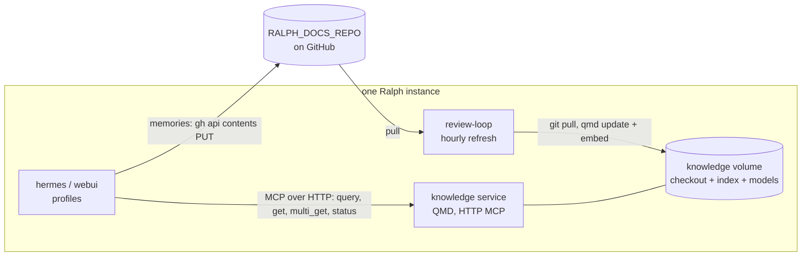

# Each Ralph instance runs one QMD service over a checkout of its docs repository, and every searching profile reaches it as an HTTP MCP server

> **This repository is public.** No employer, person, space or message content
> appears here. The work instance's docs repository is "the work docs
> repository".

Status: **in review**. Implements `prd-ralph-knowledge` (approved). Merging this
approves the design and releases the implementation plan (Ralph#120).

## Review header

**Decisions needed from you:**

1. **QMD runs as its own compose service per instance** (D1), not inside the
   hermes container or each sandbox. One process loads the models once; agents
   reach it over HTTP. Accept?
2. **Query expansion off by default** (D4). Search uses BM25 + vectors + the
   re-ranker (~1 GB of models). The 1.1 GB query-expansion model is optional,
   to keep memory down on the 12 GB VM. Accept, or turn it on?

**Scope rating:** M, about four build PRs (the plan sizes them):
the QMD service; the shared MCP block in install; memories and principles;
refresh, status and docs.

## How it fits



## Design

### D1. One `knowledge` service per instance

A new compose service, `knowledge`, in `compose/docker-compose.yml`:

- **Image:** a small Ralph image, `compose/Dockerfile.knowledge`. It installs
  Node 22, SQLite and `@tobilu/qmd@2.8.3` (pinned). It is built and versioned
  like `ralph-sandbox`, so `docker compose up` installs it (PRD R16).
- **Command:** `qmd mcp --http --host 0.0.0.0 --port 8181`, with
  `QMD_ALLOWED_HOSTS=knowledge` so Hermes can reach it by service name on the
  compose network. Nothing is published to the host.
- **Storage:** one named volume, `knowledge`, mounted at `/var/lib/ralph-knowledge`:
  - `repo/`: the docs repository checkout
  - `config/`: `QMD_CONFIG_DIR` (`index.yml`)
  - `cache/`: `XDG_CACHE_HOME` (`qmd/index.sqlite`, `qmd/models/`)

  It survives restarts and upgrades (R16). The personal and work instances
  have separate volumes, so their indexes never mix (acceptance 3).
- **Resources:** `mem_limit: 2g`, CPU-only (`QMD_FORCE_CPU=1`; the VM has no
  GPU).

Why not the hermes container: it would load ~1 GB of models into the process
that dispatches every card, and the hermes image is upstream. Why not each
sandbox: models would load once per profile (x18), and sandboxes are torn down.

### D2. Collections

`init` writes `index.yml` with two collections and a global context:

| Collection | Path | Pattern | Context |
|---|---|---|---|
| `docs` | `repo/` | `**/*.md` | "This instance's docs repository: PRDs, designs, plans, decisions, run reports and memories." |
| `ralph` | `/ralph/docs` (read-only bind of the Ralph repo's `docs/`) | `**/*.md` | "How Ralph itself is built and operated." |

Per-folder contexts (`qmd context add`) describe `projects/`, `areas/`,
`resources/`, `archives/` and `memory/`.

### D3. Refresh

The review-loop runs `bootstrap/refresh-knowledge` at most hourly (stamp file,
next to cleanup; PRD R8). Inside the `knowledge` service it:

1. `git -C repo fetch` and fast-forward, cloning on first run. It uses the
   review-loop's existing `RALPH_GITHUB_TOKEN`, passed by name only.
2. `qmd update`, then `qmd embed`, which embeds only what changed.
3. Writes `last_refresh` and counts to `cache/status.json`.

A failed refresh keeps serving the previous index and logs the error; search
never goes down because GitHub is unreachable (acceptance 4).

### D4. Search quality and memory

`index.yml` sets the embedding model (`embeddinggemma-300M`, ~300 MB) and the
re-ranker (`qwen3-reranker-0.6b`, ~640 MB). Query expansion is off
(`RALPH_KNOWLEDGE_EXPANSION=0`); turning it on adds ~1.1 GB and is one setting.
Agents send typed `lex`/`vec` sub-queries themselves, so expansion is not needed
for good recall.

### D5. Reaching profiles: a shared MCP block

`bootstrap/write-profile-config.py` gains `mcp_servers` handling: install
appends one `knowledge` server to each searching profile's config, merged with
any servers the profile already declares (lens-tools stays):

```yaml
mcp_servers:
  knowledge:
    url: "http://knowledge:8181/mcp"
    enabled: true
    tools:
      include: [query, get, multi_get, status]
```

- **Who gets it:** the default profile and the profiles in PRD R11. Install
  lists them by name, the same way it lists the clone profiles (Ralph#96). The
  lenses, review-synthesis and chat-summarizer never get it (acceptance 7), and
  a profile-config test checks both lists.
- **Read-only by construction:** QMD's MCP tools only search and read. No tool
  writes to the index or the repository.
- **Off switch:** `RALPH_KNOWLEDGE=0` skips the service and the MCP block
  (R15). The docs repository is untouched.

### D6. Memories and reports

- **Where:** `memory/` at the root of the docs repository, PARA-style:
  `memory/decisions/`, `memory/root-causes/`, `memory/conventions/`,
  `memory/reports/YYYY/MM/`.
- **Note template** (PRD R5):

  ```markdown
  ---
  kind: decision | root-cause | convention | rejected | report
  source: <card id or PR URL>
  profile: ralph-<name>
  date: YYYY-MM-DD
  ---
  # <the finding as one sentence>

  <what, why, and links. Aggregates and links, never copies>
  ```

- **How agents write:** `gh api -X PUT repos/<RALPH_DOCS_REPO>/contents/memory/...`
  from the terminal, with the profile's existing token, directly on the default
  branch (owner decision 1). One file per note, named
  `<date>-<slug>-<card>.md`, so concurrent writers never touch the same file.
  This is a single API call, with no checkout and no merge conflict.
- **Public-safety rule** (owner decision 2, R7): on an instance whose docs
  repository is public, the author of a note applies this repository's
  `AGENTS.md` rule (no people, employers, spaces, message content, secrets). A
  note that fails is not written, and the card's completion says so. The rule
  lives in the shared principles; install marks the instance public or private
  from `gh repo view --json visibility` (`RALPH_DOCS_PUBLIC`), and the principles
  line names it.
- **Generic maintenance** keeps skipping the docs repository (Ralph#63), so
  direct commits never start a maintenance round.

### D7. Principles

`PRINCIPLES.md` gains two lines that every SOUL gets (PRD R12, R13):

- **Search before you plan or write:** run `knowledge.query` for prior PRDs,
  designs, decisions and memories on the topic, and cite what you used.
- **Write down what lasts:** at completion, record a decision, root cause,
  convention or rejected approach as a note under `memory/`, following the
  template, if the next agent would otherwise rediscover it.

### D8. Operations

- `bootstrap/knowledge-status <instance>` prints collections, document and
  vector counts, last refresh and the model set, from `qmd status` and
  `status.json` (R14).
- `docs/infrastructure.md`, `workflows.md` and `operations.md` gain the
  service, the refresh, and recovery steps (re-embed, rebuild the index from
  the checkout). The diagrams move "memory", "shared MCP" and "document RAG"
  out of the planned band.

## Alternatives considered

| Option | Why not |
|---|---|
| QMD stdio MCP per profile (`command: qmd mcp`) | Each worker spawns QMD and loads ~1 GB of models per session. |
| QMD inside the hermes container | Model memory in the dispatcher process; requires changing the upstream image. |
| ZBrain | The owner chose QMD for its setup and maintenance; ZBrain stays the owner's own tool. |
| Memories as pull requests | The owner chose direct writes (decision 1); PRs would bury reviewed documents. |
| Hermes built-in memory | Machine-local and per profile; not shared, searchable or reviewable (PRD N6). |

## Non-goals

- No change to the PRD, design or plan gates, or to how documents are approved.
- No write tool in MCP: agents write memories with `gh`, never through QMD.
- No GPU, no cloud embedding or re-ranking (PRD N2).
- No memory expiry or summarisation (PRD N5).
- No indexing of anything outside the two collections (PRD N3).

## Assumptions

- `@tobilu/qmd@2.8.3` runs on Linux arm64 in a Node 22 image, CPU-only, with
  `node-llama-cpp` prebuilt binaries.
- Embedding the current docs repositories (hundreds of files) takes minutes on
  the VM's 6 CPUs, and hourly incremental embeds take seconds.
- 2 GB per instance (two instances, 4 GB total) fits the VM alongside today's
  ~6 GB in use.
- Hermes' HTTP MCP client accepts QMD's stateless Streamable HTTP endpoint.
- The profile tokens can `PUT` contents on their instance's docs repository.

## Risks

- **First start downloads ~1 GB of models** from HuggingFace. Mitigation: a
  one-time `qmd pull` during `init`, cached in the volume; search falls back to
  BM25 until vectors exist.
- **A bad memory goes straight to the default branch.** Mitigation: the public
  rule, the note template, and normal `git revert` on the docs repository.
