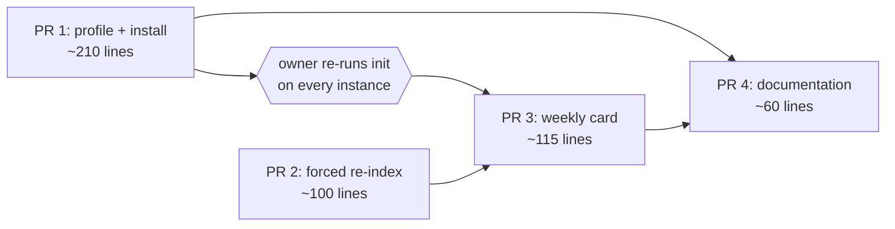

# The librarian ships in four pull requests — the profile, the forced re-index, the weekly card, then the documentation

> **This repository is public.** No employer, person, space or message content
> appears here.

Status: **in review**. Implements `dd-ralph-librarian` (approved, merged at
`Zhachory1/docs#21`). Nothing is built. This document turns that design into
the pull requests a builder opens, in build order.

**Citations.** Every path and line number below is from `Zhachory1/ralph`
`main` at `f679e098` (2026-11-09) — the same commit the design cites — read
from a checkout. I read the code; I ran nothing.

---

## Review header

### Decisions needed from you: two

| # | Decision | Why it is yours | Recommendation |
|---|---|---|---|
| **D-1** | **Four pull requests, not the design's three.** `dd-ralph-librarian` §5 groups the review-loop work as one pull request, "the weekly card and the forced re-index". I split it into PR 2 and PR 3. Two reasons. Its goal cannot be written in one sentence without an "and", which is the repository's own test for one concern (`profiles/STANDARDS.md`, `AGENTS.md` "Conventions"). And the forced re-index is useful with no librarian at all: it is the thing that cuts memory-note search latency from up to an hour to one poll (design D-B), so holding it behind a profile that does not exist yet delays a fix for every profile. | The design said three and I am proposing four. That is a change to an approved document's shape, even though §5 delegates sizing and ordering to this plan. | **Take the split.** The PRD's scope rating already allows four. If you prefer three, PR 2 and PR 3 collapse into one ~215-line pull request with no other change to this plan. |
| **D-2** | **The diagrams do not name the librarian.** `docs/diagrams/system.dot:63` and `system-flow.dot:29` label a cluster of profiles by name. The design's §5 lists three documentation files and not the diagrams, so PR 4 leaves them alone and the pictures stay one profile out of date. | Adding them means regenerating `.svg` and `.png` from Graphviz, which is a tool the builder has to have and a binary diff you would be reviewing. It is your call whether that is worth it now or at the next diagram change. | **Leave them.** The diagrams group minor profiles into one label already, so the librarian can join at the next edit to that file. Say so and PR 4 grows by two `.dot` lines plus four regenerated binaries. |

### Council dissent

**None ran.** No council or lens critique was invoked for this document. The
card's finishing sequence is one agent reviewer, then your gate.

### Scope rating

**M — four build pull requests, about 490 changed lines in total.** The largest
is ~210. Nothing here needs splitting further, and nothing is near the 400-line
CI cap.

### What changed since the last revision

**v2 — review round 1 (`ralph-reviewer`), citation corrections only. No pull
request was added, removed, resized or reordered; no `<planned_files>` block
changed.**

- **Profile count was wrong in two places, and is fixed.** There are **18**
  profile directories at `f679e098`, not twenty. Adding `librarian` makes
  **19**, not 21. Verified with `git ls-tree -d --name-only f679e098:profiles`
  and by confirming each of the 18 holds a `SOUL.md`, which is what
  `test_there_are_profiles` counts (`evals/test_profile_config.py:205-209`).
  PR 1's test plan carried the wrong number where a builder would have read it
  as an expected value, so that line now also says not to write the count into
  an assertion: the test asserts a floor.
- `bootstrap/install` push-token message cited as `:248`, corrected to `:249`;
  `:248` is the loop's closing `done'`.
- PR 2's claim that an unset `RALPH_DOCS_REPO` leaves the refresh block doing
  nothing was wrong, and is replaced. `:115-116` gates on the knowledge
  container alone. An unset variable is passed through empty at `:118` and only
  suppresses a **first clone** (`refresh-knowledge:39-43`); with a checkout
  already present the refresh still pulls and re-indexes.
- The Buildkite test is named in full
  (`…_after_profiles_exist`) so a builder grepping for it finds it.

---

## How these pull requests are opened and reviewed

All four land in `Zhachory1/ralph`, against `main` at `f679e098` or later.

- **Opened by `ralph-builder`.** Branch `agent/<card-id>-<short-slug>`, opened
  as a draft and marked ready when checks pass. Commit trailers `Kanban-Card:`
  and `Design-Doc:`, spelled exactly. The card's `<planned_files>` block copied
  into the commit message unchanged, because CI cannot read the board
  (`bootstrap/scope-check:90-105`). Label `agent-authored`.
- **Reviewed by `ralph-reviewer` and the review loop, with `zhachbot` as
  assignee and reviewer.** This is not a formality:
  `bootstrap/discover-reviews:110` searches `gh search prs --assignee @me`
  under the review account, so a pull request that is not assigned to
  `zhachbot` is never discovered and never reviewed.
- **The builder cannot merge.** You do. That gate is unchanged by this feature.

**What CI enforces.** `.github/workflows/scope-check.yml` runs
`bootstrap/scope-check` on every `agent-authored` pull request. It fails on any
changed path outside the `<planned_files>` block, and on more than 400
added-plus-removed lines (`bootstrap/scope-check:44`). The sizes below are
added plus removed, measured against that cap. A file the work genuinely needs
and the list does not hold is a scope escalation before the edit, not an edit
to the list afterwards.

---

## PR 1: the librarian profile, installed with the credentials it needs

- **Goal:** the `ralph-librarian` profile exists, searches the knowledge index,
  and can push a branch to the docs repository.
- **Implements:** design §1, §2, §3.1–§3.3 (as the SOUL's operating rules),
  §4.1, §4.2, §4.3, §4.4, §4.5.
- **Depends on:** nothing.
- **Size:** ~210 changed lines, most of it prose in one new file.

**What:**

1. **`profiles/librarian/SOUL.md`** (new, ~120 lines). `bootstrap/install:313`
   prepends `PRINCIPLES.md` and `STANDARDS.md`, so this file carries the role
   only, in the order design §4.1 fixes: the job and the permission that
   justifies the profile; the two boundary paragraphs of design §1 (against the
   auditor, against the author), close to the design's wording; the nine-step
   run of design §2.2 as a numbered list, with "the checkout decides, the index
   only proposes"; the three duplicate gates of design §3.3 with **no shared
   anchor, no merge** stated as absolute; the caps of design §2.3 and the
   pull-request body shape of design §2.4; the non-goals N1–N6 plus the three
   in design §1.1; and the finishing rule — open one pull request, complete the
   card with its link, never merge, never block waiting for approval.
2. **`profiles/librarian/config.yaml`** (new, ~48 lines), exactly the table in
   design §4.2: `anthropic` / `claude-sonnet-5`; `platform_toolsets.cli` of
   `terminal`, `file`, `kanban` and **no `code_execution`**; `approvals`
   `approve` for both modes; `memory` and `auxiliary` disabled;
   `skills.external_dirs` of `/ralph/skills/voice` and `/ralph/skills/write`;
   `agent.max_turns: 120`; `agent.run_budget_seconds: 3600`. Copy the shape of
   `profiles/auditor/config.yaml`, which is the nearest existing file.
3. **`bootstrap/install`**, three edits and nothing else:
   - `knowledge_profile()` at `:135` — add `librarian` to the case list.
   - The push-token loop at `:235` — `for profile in ralph-maintainer
     ralph-builder ralph-author ralph-librarian; do`, with the message at `:249`
     updated to name it. **Note:** there is a second `for profile in ralph-…`
     loop in this file, the Buildkite one, and
     `test_buildkite_token_goes_only_to_maintainer_and_builder_after_profiles_exist`
     pins its contents. Editing the wrong loop fails that test.
   - The read-token skip list at `:384` — add `*/ralph-librarian/*` to the
     `case`, so the librarian keeps the push token.
   - **Do not add it to `repo_cache_profile()` at `:124-129`** (design §4.2).
     The cache spans every repository the instance has touched; the librarian
     needs one small repository and clones it.
4. **`evals/test_profile_config.py`**: add `librarian` to `ALL` (`:81`) and to
   the board list in `test_general_profiles_reach_the_board` (`:152`), extend
   `test_knowledge_goes_only_to_searching_profiles` (`:261`), and add the four
   new assertions below.

**Planned files:**
<planned_files>
- profiles/librarian/SOUL.md
- profiles/librarian/config.yaml
- bootstrap/install
- evals/test_profile_config.py
</planned_files>

- **Test plan:**
  - New, in `evals/test_profile_config.py`: `ralph-librarian` is in the
    `knowledge_profile` case block; it is in the push-token loop and in the
    read-token skip list; its toolsets hold `terminal` and not
    `code_execution`; it is **not** in `repo_cache_profile`.
  - Already covering it with no new test, because they glob
    `profiles/*/config.yaml` and `profiles/*/SOUL.md`: every profile mounts
    `/ralph/skills/voice`, reaches GitHub from a `terminal`, carries
    `approvals: approve`, says "You are Ralph", and follows
    `simplified-technical-english` with `caveman` refused (`:132`, `:211`,
    `:357`, `:362`). `test_there_are_profiles` asserts at least 16, counting
    `profiles/*/SOUL.md` (`:205-209`); there are 18 today, so this makes 19.
    Do not write 19 into an assertion: the test asserts a floor, not a count.
  - Run: `python3 evals/test_profile_config.py`.
  - Not covered by any test, and named as such (design §6): the run itself —
    the duplicate gates, the archive rule, the index format. Those are a
    model's judgement over real files, and your review of the librarian's first
    pull request is the check on them.

---

## PR 2: the review loop re-indexes when the docs repository moves

- **Goal:** a merge into the docs repository becomes searchable within one
  review-loop poll instead of within the hour.
- **Implements:** design §3.4 and owner decision D-B.
- **Depends on:** nothing. It can merge before, after or alongside PR 1, and it
  is useful even if the librarian is never installed.
- **Size:** ~100 changed lines.

**What:** rewrite the existing knowledge block at
`bootstrap/run-review-loop:111-120`, in place, keeping its hourly stamp:

- Read the remote head with
  `gh api repos/$RALPH_DOCS_REPO/commits/HEAD --jq .sha`.
- Compare it against `$WORK/.knowledge-head`, a new file beside
  `.cleanup-stamp` and `.knowledge-stamp` (`:105`, `:113`).
- Refresh when the hourly stamp has expired **or** the two heads differ.
- Write `.knowledge-head` **only after `refresh-knowledge` exits zero**, so a
  failed refresh retries on the next poll instead of recording a lie. The
  hourly stamp keeps its current touch-before-run behaviour (`:117`): that is
  what stops a persistently failing refresh from running every poll.
- A knowledge container that is not running leaves the block doing nothing,
  exactly as today: that is the only thing `:115-116` gates on. **Unset
  `RALPH_DOCS_REPO` does not skip the refresh** — `:118` passes
  `KNOWLEDGE_REPO` through empty, and `refresh-knowledge` reads it only to
  decide a first clone (`refresh-knowledge:39-43`). With a checkout already
  there it still pulls and re-indexes. So the forced refresh must not assume an
  unset variable is a no-op; it is gated on the container alone.

**Planned files:**
<planned_files>
- bootstrap/run-review-loop
- evals/test_run_review_loop.py
</planned_files>

- **Test plan:** a new class in `evals/test_run_review_loop.py`, following the
  harness `StartupTests.run_loop` already uses (`:19-51`) — stub `gh`,
  `python3`, `docker` and `sleep` on `PATH`, run the real script, no network and
  no board. Three things the existing harness does not do and this class must:
  - Set `RALPH_REVIEW_WORK` to the temp directory. The existing tests do not,
    so their stamps land under `/workspaces/review-work` and the block is never
    exercised.
  - Stub `docker inspect -f '{{.State.Running}}'` to print `true`. The current
    `docker` stub is `exit 0`, which prints nothing, so the refresh block is
    skipped in every existing test.
  - Stub `gh api repos/.../commits/HEAD` to print a fixed sha, and record each
    `docker exec … refresh-knowledge` call to a file.

  The cases (design §6):
  - `.knowledge-head` differing from the stubbed remote head runs
    `refresh-knowledge` even when `.knowledge-stamp` is fresh.
  - A matching head and a fresh stamp run nothing.
  - A `refresh-knowledge` that exits non-zero leaves `.knowledge-head`
    unchanged, so the next poll retries.
  - Run: `python3 evals/test_run_review_loop.py`.

---

## PR 3: the review loop creates the librarian's weekly card

- **Goal:** one card a week appears on `queues` assigned to `ralph-librarian`,
  and never two at once.
- **Implements:** design §2.1, §3.5.
- **Depends on:** PR 1, so the profile exists before the first card is created
  — the dispatcher leaves a card for an unknown assignee sitting in `ready`
  with no error. And PR 2, because both edit adjacent blocks of the same file,
  so this order avoids a rebase conflict. It also depends on the owner step
  below having been run.
- **Size:** ~115 changed lines.

**What:** a new periodic block in `bootstrap/run-review-loop`, beside the
cleanup and knowledge blocks, built from parts that file already uses:

- `RALPH_DOCS_REPO` unset: do nothing. No new switch (design §3.5).
- Stamp `$WORK/.librarian-stamp`, tested with `find -mmin -10080` (seven days),
  the shape of `:106` and `:115`.
- Guard: `gh pr list --repo "$RALPH_DOCS_REPO" --state open` and skip while any
  open pull request has a head branch starting `librarian/`, whatever the stamp
  says. This is the overlap guard of design §3.5; the run checks it again for
  itself (design §2.2 step 1).
- Create the card through the hermes container, the shape of `:62-64`:
  `docker exec "$RALPH_HERMES_CONTAINER" hermes kanban --board "$BOARD" create
  …` with a title naming the date, `--assignee ralph-librarian`, and a body
  naming `$RALPH_DOCS_REPO`. **Reuse the loop's existing `$BOARD`** (`:14`,
  which defaults to `queues`); the design's non-goals forbid a new board or
  environment variable.
- **Touch the stamp only after create exits zero**, unlike the knowledge stamp.
  A transient failure then retries on the next poll rather than skipping a
  week; a persistent one logs every poll, which is the visible failure you
  want. The design left this open; it is listed under Assumptions.

**Planned files:**
<planned_files>
- bootstrap/run-review-loop
- evals/test_run_review_loop.py
</planned_files>

- **Test plan:** a second new class in `evals/test_run_review_loop.py`, same
  harness, with the `docker` stub recording its argument list so a
  `hermes kanban … create` call is visible. Cases (design §6):
  - A `.librarian-stamp` younger than seven days creates no card.
  - An absent or week-old stamp creates exactly one card, on `queues`, assigned
    to `ralph-librarian`.
  - An open pull request with a `librarian/` head creates no card, whatever the
    stamp says.
  - `RALPH_DOCS_REPO` unset creates no card.
  - A create that exits non-zero leaves the stamp untouched.
  - Run: `python3 evals/test_run_review_loop.py`.

---

## PR 4: the documentation says what was built

- **Goal:** the README and the operations documents describe the librarian as
  it now runs, including the prerequisite nobody can infer.
- **Implements:** design §4.6, §4.7, and §2 as the workflow description.
- **Depends on:** PR 1, PR 2 and PR 3, so it describes merged behaviour rather
  than intended behaviour.
- **Size:** ~60 changed lines.

**What:**

1. **`README.md`**, four edits:
   - A row after `auditor` in the profile table (`:34-45`), in the same style:
     `| librarian | Tidy the docs repo through one PR a week | Delete, merge, or judge |`
   - `:47` reads "All ten exist… The other five are built and unexercised."
     Eleven, and six unexercised until the librarian's first pull request
     merges.
   - Build-order step 4 (`:104`) names "docs gardener". Name the librarian
     there and link `Zhachory1/ralph#130`.
   - One line, under the table or in step 4: the docs repository's
     default-branch protection is a prerequisite, because that is what makes
     "agents cannot push to `main`" true. Design §4.4 verified that the ruleset
     on `Zhachory1/docs` is active with an empty bypass list, and that **no
     GitHub token can be scoped that way** — so do not write the sentence as
     though the token enforces it.
2. **`docs/workflows.md`**: a "Librarian" section after "Knowledge: search and
   memories", in that file's existing shape — **Entry / Exit / Owners**, then
   the run, then **Failure modes**. The run is design §2.2 in brief; the
   failure modes are the overlap guard, a cap biting and deferring work, and a
   run that finds nothing and opens no pull request.
3. **`docs/operations.md`**: a "Librarian" table in the shape of the "Knowledge
   index" table (`:57-67`) — how to force a run (clear
   `$WORK/.librarian-stamp`, or `run-review-loop --once`), what an unmerged
   librarian pull request blocks, and the owner `init` step below.

**Planned files:**
<planned_files>
- README.md
- docs/workflows.md
- docs/operations.md
</planned_files>

- **Test plan:** prose, so no new test. Two checks:
  - `python3 evals/test_profile_config.py` still passes:
    `test_standards_name_no_employer_hosts_or_document_standards` reads
    `README.md` and fails on employer or document-standard names.
  - Read each new statement against the merged code of PR 1 to PR 3. The
    profile-count line in `README.md:47` is the sentence most likely to be
    wrong, because it is a number nothing checks.

---

## Build order

| Step | Pull requests | Notes |
|---|---|---|
| 1 | **PR 1 and PR 2, in parallel** | They share no file. PR 1 touches `profiles/librarian/`, `bootstrap/install` and `evals/test_profile_config.py`; PR 2 touches `bootstrap/run-review-loop` and `evals/test_run_review_loop.py`. |
| 2 | **Owner: re-run `init`** | Not a pull request and not a card. See below. |
| 3 | **PR 3** | After PR 1 (the profile must exist), after PR 2 (same file), and after the `init` re-run, or its first card sits unassignable. |
| 4 | **PR 4** | Last, so it describes what merged. |

Nothing else parallelises. PR 3 and PR 4 are strictly serial behind the rest.

---

## Owner-only steps, which are not cards

**Re-run `init` on every instance, between PR 1 and PR 3.** After PR 1 merges
and the image is pulled, `bootstrap/install` has to run again on each instance
before `ralph-librarian` exists there — that run is what creates the profile,
writes its `SOUL.md` and `config.yaml`, and puts the push token in its `.env`.
It touches live containers per instance, so no build pull request and no Kanban
card can do it (design §4.7).

The ordering matters, and it is why this is called out rather than left to the
end: PR 3's weekly block creates cards assigned to `ralph-librarian`, and the
dispatcher leaves a card for an unknown assignee sitting in `ready` with no
error. If PR 3 merges before `init` has been re-run, the first week's card does
nothing and nothing says why.

**Check that the docs repository's default branch is protected**, on any
instance where the librarian is installed. On `Zhachory1/docs` it already is
(design §4.4). Elsewhere, the property acceptance example 6 asks for does not
exist until you create it.

**Do not create a card for either.** They are launch-note steps, and PR 4 puts
them in `docs/operations.md`.

---

## Acceptance

From `prd-ralph-librarian`. Five of the seven are proven by the librarian's
first real run, which is the design's position (§6): the run's judgement is not
unit-testable, and your review of that first pull request is the check.

| PRD example | Proven in |
|---|---|
| 1. A first run archives `projects/ralph-knowledge/` and rewrites the links | First live run, after PR 1 and the `init` re-run |
| 2. Two notes merge into one, and search finds it | First live run; PR 2 is what makes it searchable within one poll |
| 3. A note missing `kind` or `date` is completed, or reported | First live run |
| 4. The four `in review` documents whose pull requests merged become `approved` | First live run |
| 5. A run with nothing to change opens no pull request | Second live run, once the first has merged |
| 6. No push to the docs repository's default branch | The repository ruleset, verified in design §4.4; PR 4 states it as a ruleset property, not a token one |
| 7. The auditor still cannot edit outside `areas/agent-system/` | PR 1 changes no auditor file; `evals/test_profile_config.py` passes unchanged for it |

---

## Assumptions

Each is an inference the design and the card did not state. The design's own
assumptions (its §9) still hold and are not repeated here.

- Splitting the design's §5 row 2 into PR 2 and PR 3 is a sizing decision this
  plan may make. Design §5 says "The plan sizes and orders these", which I read
  as covering a split. D-1 puts it in front of you anyway.
- The weekly card's create failing should retry on the next poll rather than
  wait a week, so PR 3 touches its stamp only on success. The design did not
  say, and the adjacent knowledge block chose the opposite for a different
  reason: a failing refresh is expensive to repeat, a failing `kanban create`
  is not.
- `evals/test_run_review_loop.py`'s existing stub harness extends to these
  cases with the three changes PR 2 lists. I read the harness; I did not run a
  new test against it.
- The librarian's `SOUL.md` lands at roughly 120 lines. It would be the longest
  SOUL in the repository — the author's is 77 — because design §4.1 asks it to
  carry a nine-step procedure and three gates. If it runs much longer, that is
  the signal design §4.1 names for moving the procedure into a skill under
  `skills/write/`, and that is a new card, not a widening of PR 1.
- One `init` re-run per instance is enough, and a new profile needs no other
  per-instance step. This follows from `bootstrap/install:296-330` creating
  profiles from `profiles/*/`, which I read rather than ran.

---

## Observations, out of scope

- `docs/diagrams/system.dot:63` and `system-flow.dot:29` will not name the
  librarian. That is D-2.
- `README.md:47` counts profiles in prose ("All ten exist", "the other five are
  built and unexercised") and nothing checks either number. This is the second
  feature in a row that has to hand-correct it. A one-line test, or dropping
  the count, would end that; it is not this plan's to add.
- `evals/test_profile_config.py`'s `ALL` tuple (`:81`) lists ten of the eighteen
  profile directories, and the rule for which ten is written down nowhere —
  but it is discoverable: those ten are **exactly** the ten rows of the
  `README.md` profile table (`:36-45`), in the same order. I checked name by
  name. So the real invariant is "`ALL` mirrors the README table", and this
  plan keeps it: PR 1 adds `librarian` to `ALL`, PR 4 adds its README row.
  Between those two merging the pair is briefly out of step, which breaks
  nothing because no test compares them. One sentence of comment on `:81`
  naming the README table as the source would stop the next person guessing;
  it is not this plan's to add.
