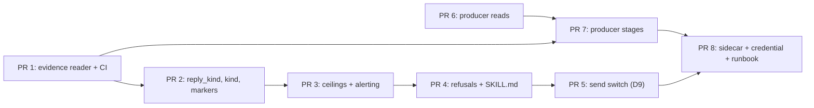

# The chat half ships in eight pull requests, the sender's bounds first and the sidecar last

> **This repository is public.** No employer, person, space, address or message
> content appears here. The requester is "a requester", the tracker is "the work
> tracker", and Google Chat is a vendor name and is named.

Implements `dd-ralph-redmine-chat` at v2 (`Zhachory1/docs#14`, amended by
`Zhachory1/docs#17`, merged `7ad9a6b`). Every `§N` below is a section of that
document. Nothing it settled is re-opened here.

All eight pull requests are in `Zhachory1/ralph`, against `main` at
**`f679e098`** or later. **The design cited `e5ce164`; `main` has moved since.**
Every chat file this plan touches is byte-identical at `f679e098` —
`bootstrap/chat-reply`, `bootstrap/chat-route`, `bootstrap/inbox-producer`,
`skills/ops/google-chat/gchat.py`, `profiles/chat-maintainer/*` and the three
chat evals are untouched between the two commits, so every line citation in the
design still resolves. **Two of the design's citations have drifted** and this
plan uses the new numbers: `bootstrap/install:170-179` is now `:178-187` and
`:186-191` is now `:194-199` (`#129` added eight lines above both), and
`docker-compose.yml:369,371` is now `:374,376` (`#129` added five lines above).
`docker-compose.yml:31`, `:90`, `:93`, `:163-171`, `:226-228`, `:261` and
`docs/workflows.md:84,89,92,110` are unmoved.

---

## Review header

### Decisions needed from you: two

| # | Decision | Why it is yours | Blocks |
|---|---|---|---|
| **P1** | **D9's default: does the send switch ship on or off?** The design's v2 amendment recommends **on**, because the overlay producer and the host `chat-reply` LaunchAgent already answer requesters every sixty seconds, so off is a deliberate silence on a live reply path rather than a ramp (§4.8; `dd-chat.md:571-577`). **This plan does not settle it** and PR 5 is one token either way. | It decides whether people who hear from Ralph today keep hearing from it. The design calls it a product call, not a file layout. | PR 5 only. PRs 1-4 and 6-8 are unaffected. |
| **P2** | **Does the private overlay job `chat_inbox.py` stage under the same operation id the public producer will use — `chat-<sha256 of the latest message's resource name>`?** I settled the design's open question in favour of **replacing** the overlay job rather than running both (§3, `dd-chat.md:252-255`; see "What this plan settles" below), but the cutover's safety depends on this answer and `chat_inbox.py` is not readable from the public repository. | Only you can read the overlay. | PR 7's cutover runbook step. If the ids differ, the first scan after cutover re-stages up to five minutes of already-answered messages, because the sent markers live in a directory named by the operation id. |

### Council dissent

One independent review round (`ralph-reviewer`, artifact lens,
[#22 comment](https://github.com/Zhachory1/docs/pull/22#issuecomment-6747653193)).
No dissent on the plan's shape: the reviewer checked the eight-versus-six-to-seven
arithmetic, every PR's class and inertness statement, and that no live-host-path
PR increases what is sent today, and accepted all three. It found two factual
defects, both fixed in this revision and neither contested:

1. A re-grounded line citation was wrong. See "What changed in v2" below.
2. **Owner-only runbook item 1 described the rejected credential path.** It said
   D8 needed a browser OAuth step before the copy — design option (a), which
   §4.2 rejects and the design's non-goals name explicitly (`dd-chat.md:636`).
   An owner following it literally would have created a second real Google
   grant, the exact cost option (b) exists to avoid. Item 1 is rewritten to the
   chosen option (b), which PR 8's own body already described correctly.

Two non-blocking observations (the sender unit's line-count reconciliation, the
total-size rounding) were raised and need no change.

### What changed in v2

- Runbook item 1 rewritten: the D8 step is `bootstrap/chat-creds-copy` against
  the token already on the host, not a browser mint. No other section changed
  mechanism — PR 8 was already correct.
- `bootstrap/install:186-191` re-grounds to **`:194-199`**, not `:189-200`
  (opening paragraph and PR 8's volume bullet). The shift is eight lines, from
  `#129`, not ten from `#128`; the paired `:170-179 → :178-187` was correct and
  is unchanged.
- No pull request was added, removed, resized or re-ordered. The eight PRs,
  their `<planned_files>`, dependencies and test plans are untouched.

### Scope: eight pull requests, roughly 2,000 changed lines

**The design rated this half at six to seven, and this is eight.** The
arithmetic, so the difference is checkable rather than a drift:

| Design's unit (`dd-chat.md:106-113`) | Pull requests here |
|---|---|
| One extracted staged-evidence reader | PR 1 |
| Two optional decision-metadata keys | PR 2 |
| The sender's ceilings, refusals, alerting and switch | PR 3, PR 4, PR 5 |
| The producer's read and eligibility | PR 6 |
| The producer's staging and card creation | PR 7 |
| The sidecar services and the credential step | PR 8 |
| The runbook | folded into PR 8 |

Seven units; six map one-to-one, the runbook folds into the sidecar it
documents, and the sender unit splits three ways. It splits because its four
pieces come to roughly 900 changed lines together and the cap is 400 — the
card's instruction is to split a pull request that would exceed it rather than
shrink the design. No pull request here implements anything outside those seven
units.

### What this plan settles, that the design handed it

- **The sidecar producer replaces the overlay job; it does not run beside it**
  (§3, `dd-chat.md:252-255`). Both staging the same thread is harmless only if
  they agree on the operation id, which cannot be checked from the public
  repository (P2). Two producers that disagree make two directories and two
  intake cards for one message: two model runs, and a second acknowledgement
  that §4.4's ceiling then refuses, blocks and alerts on. Replacing costs one
  owner action in PR 8's runbook and keeps the overlay job as the rollback.
  **The blast radius if P2's answer is "no" is bounded by §3.3's five-minute
  window:** at cutover the new producer can only re-stage messages from the last
  five minutes, never the thread's history.
- **The chat CI workflow ships in PR 1, not with the refusals** (§4.7's gap,
  `dd-chat.md:556-562`). The design says it ships with the sender's code; PR 1
  *is* the first sender change, and putting it there means every later pull
  request's new evals run in CI instead of only the last one's.

---

## PR 1: one staged-evidence reader, and the chat evals run in CI

- **Goal:** `chat-reply` and `chat-route` validate `evidence/item.json` through
  one module instead of two drifting copies, and the three chat evals start
  failing builds.
- **Implements:** §3.1 (`dd-chat.md:269-283`), §4.7's CI gap
  (`dd-chat.md:556-562`); the design's "one extracted staged-evidence reader"
  unit (`dd-chat.md:110-112`).
- **Class: 1, the live host path.** Gated by no owner action; it takes effect on
  the next sixty-second scan.
- **Inertness:** this is not inert and does not claim to be. It is safe because
  it only ever **reduces** what is sent: the shared reader refuses the union of
  what the two copies refuse today, so every message sent after it is one that
  would have been sent before it. The two copies differ — `chat-route:38` tests
  the workspace symlink and `chat-reply:69` tests it inside `destination()`, and
  only `chat-reply:78-83` checks `sender_trusted`, the space list and the
  operation-id hash. After this pull request both callers run every check.
- **Depends on:** nothing.
- **Size:** ~290 changed lines.
- **What:**
  - New `bootstrap/chat_evidence.py`: given a work root and an operation id,
    returns the validated item or raises one exception carrying a reason. It
    does the workspace, evidence and file symlink tests, the regular-file,
    hard-link-count, 64 KiB and `0o077` mode tests, the JSON parse,
    `kind == "inbound"`, `sender_trusted is True`, the `space`/`thread`/message
    shape, the `prior_operations` list rules, and the
    `op_id == "chat-" + sha256(latest message name)` identity test. A module
    beside the two scripts, so `import chat_evidence` resolves from the script's
    own directory in both the hermes container and the sender.
  - `bootstrap/chat-reply`: `destination()` becomes a call plus the one check
    that is this caller's alone, `space in allowed_spaces`.
  - `bootstrap/chat-route`: the block at `:37-69` becomes a call. `chat-route`
    reads no space list and gains none here.
  - New `.github/workflows/chat.yml`: runs `test_chat_reply.py`,
    `test_chat_route.py`, `test_gchat_send.py` and `test_chat_evidence.py` on
    changes to `bootstrap/chat-*`, `skills/ops/google-chat/**` and
    `evals/test_chat_*`.
- **Planned files:**
  <planned_files>
  - bootstrap/chat_evidence.py
  - bootstrap/chat-reply
  - bootstrap/chat-route
  - evals/test_chat_evidence.py
  - evals/test_chat_reply.py
  - evals/test_chat_route.py
  - .github/workflows/chat.yml
  </planned_files>
- **Test plan:**
  - Unit (`evals/test_chat_evidence.py`, new): each refusal fires on its own
    input — symlinked workspace, symlinked evidence dir, symlinked item, a hard
    link, a 70 KiB file, mode `0o644`, bad JSON, `kind` not `inbound`,
    `sender_trusted` false, a thread outside its space, a 21-entry
    `prior_operations`, a `prior_operations` containing this operation, and an
    operation id that does not hash the latest message name.
  - Unit: the fifteen tests in `evals/test_chat_reply.py` and
    `evals/test_chat_route.py` pass unchanged. That is the refactor's whole
    proof.
  - CI: the new workflow runs on this pull request and is green.

## PR 2: `reply_kind` and `kind`, and one marker per reply kind

- **Goal:** the sender can tell a clarifying question from an answer from a
  refusal, and an **update** stops producing a closing reply nobody asked for.
- **Implements:** §4.3 (`dd-chat.md:436-449`); R4's five kinds
  (`prd.md:403-405`), R6 and E10 (`prd.md:428-429`, `prd.md:673-674`).
- **Class: 1, the live host path.** Gated by no owner action.
- **Inertness:** not inert, and it reduces. The only requester-visible change is
  that a `route` decision classified `update` no longer produces a final card,
  so no closing reply is sent for it — which is what R6 and E10 require. No new
  send path. **The one re-send hazard, and its fix:** markers become per kind,
  and a thread already answered today carries `.reply-sent`. So `sent()` treats
  a pre-existing `.reply-sent` as satisfying **every** reply kind; without that
  line, the first scan after merge sends a second reply into every thread Ralph
  has already replied to.
- **Depends on:** PR 1. Not a code dependency — a file one. Both change
  `chat-reply` and `chat-route` in the same functions, and the refactor should
  land before anything is built on top of the old shape.
- **Size:** ~190 changed lines.
- **What:**
  - `bootstrap/chat-route`: the allowed-key set (`:55-56`) grows by `reply_kind`
    and `kind`; `reply_kind` must be in `{clarify, answer, decline}` and `kind`
    in R4's five; the brief omits the "finish with one ralph-chat-maintainer
    card" line (`:91-92`) when `kind == "update"`.
  - `bootstrap/chat-reply`: `MARKERS` (`:27`) becomes `.receipt-sent`,
    `.reply-sent`, `.clarify-sent`, `.decline-sent`, `.final-sent`; `handle()`
    picks the reply marker from `reply_kind`, defaulting to `.reply-sent` when
    the key is absent; `sent()` honours a legacy `.reply-sent` for any reply
    kind; `scan()`'s queues-board skip (`:241-242`) checks all four.
  - `profiles/chat-maintainer/SOUL.md`: the completion metadata gains
    `reply_kind` on every `reply` and `kind` on every `route`, with the five
    kinds named and "other" called out as not actionable.
- **Planned files:**
  <planned_files>
  - bootstrap/chat-reply
  - bootstrap/chat-route
  - profiles/chat-maintainer/SOUL.md
  - evals/test_chat_reply.py
  - evals/test_chat_route.py
  </planned_files>
- **Test plan:**
  - Unit: `chat-route` accepts `reply_kind` and `kind` and still refuses a
    sixth key; an invalid `reply_kind` or `kind` is refused.
  - Unit: `kind: update` leaves no final card to send (E10).
  - Unit: a `reply` with `reply_kind: clarify` writes `.clarify-sent`; an
    operation carrying only a legacy `.reply-sent` sends nothing for any reply
    kind.
  - Unit: a decision with no `reply_kind` still sends, writing `.reply-sent`.

## PR 3: the per-thread ceilings, and a failure you can see

- **Goal:** one request gets at most two clarifying questions, one refusal, one
  acknowledgement and one closing reply, counted across the whole thread; a
  breach blocks its card and alerts instead of failing silently.
- **Implements:** §4.4 (`dd-chat.md:451-473`) and §4.6 (`dd-chat.md:513-537`);
  A17 (`prd.md:797-802`), A15/R7 (`prd.md:440-442`), R6 (`prd.md:416-417`),
  R11 (`prd.md:464-465`), E18 (`prd.md:714-718`).
- **Class: 1, the live host path.** Gated by no owner action.
- **Inertness:** not inert, and it reduces twice over. The ceilings can only
  refuse a send that happens today; they add no send path. The alerting adds no
  send to a requester — `notify()` posts to the owner's own webhook, never to a
  chat thread, and it tolerates its own failure (`maintain-pr:303-305`).
  §4.4 and §4.6 are one pull request because a ceiling's "on breach" column
  *is* the block-and-alert: shipping them apart would ship a refusal with no way
  to see it.
- **Depends on:** PR 2 (it counts the per-kind markers PR 2 creates) and, through
  it, PR 1.
- **Size:** ~330 changed lines.
- **What:**
  - `bootstrap/chat-reply`: an exclusive `fcntl.flock` on
    `<root>/.locks/<sha256 of the thread name>.lock`, mode `0600`, taken before
    the count and held until after `mark()`. Per thread, not per operation, for
    the reason the design keeps from the closed review round
    (`dd-chat.md:465-468`).
  - The count: sent markers across this operation's directory and every
    `prior_operations` directory in `item.json` — staged evidence, never agent
    text. **Sent markers only**, so PR 5's held replies cannot spend a ceiling.
  - The four rules of §4.4's table, with their stated outcomes: clarify and
    decline breaches refuse, an `ack` breach holds for the next scan, a `final`
    breach refuses (already at `:183-184`).
  - A `block_and_alert()` helper: `hermes kanban … block` through the existing
    `docker exec` path (the shape at `maintain-pr:398`) plus `notify()`
    (`maintain-pr:303-305`), fired **on a refusal and on a retryable failure
    alike**, once per operation and kind, guarded by an `.alerted-<kind>`
    sentinel written with the same `O_EXCL` open as `mark()` (`:145-147`).
- **Planned files:**
  <planned_files>
  - bootstrap/chat-reply
  - evals/test_chat_reply.py
  </planned_files>
- **Test plan:**
  - Unit: a third `clarify` in one thread sends nothing and blocks the card; a
    second `decline` likewise; counts span `prior_operations` directories.
  - Unit: two operations in one thread serialise on the thread lock.
  - Unit: a held or absent marker does not count toward a ceiling.
  - Unit: a refusal and a retryable failure each block once and alert once; a
    second scan over the same operation and kind alerts no second time.
  - Unit: `notify()` with no webhook set prints and does not raise.

## PR 4: the refusals before every send, and the skill that describes them

- **Goal:** no reply leaves carrying a work-tracker reference, a link the
  requester cannot already open, or something shaped like a credential.
- **Implements:** §4.5 (`dd-chat.md:475-511`); R1 (`prd.md:594-595`), R19
  (`prd.md:592-600`), E9, and `chat-maintainer/SOUL.md:29`.
- **Class: 1, the live host path.** Gated by no owner action.
- **Inertness:** not inert, and it is the clearest reduction in the plan: every
  check can only turn a send into a refusal. It reaches the network for one
  read — an **unauthenticated** `GET https://api.github.com/repos/<owner>/<repo>`
  to learn whether a repository is public. No token: the sender gains no
  repository credential, and a non-200 means "not reachable", which refuses.
- **Depends on:** PR 3. A file dependency and a behavioural one: a refusal here
  blocks and alerts through PR 3's helper.
- **Size:** ~280 changed lines.
- **What:**
  - `bootstrap/chat-reply`: one `refuse_unsendable(body)` run before **any**
    send of agent text — `ack`, every `reply_kind`, `final`. Three checks:
    a work-tracker reference (the instance's tracker host when
    `RALPH_TRACKER_HOST` is set in the instance env, an `/issues/<n>` path, a
    bare `#<n>`); a URL absent from a `reachable` set the sender builds, where a
    GitHub pull-request or repository URL qualifies only on a 200 showing
    `"private": false` and everything else never qualifies; a
    credential-shaped string.
  - `skills/ops/google-chat/SKILL.md`: `:44` is amended to describe what the
    script then does — the ceilings, `reply_kind`, the refusals and the switch —
    in the same pull request as the code, as §4.5 requires. `:46` gains the
    sidecar beside the LaunchAgent.
  - The honest limit is recorded in the code's own comment, not argued away: a
    refusal rule catches references and links, not a sentence that paraphrases a
    private document (§4.5).
- **Planned files:**
  <planned_files>
  - bootstrap/chat-reply
  - skills/ops/google-chat/SKILL.md
  - evals/test_chat_reply.py
  </planned_files>
- **Test plan:**
  - Unit: a body containing the tracker host, `/issues/12` or `#12` is refused.
  - Unit: a URL outside the `reachable` set is refused; a public-repository pull
    request URL passes with one stubbed API read; a private one is refused and
    the card blocks.
  - Unit: the reachability read is stubbed in every test — no eval reaches the
    network — and a non-200 refuses.
  - Unit: a credential-shaped string is refused on `ack`, on each `reply_kind`
    and on `final`.

## PR 5: the send switch, and the held marker that makes flipping it safe

- **Goal:** one environment variable decides whether `post()` is called at all,
  and turning it on sends nothing that was held while it was off.
- **Implements:** §4.8 (`dd-chat.md:564-624`), decision **D9**.
- **Class: 1, and the design's named exception.** Every other class-1 pull
  request here only reduces; this one's **default decides whether a live reply
  path goes quiet**, which is why it is a decision and not a choice
  (`dd-chat.md:125-130`, `:571-577`).
- **Gated by: your answer to P1**, and by nothing else. The code is identical
  either way; the default is one token in the instance env's documented value.
- **Inertness:** not inert by construction. With the switch **on** — the
  design's recommendation — nothing a requester can notice changes, and the
  switch is a stop button. With it **off**, the producer still stages, the agent
  still decides, `chat-route` still routes and the tracker still records; only
  `post()` is skipped, and the replies people get today stop.
- **Depends on:** PR 3 (ceilings count sent markers; the held marker must be
  excluded from that count) and PR 4.
- **Size:** ~170 changed lines.
- **What:**
  - `bootstrap/chat-reply`: `instance_config()` (`:41-53`) learns a fourth key,
    `CHAT_SEND`, read once per scan, parsed as a boolean with an explicit
    default recorded in `compose/.env.example`.
  - A held reply writes `.held-<kind>` in place of the marker `mark()` would
    have written, through the same `O_EXCL` open (`:145-147`). `scan()` and
    `handle()` treat either marker as "nothing to do here", so the loop stays
    bounded at one `docker exec` per operation per kind instead of one per
    minute forever (`:239-242`).
  - The switch is read **before** the final-needs-acknowledgement check
    (`:183-184`): a held `final` is held, not refused, and writes `.held-final`
    without blocking the card. One `if`, and the difference between a quiet
    pilot and a board full of blocked cards (`dd-chat.md:597-603`).
  - `compose/.env.example`: `CHAT_SEND` documented with its default and what
    each setting costs.
- **Planned files:**
  <planned_files>
  - bootstrap/chat-reply
  - compose/.env.example
  - evals/test_chat_reply.py
  </planned_files>
- **Test plan:**
  - Unit: with the switch off, `chat-route` runs, `post()` is not called,
    `.held-<kind>` is written, the next scan skips the operation, and a body
    failing a PR 4 check is still refused and still blocks.
  - Unit: a held `final` with no acknowledgement marker writes `.held-final` and
    does not block the card.
  - Unit: turning the switch on sends nothing for an operation already carrying
    a held marker.
  - Unit: a held reply does not consume a §4.4 ceiling.
  - Unit: with the switch on, the fifteen shipped tests and PRs 1-4's tests pass
    unchanged.

## PR 6: the public producer reads, and decides what is eligible

- **Goal:** a script that lists the last five minutes of messages in the
  approved spaces and says which ones are eligible — and stages nothing.
- **Implements:** §3.2 (`dd-chat.md:290-324`) and §3.3 (`dd-chat.md:326-353`);
  R10, R18 (`prd.md:556-562`), D4, D6.
- **Class: 2, sidecar and credential.** Gated by **D8**: in a container it reads
  a credential that is not there yet. On the owner's own machine it would run
  with the existing token, and even then it only **reads** — it has no send path
  and creates no card until PR 7.
- **Inertness:** inert on merge. Nothing invokes it: no compose service runs it
  until PR 8, no LaunchAgent installs it, no cron entry names it. It adds one
  file and one eval.
- **Depends on:** nothing. **Runs in parallel with PRs 1-5** — it shares no file
  with them.
- **Size:** ~300 changed lines.
- **What:**
  - New `bootstrap/chat-producer`, the read half only. It imports `_key` and
    `_load_creds` from `skills/ops/google-chat/gchat.py` (`:106-114,129-136`),
    resolved the way `chat-reply:128` resolves the same module, and builds its
    own read-only `chat` client. It does **not** shell out to `gchat.py
    messages`, which discards both fields eligibility runs on
    (`gchat.py:222-240`), and it adds no `gchat.py` command.
  - One `spaces.messages.list` per space in `CHAT_ROUTE_SPACES`, read from the
    same instance file `chat-reply` reads (`:41-53`), same cap of eight,
    filtered to `createTime > (now − 5 minutes)`, newest first. **The fallback
    when the API rejects a `createTime` filter** (the design's assumption 1):
    page newest-first and stop at the first message older than the window.
  - Eligibility, all four conditions and no fifth: the space is listed; the
    message is inside the window; `sender.type` is a human, not `BOT`;
    `clientAssignedMessageId` does not start with `client-ralph-`.
  - `--instance-env` and `--dry-run`, which prints one line per message with its
    computed operation id and its eligibility verdict. `--dry-run` is the only
    mode this pull request has.
- **Planned files:**
  <planned_files>
  - bootstrap/chat-producer
  - evals/test_chat_producer.py
  </planned_files>
- **Test plan:**
  - Unit: against a fake service object, with no network and no credential — a
    message in an unlisted space is not eligible; one older than the window is
    not; a `BOT` sender is not; a `client-ralph-` id is not; an unmentioned
    message from a human in a listed space **is** (E14, E16).
  - Unit: a nine-space list, a malformed space name and an empty list are each
    refused by the same validation `chat-reply:49-50` applies.
  - Unit: with the filter rejected, the paging fallback stops at the first
    message older than the window.
  - Unit: the computed operation id equals `chat-` + sha256 of the message
    resource name, which is what `chat-reply:82` and `chat-route:68` check.

## PR 7: the producer stages the item record and creates the intake card

- **Goal:** an eligible message becomes `evidence/item.json` and exactly one
  intake card, idempotently, in the shape `bootstrap/inbox-producer` already
  uses.
- **Implements:** §3.1 (`dd-chat.md:257-288`), the schema this half publishes;
  E2, E16, R3 (`prd.md:399-401`).
- **Class: 2, sidecar and credential.** Gated by **D8** for the container, and
  by the **overlay cutover** (P2, PR 8's runbook) for the host.
- **Inertness:** inert on merge, for the same reason as PR 6: nothing invokes
  the producer. It writes its first file only when an owner runs it or PR 8's
  service starts.
- **Depends on:** PR 6 (same file) and PR 1 (the record it writes must satisfy
  the shared reader; that reader is the acceptance test for this schema).
- **Size:** ~310 changed lines.
- **What:**
  - `bootstrap/chat-producer` gains `--once` and the staging half. Per eligible
    message: `chat-inbox/chat-<sha256 of the message resource name>/evidence/`
    at `0700`, and `item.json` at `0600`, written through the atomic
    stage-once-and-never-rewrite shape at `inbox-producer:59-75`.
  - The record, exactly §3.1's fields: `kind: "inbound"`, `sender_trusted`,
    `space`, `thread`, `messages` (oldest first, each
    `{name, text, from_ralph}` with `text` as a list of lines), `sender`, and
    `prior_operations`. Ralph's own messages are marked `from_ralph: true` and
    stage no operation of their own (`chat-reply:131-134`; `gchat.py:33`).
  - `prior_operations`: for each earlier message in the same thread, the
    operation id it would have; kept only when that directory already exists
    under the root; newest first; capped at 20, and never containing this
    operation (`chat-route:71-74`).
  - One intake card through `docker exec … hermes kanban create`
    (`inbox-producer:148-154`): board `queues`, assignee
    `ralph-chat-maintainer`, body carrying exactly one `operation_id:` line,
    `--idempotency-key <operation id>`, and
    `--workspace dir:/workspaces/chat-inbox/<operation id>` — the container path
    `chat-reply:171-172` requires, not the host path.
- **Planned files:**
  <planned_files>
  - bootstrap/chat-producer
  - evals/test_chat_producer.py
  </planned_files>
- **Test plan:**
  - Unit: the staged record passes `bootstrap/chat_evidence.py` from PR 1 —
    schema conformance proved by the consumer, not by a second copy of the
    rules.
  - Unit: a second run over the same message writes no second directory and
    creates no second card (E2); the card create is called once.
  - Unit: a thread with four earlier staged operations yields four
    `prior_operations`, newest first; a thread with 25 yields 20; this operation
    never appears in its own list.
  - Unit: the whole thread is staged on every operation, so a later message
    carries the earlier ones as context (E16).
  - Unit: `sender` is present and `from_ralph` is true for exactly Ralph's own
    messages.

## PR 8: the sidecar services, the credential step, and the runbook

- **Goal:** producer and sender run as a compose service beside the agent, with
  the Chat token in a volume the model's container does not mount, and the owner
  has written steps for the token copy, the overlay cutover and the switch.
- **Implements:** §4.1 (`dd-chat.md:365-414`), §4.2 (`dd-chat.md:416-434`),
  decision **D5**, and the runbook the design's scope lists last.
- **Class: 2, sidecar and credential.** Gated by **D8**, which is the whole of
  this pull request's usefulness and none of its merge safety.
- **Inertness:** inert on merge, on two independent grounds. **First**, the
  service carries `profiles: ["chat"]`, the gating pattern already used for the
  knowledge service (`docker-compose.yml:286`), so a plain `docker compose up`
  does not start it — starting it is an owner command. **Second**, even started,
  the `chat-creds` volume is empty and `_creds_or_die` exits "Not authenticated
  for Chat" (`gchat.py:146-154`); `post()` is unreachable without a token. This
  pull request mints no token, copies no credential and reads none: the copy is
  a script the **owner** runs on the host, once.
- **Depends on:** PR 7 (there must be a producer worth running) and PR 5 (the
  service passes the switch through). Everything else can be merged before it in
  any order.
- **Size:** ~330 changed lines.
- **What:**
  - `compose/Dockerfile.notifier`: the four Python packages `gchat.py` imports
    and this image does not install (`gchat.py:46-52`;
    `Dockerfile.notifier:6-16`) — extend this image rather than add a second
    one, and record the size delta in the pull request description. **The design
    did not measure it** (its assumption 9).
  - `compose/docker-compose.yml`: a `chat-sender` service on the notifier image,
    `profiles: ["chat"]`, command `bootstrap/run-chat-sender`, `depends_on`
    hermes, socket-proxy and init, `restart: unless-stopped`. Volumes exactly
    §4.1's forced list and nothing more: `chat-creds` **read-write** (a refresh
    rewrites the token in place, `gchat.py:139-143`), `../bootstrap:ro`,
    `../skills:ro` (`post()` shells out two levels up, `chat-reply:128`), and
    `${RALPH_WORKSPACES}:/workspaces` at the same host path as the hermes
    service, because `bootstrap/install:178-187,194-199` derives the
    chat-maintainer's read-only evidence mount from that container's own
    `/workspaces` source. Environment: `RALPH_INSTANCE`, `RALPH_WORKSPACES`,
    `CHAT_ROUTE_SPACES`, `CHAT_SEND`, `RALPH_NOTIFY_URL`,
    `RALPH_HERMES_CONTAINER`, `DOCKER_HOST`. New named volumes `chat-creds` and
    `tracker-creds`, and the tracker service stanza, because `dd-tracker.md`'s
    scope disclaims the compose services (`dd-tracker.md:131-134`) and this is
    the only pull request in either plan that creates them.
  - New `bootstrap/run-chat-sender`: a sixty-second loop running
    `chat-producer --once` then `chat-reply --scan`, as a service rather than a
    cron entry for the reason `run-notifier:4-5` states — a crash shows as a
    restarting container, not a silently missing job.
  - New `bootstrap/chat-creds-copy`: the **owner** runs it on the host. It reads
    `~/.config/gws-cli/chat_token.json.enc` with the host key, re-encrypts it
    under HKDF of `"<pinned machine id>:<pinned container user>:gws-cli"`
    (`gchat.py:106-114`) and writes it into the sender's volume. `gchat.py` is
    unchanged and the encrypted client secret never enters the container
    (§4.2 option b).
  - `compose/.env.example`: the new variables and the `chat` compose profile.
  - `docs/operations.md`, `docs/workflows.md`, `docs/infrastructure.md`: the
    runbook below, and the chat loop's intake owner changes from the overlay
    job to the public producer (`workflows.md:84`).
- **Planned files:**
  <planned_files>
  - compose/docker-compose.yml
  - compose/Dockerfile.notifier
  - compose/.env.example
  - bootstrap/run-chat-sender
  - bootstrap/chat-creds-copy
  - evals/test_chat_creds_copy.py
  - docs/operations.md
  - docs/workflows.md
  - docs/infrastructure.md
  </planned_files>
- **Test plan:**
  - Unit (`evals/test_chat_creds_copy.py`, new): a round trip with a fake
    machine id, a fake user and a fake token file — never a real credential —
    produces a file the same `_load_creds` path decrypts; a wrong machine id
    does not; the source file is left unmodified.
  - Unit: the rendered compose file parses, and the `chat-sender` service mounts
    neither `hermes-home` nor `tracker-creds`.
  - By hand, after D8 and the cutover: `docker compose --profile chat up`
    starts the sender; `docker exec` into it shows `gchat.py status`
    authenticated; `docker exec` into the hermes container shows no chat
    credential path.

---

## Owner-only runbook — no card is created for any of these

These are yours. None is a pull request, and nothing in the plan schedules them.

1. **Copy the Chat token you already have into the sidecar's volume (D8).**
   **Not a browser step, and not a second OAuth grant.** The design rejects
   minting a token inside the container (§4.2 option a) and lists "a second
   OAuth grant, a second consent screen" among its non-goals
   (`dd-chat.md:636`); the chosen option b copies the grant that exists today
   (`dd-chat.md:51`). The host token is already send-capable — `gchat.py` has
   one scope list and `chat.messages.create` is in it (`:60-66`) — which is why
   the host `chat-reply` LaunchAgent posts replies now. **After PR 8 merges,
   before it is useful** — PR 8 merges with no credential present and mints
   nothing. One command, on the host, once:
   `bootstrap/chat-creds-copy`, which reads
   `~/.config/gws-cli/chat_token.json.enc` with the host key and re-encrypts it
   into the `chat-creds` volume. Your host token is not moved or replaced; a
   second copy of it comes into existence. What you give up is in §4.2: that
   copy has no machine binding left and can post as you until you revoke the
   grant in your Google account.
2. **Answer P2, then cut over from the overlay job.** Read `chat_inbox.py` and
   check whether it stages under `chat-<sha256 of the message resource name>`.
   Then, in this order: stop the overlay cron job, start the sidecar
   (`docker compose --profile chat up -d chat-sender`), and unload the host
   `chat-reply` LaunchAgent — the sidecar runs the same scan. **After PR 8
   merges and after step 1.** If the sidecar misbehaves, the rollback is the
   reverse: stop the service, re-enable the overlay job, reload the LaunchAgent.
   `install-chat-reply-launchd` is deleted by no pull request in this plan.
3. **Decide and set the send switch (D9/P1).** The variable ships documented in
   `compose/.env.example` at PR 5; setting it on your instance is yours. The
   design recommends **on**.
4. **Run one threaded reply in a space of your own before the first real send.**
   `evals/test_gchat_send.py:34-40` proves the code asks for
   `REPLY_MESSAGE_OR_FAIL`, not what the service does with a thread id captured
   minutes earlier (§4.5's R8 paragraph). The design calls this "yours, but not
   a decision", and the token holds no delete scope (`gchat.py:60-66`), so a
   wrong-thread message can be reported and not withdrawn.
5. **Pick the pilot spaces knowing Ralph reads every human message in them**
   (§3.2). Every one is an operation, an intake card and one model run.

---

## Order and parallelism

**Two lanes, independent until the end.**

- **Lane A, the sender: PR 1 → PR 2 → PR 3 → PR 4 → PR 5, strictly sequential.**
  All five change `bootstrap/chat-reply`, and PRs 1 and 2 also change
  `bootstrap/chat-route`. The dependency is partly behavioural — PR 3 counts
  PR 2's markers, PR 4 blocks through PR 3's helper, PR 5 must not let a held
  marker spend PR 3's ceiling — and partly the plainer kind: five concurrent
  branches in one 265-line file is a merge conflict with extra steps. This lane
  goes first, as the design requires: it adds no behaviour and closes the most
  exposure, because the shipped sender has none of the ceilings today
  (`dd-chat.md:113-115`).
- **Lane B, the producer: PR 6 → PR 7.** Shares no file with lane A. **PR 6 can
  start at the same time as PR 1.** PR 7 additionally waits on PR 1, because
  PR 1's reader is PR 7's acceptance test.
- **PR 8 is last and needs both lanes**, as the design requires: everything
  before it runs by hand (`dd-chat.md:115-116`).

**The shortest honest path:** lane A is five rounds of review on one file and is
the critical path; lane B is two and can run in parallel with a second builder.
Nothing is gained by starting lane A's later pull requests early.

**One hotspot, named so it is not discovered late:** `bootstrap/chat-reply`
carries five of the eight pull requests. It is 265 lines today and will be
roughly 450 after PR 5 — past the standards' 400-line refactor threshold, not
past the 800-line one. The design chose this on purpose (§2 option C: one
sender, one file, so one grep over two files proves there is exactly one way to
send). No pull request here splits it, and splitting it would weaken §4.7's
assertion.

---

## Assumptions

Every inference the design, the card and the verified source did not state. The
design's own twelve (`dd-chat.md:667-716`) still stand and are not repeated.

1. **A legacy `.reply-sent` marker must satisfy every new reply kind** (PR 2).
   The design says markers "extend" the three that ship and does not say what
   happens to a thread already answered. Without this rule, PR 2's merge sends a
   second reply into every thread Ralph has replied to. Load-bearing, and the
   plan's largest safety inference.
2. **The sidecar producer replaces the overlay job** (PR 7, PR 8). The design
   handed this to the plan and could not settle it (`dd-chat.md:252-255`). The
   cutover's cost depends on P2.
3. **The thread lock lives at `<root>/.locks/<sha256 of the thread name>.lock`,
   mode `0600`** (PR 3). The design names the mechanic — an exclusive `flock` on
   a file named for the thread — and not the path.
4. **The switch is `CHAT_SEND` in the same instance env file `CHAT_ROUTE_SPACES`
   already lives in** (PR 5), reaching the sidecar as an environment variable of
   the same name (§4.1). The design says "one environment variable" and names
   none.
5. **R19's reachability read is unauthenticated** (PR 4): a public repository
   answers a token-less `GET /repos/<owner>/<repo>`, so the sender needs no
   repository credential, and a non-200 refuses. The design says "one API read
   showing the repository is public" without saying whose credential.
6. **R1's tracker-host pattern reaches the sender as `RALPH_TRACKER_HOST` in the
   instance env, and the check falls back to the `/issues/<n>` and `#<n>`
   patterns when it is unset** (PR 4). `dd-tracker.md` defines a key file, not a
   host variable; this is the chat half naming its own input.
7. **`prior_operations` is derived by recomputing each earlier message's
   operation id and keeping the ones whose directory exists** (PR 7). The design
   states the field's rules, not how the producer fills it.
8. **PR 8 is the only place either compose service stanza is created**, because
   `dd-tracker.md:131-134` disclaims the compose services and this plan is the
   other half. The tracker plan's wiring pull request must not add a second
   `tracker-creds` volume or a second service.
9. **`import chat_evidence` resolves for both callers** (PR 1), because Python
   puts a script's own directory on `sys.path` and both scripts live in
   `bootstrap/`. Cheap to check and cheap to fix — an explicit `sys.path`
   insert, the shape `chat-reply:128` already uses for `gchat.py`.
10. **The chat CI workflow runs the four evals on `ubuntu-latest` with stdlib
    Python**, as `skills-public.yml:33,36` already does. No eval in this plan
    reaches the network or needs a credential.
