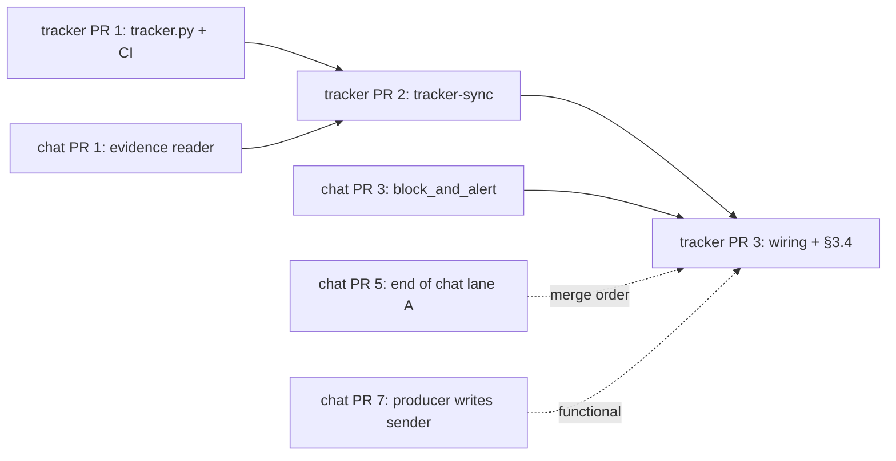

# The tracker half ships in three pull requests, the client first and the live wiring last

> **This repository is public.** No employer, person, space, address or message
> content appears here. The requester is "a requester" and the tracker is "the
> work tracker" (a self-hosted Redmine).

Implements `dd-ralph-redmine-tracker` at v2 (`Zhachory1/docs#15`, amended by
`Zhachory1/docs#17`, merged `7ad9a6b`). Every `§N` below is a section of that
document, with the line range it sits at in the merged text. Nothing the design
or its amendment settled is re-opened here.

All three pull requests are in `Zhachory1/ralph`, against `main` at
**`f679e09`** or later. **The design cited `e5ce164`; `main` has moved since.**
Every file this plan touches or cites is byte-identical at `f679e09` —
`bootstrap/chat-reply`, `bootstrap/chat-route`, `bootstrap/inbox-producer`,
`bootstrap/maintain-pr`, `notifier/poller.py` and
`profiles/orchestrator/SOUL.md` are untouched between the two commits, so their
line citations still resolve. Two files moved and neither is edited here:
`bootstrap/install` gained ten lines above its read-only chat-evidence mount, so
the design's `install:170-178` is now **`:178-187`**, and
`compose/docker-compose.yml` gained five lines at `:338`, below every line this
plan cites (`:31`, `:63`, `:176` and `:286` are unmoved).

**No tracker code exists in the tree at `f679e09`.** `grep -ri redmine` finds
only the two architecture diagrams, where it is dashed and labelled "DD awaiting
approval". This half is greenfield; nothing here is a refactor.

---

## Review header

### Decisions needed from you: three

Lettering: `D` is your lineage from the closed design, `T` the tracker design's
own, `P` the chat plan's. This plan's are **`Q`**, so none of the four collide.

| # | Decision | Why it is yours | Blocks |
|---|---|---|---|
| **Q1** | **D1's deliverable is one file, not a bare key.** This plan has `tracker-sync` read a single JSON file in the `tracker-creds` volume holding the base URL, the API key, the project identifier and the id of the thread-key custom field — because that field is created by hand (D1) and its id only exists after you create it, so the by-hand step that mints the key is the one that learns the id. The design says "put that key in the `tracker-creds` volume" and names no layout. **Confirm, or name the layout you want.** | You perform D1 by hand; this says exactly what you place and where. | PR 1 only, and one function in it. |
| **Q2** | **Two of §4's statuses are not stock Redmine.** A default Redmine ships `New`, `In Progress`, `Resolved`, `Feedback`, `Closed` and `Rejected` (general product knowledge, like the design's assumption 1 — your instance was not inspected and must not be). §4's table also uses **`Waiting on requester`** and **`Duplicate`**, which do not exist until someone creates them, in the admin interface, exactly like the custom field. Either create the two statuses, or map them onto stock ones in Q1's file: PR 1 ships the optional mapping either way, so the code cost is zero and the choice is yours. | It is admin work on your instance, and `Feedback` in place of `Waiting on requester` is a wording you have to live with in your own saved query. | Nothing in the merge path. It decides whether the feature works after D1, not whether a pull request can land. |
| **Q3** | **Confirm the chat plan's PR 8 creates the `tracker-creds` volume and the `tracker-sync` service stanza, carrying the two environment variables this plan names** (`RALPH_TRACKER_CREDS` on the tracker service, `RALPH_TRACKER_CONTAINER` on the sender). The design disclaims the compose services (§scope, `dd-tracker.md:131-134`) and the chat plan claims them in exactly one place (its assumption 8, its PR 8). That plan is in review and not merged, so the claim is not yet a fact. **If you would rather this plan own the stanza, it becomes a fourth pull request here** and the chat plan's PR 8 drops it. | You approve both plans, and only you can decide which one carries a file they both reach. | Nothing in this plan's merge path. It decides where one compose stanza is written. |

### Council dissent

Two review rounds. The first (`ralph-reviewer`, comment-only) raised one
blocking finding and three observations, and it re-resolved roughly thirty of
this document's citations against the source rather than trusting the narrative.
The second (the review queue's reliability lens) raised one blocking finding,
which is the larger of the two and the reason v3 exists.

- **Blocking, round 2, accepted in full: v2 planned a retry that could not
  happen.** PR 3 said a non-zero `--record` "retries next scan" **and** that it
  goes through `block_and_alert()`. Both cannot be true of the same failure. The
  sender's scan lists only `--status done` cards (`chat-reply:222-224`) and
  `handle()` refuses a card in any other status (`chat-reply:164-166`), so the
  moment the block lands the intake card leaves the set the retry is drawn from.
  One slow tracker call would have stranded an acknowledgement that the design
  says retries by itself (`dd-tracker.md:240-242`). v3 bounds the retry and
  fires the block at the end of it rather than at the start; see **"What changed
  in v3"** and PR 3.

- **Blocking, accepted in full.** v1 said `.final-sent` "arrives" in the chat
  plan's PR 2, in the cross-plan table and again in assumption 6. It does not:
  `.final-sent` is the shipped sender's own marker today (`chat-reply:27`), and
  only `.clarify-sent` is new. The consequence v1 drew from it was wrong too —
  `--settle` is not a no-op until chat PR 2, only its `Waiting on requester`
  half is. No `depends on` line changed, because none of them was wrong; the
  narrative around them was. Fixed in both places.
- **Observation, accepted.** One citation ran a line long
  (`dd-tracker.md:142-145`, now `:142-144`). The reviewer read it as starting
  two lines earlier; the start was right and the end was not.
- **Observation, no change, deliberately.** PR 1 adds
  `.github/workflows/tracker.yml`, which §7 does not name. The reviewer agreed
  with the reasoning and flagged it so you see it was a judgment call rather
  than an oversight. It is named in Scope, below, and it is yours to strike.
- **Observation, no change.** `docs/workflows.md` is edited by this plan's PR 3
  and the chat plan's PR 8. The rebase risk and the order (tracker first) were
  already stated; the reviewer called that acceptable.

### What changed in v3

One blocking finding, in one push. **PR 3's retry is now bounded and the block
fires at the end of it**, so a transient tracker failure retries by itself and
only a failure that keeps happening takes the card out of the loop — with the
recovery named rather than left to the reader (runbook step 9). PR 2 gains the
one line that makes a `--settle` failure attributable to an operation, because
the design's per-operation alert sentinel is unwritable without it. Sizes move
to ~250 (PR 3) and ~395 (PR 2); no pull request, file list, dependency or
decision changed, and nothing the design settled was re-opened.

### What changed in v2

Three narrative corrections and this header. No pull request, file list,
dependency, size or test plan changed, and no decision was re-opened.

### Scope: three pull requests, roughly 990 changed lines

**The design rated this half at three, and this is three**, one per unit, in the
design's own order (`dd-tracker.md:126-135`):

| Design's unit (`dd-tracker.md:128-131`) | Pull request here |
|---|---|
| The tracker client behind one module | PR 1 |
| `tracker-sync` with its own eval, inert because nothing calls it | PR 2 |
| The wiring that adds `--record` before the acknowledgement and `--settle` once per scan | PR 3 |

**Claimed by neither pull request, by the design's own instruction**
(`dd-tracker.md:131-135`): the extracted staged-evidence reader (the chat plan's
PR 1 builds it, and this half is its third caller, which is what made it a rule
of three), the compose services (chat plan PR 8, subject to Q3) and the chat
runbook (chat plan PR 8). PR 3 documents **only** the tracker's own failure path
(§3.4), because no pull request in either plan otherwise would, and an alert
nobody has read about is an alert nobody acts on.

**One addition the design did not name, and why it is not scope creep:** PR 1
also adds `.github/workflows/tracker.yml`. The design's §9 records that no chat
eval runs in CI (`dd-tracker.md:497-498`), and the chat plan fixes that for chat
files in its PR 1. The two tracker evals need the same treatment, it is a
25-line file, and putting it in the first pull request means PRs 2 and 3 arrive
with CI already watching them. It changes no runtime path.

### Class, per pull request

`dd-chat.md`'s scope section defines three classes and requires each planned
pull request to state one (`dd-chat.md:122-135`).

| | Class | Gated by |
|---|---|---|
| PR 1 | **3, tracker-side** | D1. No caller exists, and no key file exists. |
| PR 2 | **3, tracker-side** | D1. Nothing invokes the script. |
| PR 3 | **3, and 1 because it edits the live host sender** | D1 for any effect at all. Nothing gates the merge. |

---

## The cross-plan dependency table

`tracker-sync` consumes what the chat half produces and defines none of it
(§5, `dd-tracker.md:376-397`). Six things cross the line. **Only two block a
merge**; the rest decide whether the feature does anything once merged, which is
a different question and not a reason to hold a pull request.

| What this half reads | Written by | Chat plan PR (`Zhachory1/docs#22`) | Blocks a merge? |
|---|---|---|---|
| `evidence/item.json`, including **`sender`** | the public producer | **PR 7, "the producer stages the item record and creates the intake card"** | **No.** Functional. Until it merges the record comes from the overlay job, which may or may not carry `sender`; `--record` leaves the requester field unset rather than failing. |
| `bootstrap/chat_evidence.py`, the shared reader | the refactor | **PR 1, "one staged-evidence reader, and the chat evals run in CI"** | **Yes, for PR 2.** `tracker-sync` imports it. A second copy of those checks is the thing the rule of three exists to stop. |
| `.clarify-sent`, the one **new** marker `--settle` walks for | the sender | **PR 2, "`reply_kind` and `kind`, and one marker per reply kind"** | **No.** Functional, and only for half of `--settle`. `.final-sent` ships today (`chat-reply:27`, `MARKERS`), so the `Resolved` half works the day this plan's PR 2 merges, given chat plan PR 1. It is the `Waiting on requester` half that finds nothing until chat PR 2 creates `.clarify-sent`. |
| `kind` on the done card's decision metadata (R4's classification) | `chat-route`'s widened allow-list (`chat-route:55-56`) | **PR 2** | **No.** Functional. Absent, `--record` leaves the kind field unset. |
| `block_and_alert()` and its `.alerted-<kind>` sentinel | the sender's alerting | **PR 3, "the per-thread ceilings, and a failure you can see"** | **Yes, for PR 3.** §3.4 says the tracker reuses the same block and the same best-effort alert; a second copy in one file would be two mechanisms doing one job. |
| The `tracker-creds` volume and the `tracker-sync` service stanza | compose | **PR 8, "the sidecar services, the credential step, and the runbook"**, subject to **Q3** | **No.** Functional, and it is half of D1: with no volume there is no key file, which is the condition every pull request here is safe under. |

**The per-thread `flock` is not in this table.** It is the chat half's
(`dd-chat.md` §4.4, chat plan PR 3), this half cannot take it, and §3.3's
convergence guard is what makes `--record` correct without it
(`dd-tracker.md:283-320`). The guard ships in PR 2 whether or not the lock
exists, and its cost — one extra `Duplicate` item a person can see — is the
design's, stated there and not re-argued here (`dd-tracker.md:317-320`).

---

## PR 1: the tracker client, behind one module

- **Goal:** one module makes every call to the work tracker, resolves a thread
  key to exactly one item by the oldest-wins rule, and reports "not configured"
  instead of calling anything when no key file is there — so a build that cannot
  reach a tracker still has a fully tested client.
- **Implements:** §3's module sentence (`dd-tracker.md:226-231`), the thread-key
  lookup and the item fields of §4 (`dd-tracker.md:337-372`), the
  oldest-canonical rule of §3.3 (`dd-tracker.md:291-296`), the "not configured"
  gate of §3.2 (`dd-tracker.md:262-268`) and §7's `test_tracker` row
  (`dd-tracker.md:434`).
- **Class: 3, tracker-side.**
- **Inertness:** **inert on merge, on two independent grounds.** First, nothing
  imports it: `tracker-sync` does not exist until PR 2, `chat-reply` does not
  call it until PR 3, and no compose service runs anything. Second, even
  imported, every function needs a configuration, `load()` returns `None` when
  the file named by `RALPH_TRACKER_CREDS` is absent, and the module makes no
  call at import time. **It is safe to merge with D1 not done because there is
  no caller and no key**, and no eval here reaches the network: every test
  injects a fake opener.
- **Depends on:** nothing. **It can start immediately**, in parallel with the
  whole chat plan.
- **Size:** ~345 changed lines.
- **What:**
  - New `bootstrap/tracker.py`, stdlib only (`urllib.request`, `json`), so the
    image it runs in needs no new package and no `Dockerfile` change.
    - `load(path)` reads Q1's JSON file: `url`, `key`, `project`,
      `thread_field` (the custom-field id from D1's by-hand step) and an
      optional `statuses` map for Q2. A missing file, an unreadable file or a
      missing required key returns `None`, which every caller reads as "not
      configured". A file whose mode is group- or world-readable is refused, the
      way staged evidence is (`chat-reply:71-74`).
    - A `Tracker` object holding that configuration and an **injected** opener,
      defaulting to `urllib.request.build_opener()`. No business logic builds
      its own client, and no test needs the network.
    - `find(thread)` — `GET /issues.json` filtered on the thread-key custom
      field, `status_id=*`, sorted by id ascending, returning
      `(canonical, newer)`: the oldest item, and every other match. **One place
      implements oldest-wins**, because §3.3 requires every thread-keyed lookup
      in this half to reach the same answer (`dd-tracker.md:291-296`).
    - `create(fields)`, `update(id, fields)` and `note(id, text)` — the design's
      four named functions, with `note` posting a journal note rather than a
      field change.
    - `relate(a, b)` — a fifth function, and the one addition to the design's
      list. §3.3 step 2 requires a `related to` relation
      (`dd-tracker.md:300-301`), and Redmine creates relations through their own
      endpoint rather than as an issue field (general product knowledge), so
      `update` cannot carry it. Named here rather than slipped in.
    - Status names resolved to ids once per run from `/issue_statuses.json`,
      overridable by Q1's `statuses` map. A name that does not exist raises one
      error that **names the missing status** — Q2's whole failure mode, and the
      one message that makes it a two-minute fix.
    - Every call carries a timeout and a bounded retry, and a non-2xx raises a
      `TrackerError` holding the status code and the first 200 characters of the
      body: enough for §3.4's alert, short enough not to paste a payload into a
      card.
  - New `.github/workflows/tracker.yml`: runs `evals/test_tracker.py` and
    `evals/test_tracker_sync.py` on changes to `bootstrap/tracker*` and
    `evals/test_tracker*`, on `ubuntu-latest` with stdlib Python, the shape
    `skills-public.yml:27-33` already uses.
- **Planned files:**
  <planned_files>
  - bootstrap/tracker.py
  - evals/test_tracker.py
  - .github/workflows/tracker.yml
  </planned_files>
- **Test plan:**
  - Unit (`evals/test_tracker.py`, new), every case against a fake opener:
    `load()` returns `None` for a missing file, a malformed file, a file with no
    `thread_field` and a file at mode `0o644`; it returns a configuration for a
    well-formed `0o600` file.
  - Unit: `find` with no match returns `(None, [])`; with one match returns it
    and an empty rest; **with three matches returns the lowest id as canonical
    and the other two as `newer`, whatever order the fake returns them in** —
    oldest-wins tested as a rule, not as a happy path.
  - Unit: `create` sends §4's fields, including the thread key in the custom
    field (E12's "reads cold" row, `dd-tracker.md:434`); `update` sends only
    what it is given; `note` posts a journal note and changes no field;
    `relate` posts a `relates` relation.
  - Unit: an unknown status name raises an error naming that status; a name
    mapped through `statuses` resolves instead. Q2 passes either way.
  - Unit: a 500 raises `TrackerError` carrying the code; a connection error is
    retried the stated number of times and then raises. **No test opens a
    socket**: the fake opener is asserted to be the only transport used.
  - CI: the new workflow runs on this pull request and is green.

## PR 2: `bootstrap/tracker-sync`, both entry points and the convergence guard

- **Goal:** one script makes the work tracker match the state of a chat
  operation — `--record` before an acknowledgement, `--settle` after replies —
  with every write idempotent, including its own markers, and with §3.3's guard
  resolving a lost race rather than only detecting it.
- **Implements:** §3 (`dd-tracker.md:226-231`), §3.1's two entry points
  (`dd-tracker.md:233-249`), §3.2's idempotence and the "not configured" exit
  (`dd-tracker.md:251-268`), §3.3's walk, dependency and guard
  (`dd-tracker.md:270-320`), §4's fields, statuses and evidence removal
  (`dd-tracker.md:337-372`), §5's input contract (`dd-tracker.md:376-397`) and
  §7's `test_tracker_sync` rows (`dd-tracker.md:428-435`).
- **Class: 3, tracker-side.**
- **Inertness:** **inert on merge.** Nothing invokes it: `chat-reply` gains the
  call in PR 3, no compose service runs it (the design's §2 service is exec'd
  into, never ticked, `dd-tracker.md:216-222`), and no cron entry or LaunchAgent
  names it. **It is safe to merge with D1 not done** for the second reason as
  well: with no key file both entry points print "tracker not configured",
  change nothing and **exit 0**, which is the exit code PR 3's gate reads as
  success (`dd-tracker.md:262-268`).
- **Depends on:** **PR 1** (it imports the module) and, across plans, **chat
  plan PR 1** (it imports `bootstrap/chat_evidence.py`). Functionally but not
  for the merge: chat plan PR 7 for `sender`, chat plan PR 2 for the
  `.clarify-sent` marker and `kind`.
- **Size:** ~395 changed lines. **If the build comes in over 400, the split is
  decided here rather than improvised:** `--record` with the guard in one pull
  request, `--settle` with the evidence removal in a second, same files, same
  order, `--settle` second. Say so on the card instead of shrinking a test.
- **What:**
  - New `bootstrap/tracker-sync`, with `--record <op>`, `--settle` and
    `--work-root`, mirroring `chat-route`'s argument shape
    (`chat-route:109-112`). Exactly two entry points: §8 forbids a third job and
    a tick of its own (`dd-tracker.md:448-450`).
  - **Reading an operation.** `import chat_evidence` for the validated item,
    resolved from the script's own directory the way `chat-reply:128` resolves
    `gchat.py`. An operation the reader refuses is **skipped with one line on
    stderr** and never recorded: §3.3 rests the walk's safety on the refusals
    the sender already makes (`dd-tracker.md:277-281`).
  - **`--record <op>`.** An existing `.tracker-recorded` exits 0 — a marker that
    is there is success, not an error, which is the load-bearing paragraph of
    §3.2 (`dd-tracker.md:251-260`). Otherwise `find(thread)`, create with §4's
    fields when there is no match, then **re-query and run the guard**:
    1. every `newer` item loses its thread-key custom field and becomes
       `Duplicate`, with a `note` saying which item it folded into;
    2. `relate` each one to the canonical item;
    3. write, **or rewrite**, `.tracker-recorded` to the **canonical** id, never
       the id this call happened to create.
    The marker is written without `O_EXCL`, and the reason is a comment in the
    code rather than folklore: `chat-reply:145-147` uses `O_EXCL` for a send
    that must happen once, and copying it here deadlocks the acknowledgement on
    the first retry (`dd-tracker.md:253-260`).
  - **`--settle`.** Walk `root/*/` on disk, not the sender's
    `list --status done` loop, which stops looking at an operation once its
    reply marker exists (`chat-reply:239-242`; `dd-tracker.md:270-275`). For
    each operation: a clarification marker and no `.tracker-waiting` writes the
    pending record and sets `Waiting on requester`; a final marker and no
    `.tracker-closed` sets `Resolved` with the outcome from the report card,
    then removes the operation's `evidence/` directory and **keeps every marker
    file**, so the thread's history still counts (`dd-tracker.md:369-372`).
    `Resolved` is written **only** with a non-empty outcome; an empty one is
    `Closed`, which is what keeps E11's "finished badly" apart from "never
    finished" (`dd-tracker.md:361-363`).
  - **Both entry points resolve the item by thread key at the start of every
    call** and treat the id in a marker as advisory. That is the rule that makes
    the other operation's stale marker converge from its own side
    (`dd-tracker.md:305-311`).
  - **Reading cards.** One `hermes kanban list --json` per board through the
    same `docker exec`-or-local helper `inbox-producer:29-33` uses, matched to
    operations by the `operation_id:` line: `ack` for `--record`, the final
    `body` for `--settle` (`dd-tracker.md:245-249`). It reads no decision in
    order to act on one.
  - **One failing operation does not end the `--settle` walk, and it says which
    one failed.** A `TrackerError` on one operation prints
    `settle-failed: <op_id>` on stderr, the walk continues to the operations
    after it, and the command exits 1 at the end. **This line is what makes
    §3.4's per-operation alert writable at all** (`dd-tracker.md:330-332`): the
    sender gets one `.alerted-tracker-settle` per operation only if it can tell
    which operation it was, and `--settle` is the only party that knows. One
    failing item otherwise hides every operation behind it in the walk.
  - **Exit codes:** 0 for done, nothing to do, or not configured; 1 for a
    retryable failure; 2 for a refusal. The same three `chat-reply:154-155`
    already documents, so PR 3's wiring needs no new vocabulary.
- **Planned files:**
  <planned_files>
  - bootstrap/tracker-sync
  - evals/test_tracker_sync.py
  </planned_files>
- **Test plan:** every test runs against PR 1's fake opener and a temporary work
  root. No network, no credential, no tracker.
  - Unit: with no key file, `--record` and `--settle` both print "tracker not
    configured", write nothing and **exit 0**. The inertness claim, as a test.
  - Unit (E1, `dd-tracker.md:428`): `--record` creates one item carrying the
    requester, the request text, the kind, the state and the thread key, and
    writes `.tracker-recorded` holding its id.
  - Unit (E2, `:429`): a second `--record` over the same operation exits 0,
    creates nothing and leaves the marker unchanged.
  - Unit (E5, E13, `:431`): a thread with an existing item is found, not
    recreated. **A forced double create converges**: the newer item loses its
    thread key and becomes `Duplicate`, a `relates` relation is posted, the
    marker holds the **canonical** id, and a `find` afterwards returns exactly
    one item.
  - Unit: the loser's own operation, whose marker still names the demoted item,
    settles against the canonical item on its next pass — the convergence
    claimed at `dd-tracker.md:305-311`, tested from the other side.
  - Unit (E8, E10, `:432`): `--settle` closes an item once; a second pass exits
    0 and writes nothing; an already-closed item stays retryable rather than
    erroring.
  - Unit (E11, `:433`): an empty outcome gives `Closed`, a non-empty one
    `Resolved`.
  - Unit (E15-E18, `:435`): a clarification marker yields the pending record
    once and sets `Waiting on requester`; nothing sweeps or expires it.
  - Unit: `--settle` removes `evidence/`, keeps the markers, **and leaves the
    operation directory in place**, so the chat producer's `prior_operations`
    still counts that operation (chat plan PR 7).
  - Unit: an operation whose `item.json` the shared reader refuses is skipped,
    and `--settle` still processes the operations after it in the walk.
  - Unit: a tracker failure on one operation prints `settle-failed: <op_id>`,
    **the operations after it in the walk are still settled**, and the command
    exits 1. The line PR 3's per-operation sentinel is parsed from, tested where
    it is produced.

## PR 3: the wiring, and a tracker failure you can see

- **Goal:** the sender records the item before it acknowledges and settles once
  per scan; a transient tracker failure **retries on the next scan, by itself**,
  and only a failure that keeps happening blocks the card and alerts; and with
  no key file the requester-facing path is the one that runs today, unchanged.
- **Implements:** §3.1's "called by" column (`dd-tracker.md:233-243`), §2's
  local-or-`docker exec` invocation (`dd-tracker.md:216-222`) and §3.4 in full
  (`dd-tracker.md:322-333`).
- **Class: 1 and 3.** It edits `bootstrap/chat-reply`, which runs every sixty
  seconds against live threads, **and** every path it adds is gated on D1.
- **Inertness:** **not inert by file, and fully gated by behaviour.** The gate
  is one exit code: with no key file `tracker-sync` exits 0, so `--record`
  succeeds, the acknowledgement goes out unchanged, and the only measurable
  difference is one extra process per acknowledgement. **Adding `--record`
  before the acknowledgement can only delay a send, never add one**
  (`dd-tracker.md:142-144`): it sits on the branch that already holds the
  acknowledgement until `chat-route` confirms (`chat-reply:193-199`), and a
  non-zero exit sends nothing and retries next scan, exactly as a failed
  `chat-route` does today. With no key file **no failure path runs at all**: the
  retry counter is never created, nothing is ever blocked and nothing is ever
  alerted. **`--settle` cannot touch a send at all.** It runs at
  the top of `scan()`, before any card is handled; its failure sets the scan's
  exit status and alerts, and never withholds a reply, because everything it
  does happens after a reply has gone out (`dd-tracker.md:240-243`).
- **Depends on:** **PR 2** (there must be a script to call) and, across plans,
  **chat plan PR 3** for `block_and_alert()` and its `.alerted-<kind>` sentinel.
  **Sequenced after the chat plan's lane A (its PR 5)** — see Order below. That
  is a merge-conflict constraint, not a behavioural one.
- **Size:** ~250 changed lines.
- **What:**
  - `bootstrap/chat-reply`: a `tracker(*args)` helper in the shape
    `inbox-producer:29-33` already uses — `docker exec` into
    `RALPH_TRACKER_CONTAINER` when that variable is set, the local
    `bootstrap/tracker-sync` when it is not. §2 requires both, because the
    wiring lands before the compose service does (`dd-tracker.md:218-222`).
  - In `handle()`, in the `kind == "ack"` branch, **after** the `chat-route`
    confirmation at `:193-199` and **before** `post()`:
    `tracker("--record", op_id)`. A non-zero exit returns 1, the
    acknowledgement is not sent, and the operation retries next scan.
  - **The retry is real, and it is bounded — the load-bearing paragraph of this
    pull request.** The sender's scan lists only `--status done` cards
    (`chat-reply:222-224`) and `handle()` refuses a card in any other status
    (`chat-reply:164-166`), so **blocking the intake card is what ends the
    retry**, not what reports it. The two cannot fire on the same failure. So:
    - a non-zero `--record` increments a decimal count in
      `<root>/<op>/.tracker-record-failures`, mode `0600`, written with a plain
      open rather than `O_EXCL` for the reason §3.2 gives about
      `.tracker-recorded` (`dd-tracker.md:251-260`) — it is a counter, not a
      once-only marker;
    - **below `TRACKER_RECORD_ATTEMPTS` (5, a named constant) nothing blocks and
      nothing alerts.** The card stays `done`, the shipped loop calls `handle()`
      again next minute, and `--record` runs again. That is the retry the design
      describes (`dd-tracker.md:240-242`), and five scans is five minutes,
      because the scan is the clock and a counter is the only state that
      survives a restart of the sender;
    - **on the attempt that reaches the budget, and immediately on a refusal
      (exit 2, where there is nothing to retry), `block_and_alert()` fires
      once.** That is §3.4's "repeating retry" (`dd-tracker.md:328-330`), and
      the end of the automatic path **on purpose**: an acknowledgement held by a
      tracker that has been failing for five minutes is the quiet failure §3.4
      exists to make loud. Recovery is runbook step 9, named rather than left to
      the reader;
    - **any exit 0 removes the counter**, including "tracker not configured", so
      an outage followed by a success does not leave the next failure one
      attempt from the ceiling.
    No retry can send twice: no marker is written until `post()` succeeds
    (`chat-reply:200-206`), `chat-route` is idempotent, and `--record` is
    idempotent by thread key and by `.tracker-recorded`.
  - In `scan()`, once, after `instance_config()` and before the board loop:
    `tracker("--settle")`. A non-zero exit sets the scan's status and alerts;
    the loop continues.
  - **A `--settle` failure alerts and blocks nothing**, once per failing
    operation, guarded by `.alerted-tracker-settle` in that operation's
    directory and keyed off the `settle-failed: <op_id>` lines PR 2 prints. §3.4
    names one card to block, and it is the intake card whose acknowledgement is
    held; by the time `--settle` runs the reply is already out
    (`dd-tracker.md:240-243`), so there is no card whose progress a block would
    protect and a blocked done card would be board noise a worker never clears.
    The alert is the whole signal here, with `notifier/poller.py:121-127` as the
    backstop the design names.
  - **The `--record` path uses chat plan PR 3's `block_and_alert()` whole; the
    `--settle` path uses only its alert half** — `notify()`
    (`maintain-pr:303-305`), which that helper itself calls — because
    `block_and_alert()` blocks by definition and `--settle` has no card to
    block. Both are guarded by an `.alerted-<kind>` sentinel, so a loop reports
    itself once rather than every minute (`dd-tracker.md:326-332`). The two
    sentinel kinds this pull request adds are `tracker-record` and
    `tracker-settle`.
  - `docs/operations.md`: one short tracker section — what the two sentinels
    mean, what a blocked card with a tracker reason is **and how to clear it
    (runbook step 9)**, where the key file lives, and the three admin-interface
    steps D1 needs (the account, the custom field, Q2's statuses).
    `docs/workflows.md:82-92`'s chat-loop owner list
    gains `tracker-sync` as the step between the acknowledgement and the reply.
    **This is the tracker's own runbook text, not the chat runbook**, which is
    chat plan PR 8's; if that pull request has not merged, this section is
    appended to the same file and PR 8 rebases over it.
- **Planned files:**
  <planned_files>
  - bootstrap/chat-reply
  - evals/test_chat_reply.py
  - docs/operations.md
  - docs/workflows.md
  </planned_files>
- **Test plan:**
  - Unit (E1, `dd-tracker.md:428`): a **non-zero `--record` sends nothing** and
    returns 1, with `post()` asserted not called. The single most important test
    in this pull request.
  - Unit: `--record` runs after the `chat-route` confirmation and before
    `post()`, proved by call order on the patched runner rather than by reading
    the source.
  - Unit (E3, `:430`): a `decline`, an `ignore` and a `reply` decision call
    `tracker-sync` **not at all**. Only an `ack` records.
  - Unit: with `--record` exiting 0 and printing "tracker not configured", the
    acknowledgement is sent and the fifteen shipped tests in
    `evals/test_chat_reply.py` pass unchanged. That is the inertness claim, as a
    test.
  - Unit: `--settle` runs once per scan, before any card is handled; a non-zero
    `--settle` sets the scan status, alerts once, and **stops no reply from
    going out**; a second scan with the same `settle-failed:` operation alerts
    no second time, and **no card is blocked** by either scan.
  - **Unit, the retry, which is the test this pull request exists for:** one
    non-zero `--record` blocks nothing and alerts nothing, and **the next scan
    over the same still-`done` card calls `--record` again**. Asserted on the
    card listing the second scan makes, not on the counter file: the defect
    this replaces was a plan in which the second scan could not see the card.
  - Unit: five consecutive non-zero `--record` calls block the card once and
    alert once, on the fifth; a sixth scan alerts no second time.
  - Unit: four failures then a success clears `.tracker-record-failures`, the
    acknowledgement goes out, and a later failure starts counting from one.
  - Unit: a `--record` **refusal** (exit 2) blocks and alerts on the first
    failure, with no retry budget spent.
  - Unit: with no key file (`--record` exits 0, "tracker not configured"), no
    counter file is ever created and `block_and_alert()` is never called. The
    inertness claim on the failure path, as a test.
  - Unit: with `RALPH_TRACKER_CONTAINER` set the call is a `docker exec`; with
    it unset the same arguments run locally.

---

## Order and parallelism

**One lane, three pull requests, strictly sequential**, because each needs the
one before it to exist: PR 2 imports PR 1, PR 3 calls PR 2.

- **PR 1 can start now.** It shares no file with the chat plan and waits on
  nothing. It is the only pull request in either plan that can be built before
  anything at all has merged.
- **PR 2 waits on chat plan PR 1**, which is first in the chat plan's lane A and
  itself depends on nothing. In practice the two plans' first pull requests are
  built in parallel, and PR 2 starts when both have merged.
- **PR 3 waits on chat plan PR 3 to work, and on chat plan PR 5 to merge
  cleanly.** The functional dependency is `block_and_alert()`. The ordering one
  is the chat plan's named hotspot: `bootstrap/chat-reply` already carries five
  of its eight pull requests in sequence (`plan-chat.md:608-614`), and **this
  pull request is a sixth toucher of that file**. Slotting it into that chain
  buys nothing and costs every later chat pull request a rebase, so it goes
  after the chain.
- **Nothing here runs in parallel with anything else here.** The honest shortest
  path is PR 1 immediately, PR 2 one chat merge later, PR 3 after the chat
  sender work is finished. If the chat plan slips, PRs 1 and 2 still land and
  still do nothing, which is the point of the inertness claims.

**The hotspot, named rather than discovered late:** `bootstrap/chat-reply` is
265 lines at `f679e09`, roughly 450 after the chat plan's PR 5 and roughly 500
after this plan's PR 3 — past the standards' 400-line refactor threshold, short
of the 800-line one. The chat design chose one sender in one file on purpose, so
that one `grep` over two files proves there is exactly one way to send
(`dd-chat.md:222`, §2 option C). No pull request in either plan splits it, and
splitting it would weaken that proof. It is flagged so the next change to that
file is a decomposition decision somebody makes deliberately.

---

## Owner-only runbook — no card is created for any of these

These are yours. None is a pull request, and nothing in this plan schedules
them. **All of D1 happens after PR 3 merges and before anything works**; every
pull request here merges with none of it done.

1. **Enable the work tracker's REST API** (D1). A setting on your instance.
2. **Create Ralph's own account on the tracker**, with access to the project it
   files into. Not your account: §2's separation is about which credential sits
   in which volume, and a shared account makes "who wrote this" unanswerable.
3. **Generate that account's per-user API key.**
4. **Create the thread-key custom field by hand, in the admin interface.**
   **This part is not an API call** — Redmine creates custom fields through the
   admin interface and not over REST (general product knowledge; the design's
   assumption 1, `dd-tracker.md:468-471`). An issue custom field, format string,
   enabled for the project from step 2. You need **its numeric id** for step 6.
5. **Settle Q2's two statuses, also by hand.** Either create
   `Waiting on requester` and `Duplicate` as issue statuses and add them to the
   workflow for Ralph's role, or map them onto stock statuses in step 6's file.
   No code changes either way.
6. **Write Q1's file into the `tracker-creds` volume**, mode `0600`, owned by
   the service user: the base URL, the key from step 3, the project identifier,
   the custom-field id from step 4, and Q2's optional status map. **Not beside
   the chat token** — a different volume, mounted into a different service, is
   the whole of §2's separation claim (`dd-tracker.md:209-214`).
7. **Make one read-only call by hand, from inside the tracker service, before
   the first real one.** The design's assumption 1 says the first eval runs
   against a fake and the first live call is manual
   (`dd-tracker.md:468-471`). Every test in this plan proves the code's
   behaviour against a fake tracker, and none proves that your instance answers
   the way the product documentation says. One `curl` of the issues endpoint
   with the key, checking that the project exists and the custom field comes
   back, is the whole step.
8. **Watch the first acknowledgement.** The first `--record` against live
   traffic is the first write. If it fails, the sender retries it for five
   scans; if it is still failing after that, §3.4's alert fires once and the
   card blocks. The requester gets nothing they would not have got anyway,
   because a failed record holds the acknowledgement rather than sending a wrong
   one.
9. **Clearing a card blocked with a tracker-record reason** — the one recovery
   step, and the only thing that restarts a held acknowledgement. The block is
   deliberate (PR 3): five scans of failures mean the tracker, not the moment.
   In order: fix the tracker, **or** rename the key file, which makes
   `tracker-sync` inert again and lets the acknowledgement go out untracked;
   delete `.alerted-tracker-record` and `.tracker-record-failures` from
   `<chat-inbox>/<operation>/`, or the next alert will not fire and the counter
   starts at the ceiling; then unblock the intake card. **Nothing here is
   urgent and nothing is lost by waiting** — the request is already an
   orchestrator card, because `--record` runs only after `chat-route` confirms
   one (`chat-reply:193-199`). What the requester is missing is the
   acknowledgement, not the work.

---

## Assumptions

Every inference the design, its amendment, the card and the verified source did
not state. The design's own six (`dd-tracker.md:464-485`) still stand and are
not repeated.

1. **D1's deliverable is one JSON file holding url, key, project and the
   custom-field id** (PR 1, Q1). The design says "that key in the
   `tracker-creds` volume" and names no layout. The field id has to travel from
   a by-hand admin step into the code somehow, and the file that carries the key
   is the only place that already exists.
2. **`Waiting on requester` and `Duplicate` are not stock Redmine statuses**
   (Q2), so §4's table needs either two created statuses or a mapping. General
   product knowledge, marked as such; your instance was not inspected. This is
   the plan's largest correctness inference, and if it is wrong in your
   instance's favour, Q2 costs you nothing.
3. **`relate` is a fifth module function**, because §3.3 step 2 needs an issue
   relation and Redmine creates relations through their own endpoint rather than
   as an issue field. The design listed four functions and required a relation;
   one of the two had to give.
4. **`tracker.py` stays stdlib-only** (`urllib.request`), so no image gains a
   package and no `Dockerfile` changes in this plan. The chat plan's PR 8
   already pays an image cost for `gchat.py`'s four packages; this half adds
   none.
5. **`tracker-sync` imports `bootstrap/chat_evidence.py` rather than reading
   `item.json` itself** (PR 2). The design calls that reader "the extracted
   staged-evidence reader all three scripts need"
   (`dd-tracker.md:131-134`), which names this half as the third caller without
   saying it imports it. The alternative is a third copy of the refusals.
6. **A clarification marker means `.clarify-sent` and a final marker means
   `.final-sent`.** §3.1 says "a clarification marker" and names no file.
   `.final-sent` is the shipped sender's own marker (`chat-reply:27`); only
   `.clarify-sent` is new, and the chat plan's PR 2 adds it.
7. **`RALPH_TRACKER_CONTAINER` on the sender and `RALPH_TRACKER_CREDS` on the
   tracker service are the two variables the compose stanza must carry** (PR 3,
   Q3). The design names the local-or-exec behaviour and the volume, not the
   variables. They are listed here so whoever writes the stanza has the list.
8. **The tracker's own failure path is documented in `docs/operations.md` by
   PR 3** (see Scope). The design disclaims "the runbook", which is the chat
   runbook; nothing else in either plan would describe a blocked card carrying a
   tracker reason.
9. **A `--settle` failure never withholds a reply** (PR 3). §3.1 says everything
   `--settle` does happens after a reply has gone out
   (`dd-tracker.md:240-243`); this makes that a property of the wiring, by
   running it before the board loop and letting it set only the exit status.
10. **The two tracker evals run in CI from PR 1** on `ubuntu-latest` with stdlib
    Python, the shape `skills-public.yml:27-33` uses. No eval in this plan
    reaches the network or needs a credential.
11. **"A repeating retry" is five consecutive failed `--record` calls, counted
    in a file the sender owns** (PR 3). §3.4 says the block and the alert fire
    on a repeating retry and gives no number (`dd-tracker.md:328-330`); a plan
    that leaves the number out either blocks on the first failure, which strands
    the acknowledgement, or never blocks, which is the quiet failure §3.4
    exists for. Five is one per scan and so five minutes. The counter lives with
    the sender rather than in `tracker-sync` because the retry policy is the
    sender's — it is the party that decides to hold a send — and because
    `tracker-sync` must stay callable by hand without spending a budget.
12. **Unblocking the intake card is enough to resume a held acknowledgement**
    (runbook step 9). The sender's scan reads `--status done`
    (`chat-reply:222-224`); whether an unblock restores `done` directly or
    returns the card for the chat-maintainer to complete again, the next scan
    sees it either way, and every step after it is idempotent — no marker was
    written, so nothing was sent (`chat-reply:200-206`). **The kanban kernel is
    not in this repository and was not read**, so the exact post-unblock status
    is the one claim here taken from behaviour rather than from source. It
    changes no file list: if an unblock turns out to need a second action, that
    is a line in `docs/operations.md`, which PR 3 already writes.
13. **A `--settle` failure alerts and blocks no card** (PR 3). §3.4 names a
    block without naming which card, and `--settle` has no card: it runs once
    per scan over a directory walk, after every reply is out. Alerting is the
    half of §3.4 that applies.

### Observations, out of scope

- **The chat plan's `block_and_alert()` has the same shape on its own retryable
  failures, and that is the chat plan's question, not this one's.** Chat plan
  PR 3 fires it "on a refusal and on a retryable failure alike"
  (`plan-chat.md:261-265`), and a block takes any intake card out of the
  `--status done` listing the retry is drawn from — the same mechanism this
  plan's v3 fixes for `--record`. Whether a failed `post()` should keep its
  retry is for `Zhachory1/docs#22` to answer; **naming it here rather than
  editing that document**, because one plan editing another's pull request is
  how two plans stop agreeing.
- **`RALPH_TRACKER_HOST` and this plan's `url` are two names for one host.** The
  chat plan's PR 4 refuses any reply that mentions the tracker host, reading it
  from `RALPH_TRACKER_HOST` in the instance env (its assumption 6); this plan
  reads the same host from the creds file, in a different service. Two sources
  for one fact. Harmless today, because one refuses a reply and the other makes
  a call, and worth one line of cleanup if a third reader ever appears.
- **Nothing in either plan ever shows a requester an item id** (R1,
  `dd-tracker.md:454-455`). The tracker half never sends, and the chat half
  refuses tracker references in outbound text. Stated here because it is the one
  guarantee that spans both plans and neither document owns alone.
- **`--settle` walks every operation directory on every scan**, once a minute,
  and nothing prunes those directories, because the markers have to stay for the
  thread's history (`dd-tracker.md:369-372`). At pilot volume this does not
  matter. At thousands of operations it is a scan that gets slower every week,
  and the fix — an index, or settling only operations whose markers changed
  since the last pass — is not in this plan because the design does not ask for
  one.
