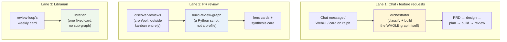
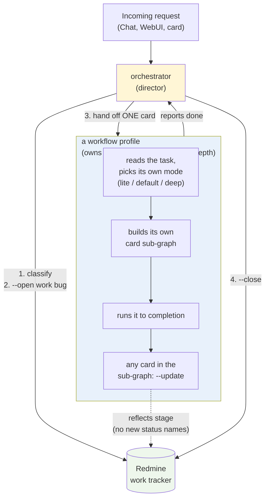
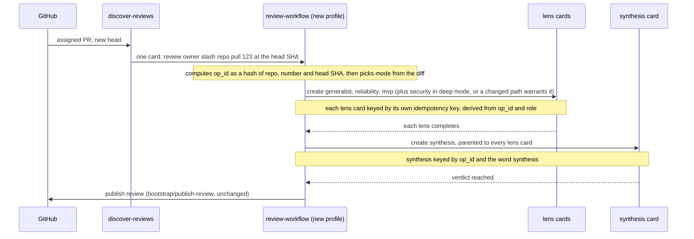
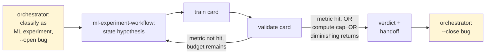

# Orchestrator becomes a director — workflow profiles own their own shape, mode, and brief depth; the work tracker is the spine across every lane

> **This repository is public.** No employer, person, space or message content
> appears here. The work instance's docs repository is "the work docs
> repository".

Status: **approved** by the owner (merge of Zhachory1/docs#32, 2026-11-13). A design spike for [ralph#180](https://github.com/Zhachory1/ralph/issues/180), read alongside [ralph#163](https://github.com/Zhachory1/ralph/issues/163) (a separate, read-only audit of what exists today — its findings may change or delay this). `bootstrap/tracker-work` and its `--open`/`--update`/`--close` shape ([ralph#177](https://github.com/Zhachory1/ralph/pull/177), merged) already exist; this design widens who uses it and extracts logic that already exists elsewhere into new profiles, rather than inventing new mechanics.

## Review header

**Decisions needed from you:** whether `review-workflow`'s card-creation logic should be a genuine rewrite (compute its own idempotency keys, call `hermes kanban create` directly) or call the existing `bootstrap/build-review-graph` script. **Resolved in conversation 2026-11-13: rewrite.** See [Why a rewrite, not a wrapper](#why-a-rewrite-not-a-wrapper) for the reasoning and what specifically justified it.

## The problem, as it stands today

Three independent ways work starts, each with its own owner, and only one of the three has a director role at all:

Orchestrator's own prompt (`profiles/orchestrator/SOUL.md`) contains the actual graph-building logic for lane 1 ("a feature runs PRD to design doc to PRs," the gate sequence, decompose) directly in its text. Lane 2's equivalent logic lives in `bootstrap/build-review-graph`, a deterministic Python script — never a profile, never touched by orchestrator. Lane 3 is one fixed card with no sub-graph at all.

**Consequence:** "where does work come from" has three different answers depending on which kind of work you mean, and nothing ties a unit of work's whole lifecycle together across cards, boards, or lanes. [ralph#177](https://github.com/Zhachory1/ralph/pull/177) gave lane 1 a tracker item per graph; lanes 2 and 3 have no tracker presence at all.

## The proposed shape

- **Orchestrator classifies, opens, hands off, watches, closes — and nothing else.** It stops containing any one workflow's graph-building logic, and it does not pick a workflow's mode either (see [Mode levels](#mode-levels-lite--default--deep)). "A feature runs PRD→design→plan→build" moves out of orchestrator's prompt and into a `feature-workflow` profile's own prompt; "discover, stage evidence, fan out lenses, synthesize" moves from `build-review-graph`'s Python into a `review-workflow` profile's own prompt.
- **A workflow profile owns one shape — but only when that shape earns the abstraction.** A workflow profile is warranted when its sub-steps are complicated *and* non-deterministic enough to need coordinating multiple cards or profiles: a parallel fan-out (review's lenses), a branching multi-document gate chain (feature's PRD/design/plan), a loop with a stop condition that depends on evidence (an ML experiment's hypothesis/train/validate). A long but deterministic checklist run by one profile claiming one card — librarian's nine ordered steps, none of them branching into new cards — does not meet that bar and stays exactly what it already is: a regular profile working a fixed sequence, no sub-graph, no workflow-profile wrapper. "Complicated" alone is not the test; a long deterministic list is still simple in the sense that matters here.
- **The tracker item is the spine, not a side channel.** One Redmine issue per unit of work, opened once by orchestrator at classification time, carried through every stage regardless of which workflow or how many cards it took, closed once by orchestrator when it judges the work done. Only orchestrator ever calls `--open`/`--close` — settled explicitly in conversation: the director declares a work order complete; a workflow profile reports done, it does not close its own bug.
- **Direct-triggered, fixed-shape jobs stay outside this, and get no tracker bug at all.** PR review and librarian are mechanical, predetermined, and high-frequency — hundreds of review graphs over time, one librarian run a week. A Redmine issue per run would flood the tracker with noise nobody reads, defeating its purpose as a signal for real units of work a human or workflow is actually waiting on. Each already has its own visible record where it belongs: a review's result is the PR itself; a librarian run's result is its own pull request. They keep their own outside-the-graph triggers (`discover-reviews`'s poll, `review-loop`'s weekly card) and never call `tracker-work` at all, in any mode.

## Why a rewrite, not a wrapper

The first draft of this design proposed `review-workflow` as a thin judgment layer calling `bootstrap/build-review-graph` to do the actual card creation, on the assumption the script held correctness properties a prompt-driven process couldn't cheaply replicate. Walking through what the script actually does settled this the other way:

- **Idempotency keys are a pure formula, not script-held state.** `build-review-graph`'s `op_id` is `"review-" + sha256(f"{repo}:{number}:{head_sha}")` ([`bootstrap/stage-review-evidence`](https://github.com/Zhachory1/ralph/blob/main/bootstrap/stage-review-evidence)'s `operation_id()`), and each card's key is `f"{op_id}-{role}"`. An LLM computing the same `sha256` of the same inputs gets the identical key, every time — there is no filesystem coordination or race the script is protecting that the formula does not already resolve.
- **The retry cap is Hermes's own guarantee, not the script's.** `--max-retries 3`/`--max-runtime 480` are flags `build-review-graph` passes straight through to `hermes kanban create`; they are enforced by the kanban kernel regardless of who calls the command. A profile calling `hermes kanban create --max-retries 3` directly gets the same guarantee.
- **Finding new PRs and head SHAs stays a script's job, correctly.** `discover-reviews`'s polling loop is unaffected by this decision — it keeps finding assigned PRs and new heads exactly as today. `review-workflow` only starts once `discover-reviews` hands it one already-discovered `(repo, number, head_sha)`; the LLM never polls GitHub itself.
- **Workspace resolution is satisfied by the profile running in-container, not by the script.** `build-review-graph`'s own docstring notes staging and creating cards from the host produced cards whose `evidence_root` the container could not see — the fix was running from inside the hermes container, which every profile's terminal tool already does by construction.

**Conclusion:** `review-workflow` computes its own deterministic `op_id`/keys from `(repo, number, head_sha)`, decides mode and brief depth from the diff, and calls `hermes kanban create --idempotency-key ... --parent ...` directly for each lens card and the synthesis card. `bootstrap/build-review-graph` becomes dead code once `review-workflow` is live and proven, and is retired rather than kept as a parallel path.

## Worked example 1: review, converted to a workflow profile

`discover-reviews` keeps polling exactly as it does today — it is the direct trigger this design says lane 2 should keep. `publish-review`'s deterministic posting logic is untouched; only card creation moves from a script into `review-workflow`'s own prompt, per the decision above.

## Worked example 2: a new workflow shape that does not fit lane 1 or lane 2

[`Zhachory1/autopraxis`](https://github.com/Zhachory1/autopraxis)'s `ml-experiments` skill names a shape neither existing lane has: hypothesis → train → validate, looping until a metric hits its target, a compute cap is hit, or returns diminish — not a document-gate chain, not a fan-out-then-synthesize. Referenced here for the *shape* only; its actual machinery (agent-fleet `/council`, telemetry MCP, long-term memory MCP) does not exist in Ralph's stack and is explicitly not part of this proposal.

The loop-stop condition (metric hit / compute cap / diminishing returns) is `ml-experiment-workflow`'s own business, the same way review's lens-count and synthesis-parent rule is `review-workflow`'s own business. Orchestrator never needs to know what "diminishing returns" means for an ML experiment; it only needs to know the workflow eventually reports done. **Deferred** — not one of the first two profiles built; picked up later, against real need.

## What this is not

- Not a change to review's actual *rules*: one review per head commit, lens-then-synthesize order, the 3-attempt cap. `review-workflow` enforces the same rules `build-review-graph` enforces today — the decision above changes who writes the cards, not what they are.
- Not porting `agent-fleet`, `/council`, or any MCP (telemetry, long-term memory) from autopraxis. Those are a different runtime. Only the *shape* of its workflows (mode levels, loop-stop conditions) is referenced.
- Not a change to `bootstrap/tracker-work`'s open/update/close ownership rule. It already matches this proposal: orchestrator only.
- Not required reading before ralph#163's audit finishes. If that audit finds a profile or script this proposal would touch is already slated for deletion, this spike should be revisited against those findings first.

## The first two workflow profiles

**Decided:** the minimum set to build first is `review-workflow` and `feature-workflow`. Both have real existing logic to move (`build-review-graph`'s script, retired per the decision above; orchestrator's own PRD→design→plan→build prose) and both pass the complicated-and-non-deterministic test above. Every other autopraxis-inspired shape (`ml-experiment-workflow` or similar) is deferred — picked up later, against real need, not speculatively built now.

## Mode levels: lite / default / deep

Today both candidate workflows are already one fixed shape regardless of how small or large the triggering work is — every feature gets all three document gates; every review gets the same lens set except for one existing exception (the security lens only runs when a changed path warrants it, `build-review-graph`'s one real precedent for this). Autopraxis's skills (`plan-to-launch`, `pr-review`) name this split explicitly as `lite`/`default`/`deep`, each with its own budget. Worth building into both new workflow profiles from the start, not bolted on after:

| Mode | `review-workflow` shape | `feature-workflow` shape | Brief depth (both) |
| --- | --- | --- | --- |
| `lite` | one lens only (generalist), no synthesis card — a trivial, low-risk diff (docs, config, a single obvious fix) | skip the PRD gate; start straight from a design card for an accepted, already-scoped small change | short, direct instruction; the receiving profile is trusted to infer the rest from the (small) diff or (already-scoped) design |
| `default` | today's shape: generalist + reliability + mvp, synthesis — the common case | today's shape: PRD → design → plan → decompose → build, every gate | today's level of detail: goal, cited design section, `<planned_files>` |
| `deep` | every lens including security, synthesis required to cite all of them | same as `default`, plus a named reason for the extra round when design review sends work back to a new PRD round | full context: named edge cases, explicit test/verification expectations spelled out rather than implied, so the receiving profile does not have to infer scope on a high-stakes task |

- **Who picks the mode — always the workflow profile, never orchestrator.** Orchestrator classifies *which workflow* applies (feature vs. review vs. a future shape) and hands off one card; it does not also judge how deep that instance of the work needs to go. The workflow profile holds the actual context the mode decision needs — the diff, for `review-workflow`; the classified request's own scope, for `feature-workflow` — and orchestrator has neither.
- **Two axes, one decision.** Shape and brief depth are not picked separately — the workflow profile reads the task once and both follow from that same read. A `deep`-mode review still runs the same lens prompts (correctness is never cut by mode); a `deep`-mode feature's build cards simply say more, for the same `<planned_files>` list, than a `lite`-mode one's would. Neither axis ever changes the tracker ownership rule (orchestrator still opens/closes regardless of mode) or a workflow's own correctness rules.
- **Escalation, not just selection.** A mode chosen at the start is not fixed for the whole run: `review-workflow` escalates `lite`→`default` or `default`→`deep` mid-run if a lens finds something the lower mode would have missed (the autopraxis pattern's own "Escalate" line: ambiguity, high blast radius, conflicting judgments). `feature-workflow` escalates by sending work back to an earlier gate (already true today for a design that changes the user, outcome, trust boundary, or a required capability) rather than skipping forward.

**No change to tracker-bug rules from mode.** `review-workflow` never calls `tracker-work` in any mode — it is still the same direct-triggered, high-frequency lane the earlier decision covers, `lite` included; a `lite` review is still just a review. `feature-workflow` still gets one tracker bug per graph regardless of mode, because that rule was never about size — orchestrator opens one the moment it classifies a request as a feature at all, `lite` or `deep`.

## Open questions

1. **The exact mode-selection thresholds**, within each workflow profile's own judgment — e.g., which diff properties make a PR `lite` versus `default` for `review-workflow`. *Who* decides is settled (the workflow profile, from its own context, never orchestrator); the precise criteria still need deciding against real PRs and real feature requests, not guessed here.
